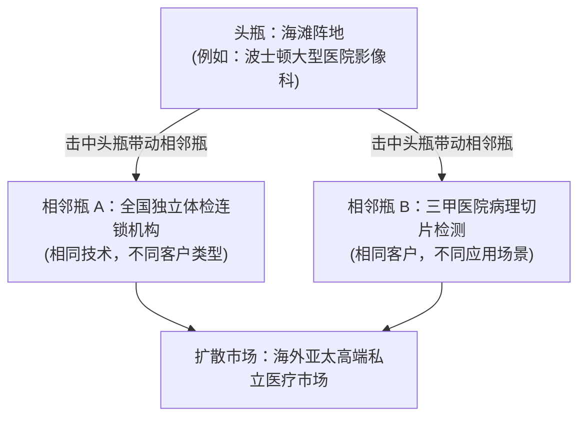

# Lec 21 业务规模化与商业计划路演呈现 (Scaling the Business, Team Section, and Plan Presentation)

> MIT 15.390 · New Enterprises · 模块六：组织法律、规模化与逆境管理

## TL;DR

- 业务规模化（Scaling）的本质是在海滩阵地建立可复制机器后，向相邻市场发起保龄球道式扩张。
- 团队扩张面临从“通才工程师”到“专才职业经理人”的组织阵痛与文化稀释风险。
- 融资路演 PPT 必须严格遵循 10-12 页标准叙事框架，每一页只传达一个核心论点。
- 面对投资人提问，最高级的回答方式是直面核心隐患并阐明风险化解的具体里程碑。

## 规模化扩张战略：保龄球瓶模型（Bowling Pin Strategy）

当企业在海滩阵地市场达成主导地位（市场份额超过 20%-30%）后，如何开启下一步扩张？

::: definition 保龄球道扩张策略 (Bowling Pin Strategy)
击倒第一个球瓶（海滩阵地）产生的动量，必须能够自然碰撞倒相邻的球瓶。扩张路径分为两种：
1. **应用扩展 (Application Bowling)**：向相同的客户群销售全新的相邻衍生产品（基于既有客户信任与销售渠道）；
2. **市场复制 (Market Bowling)**：将业经验证的完全相同产品复制推向具备类似痛点的相邻行业细分群体。
:::

## 投资人路演幻灯片（Pitch Deck）的标准 10 页结构

成熟风险投资人平均审查一份路演 PPT 的时间只有 2 分 40 秒。每一页幻灯片必须在 5 秒内让受众抓住中心思想：

| 页码 | 幻灯片标题 | 核心回答的问题 | 视觉传达要领 |
| :--- | :--- | :--- | :--- |
| **1** | **公司概览 (Title)** | 你们是谁，用一句话定义业务 | 极简 Logo 与核心定位口号（One-liner） |
| **2** | **剧烈痛点 (Problem)** | 客户正在遭受什么无法忍受的痛苦 | 具象化 Persona 的日常血泪，量化损失 |
| **3** | **解决方案 (Solution)** | 你们如何以 10 倍效率解决该痛点 | 高层规格图展示，突出产品核心亮点 |
| **4** | **核心技术与护城河 (Secret Sauce / Core)** | 为何是你们？对手为何极难复制 | 核心架构、网络效应或专有数据飞轮 |
| **5** | **市场空间 (Market Size / TAM)** | 天花板有多高？从哪里切入 | 自下而上海滩阵地 TAM + 保龄球道扩展 |
| **6** | **商业模式 (Business Model)** | 你们如何收钱？单元经济账如何 | 定价阶梯、毛利率预测与 $LTV/COCA$ 比例 |
| **7** | **市场切入 (Go-to-Market)** | 如何用低成本批量拿下早期客户 | DMU 渗透路径、销售管道与关键渠道协议 |
| **8** | **竞争格局 (Competition)** | 相比现状与其他对手，你们胜在哪里 | 二维竞争定位象限图，突出自身独特价值 |
| **9** | **创始团队 (Team)** | 为什么是你们这帮人能干成这件事 | 核心成员互补技能、过往成功操盘履历 |
| **10** | **财务里程碑与融资 (Financials & The Ask)** | 打算融多少钱？能达成什么具体里程碑 | 未来 18 个月关键指标、资金用途饼图 |

## 组织扩张中的“文化稀释”危机

随着团队从 5 人车库扩展到 50 人正规军，公司必然经历著名的“邓巴数（Dunbar's Number）”震荡：
- **第一阶段（1-10 人：突击队）**：靠默契与激情驱动，围坐一张桌子办公，没有正规审批流程；
- **第二阶段（10-30 人：部落期）**：开始设立工程、销售与产品部门，沟通成本呈指数级上升；
- **第三阶段（30-100 人：正规陆军）**：必须引入专业人力资源体系、KPI 绩效考核与中层管理者，早期创业文化开始面临被大厂官僚病侵蚀的巨大风险。

::: insight
路演不是为了展示你们有多聪明，而是为了展示你们对这个垂直行业的理解有多**深**、思考有多**实**。最糟糕的路演是满口充斥人工智能、区块链等时髦热词，却讲不清一个真实客户的采购流程。
:::

::: pitfall
在回答投资人提问时出现“防御性反弹”。当投资人质疑你的竞争壁垒时，立刻表现出愤怒并与对方争辩，这会直接被标记为“不可辅导（Uncoachable）”，瞬间宣判融资死刑。
:::
