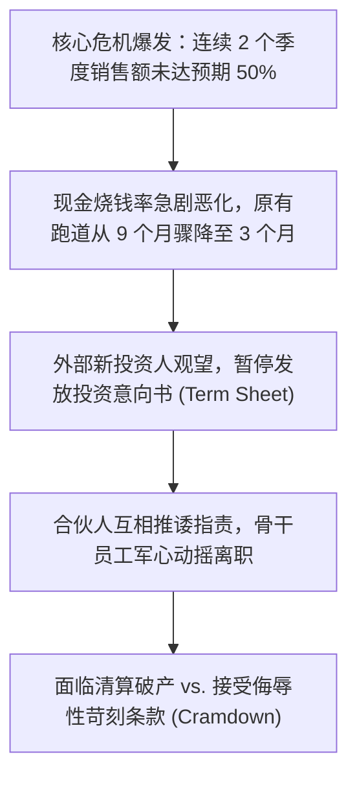

# Lec 22 创业危机化解与融资财务陷阱 (Troubles Ahead: Entrepreneurial Finance and Turnarounds)

> MIT 15.390 · New Enterprises · 模块六：组织法律、规模化与逆境管理

## TL;DR

- 创业的常态不是顺风顺水，而是连续不断的危机公关与近死体验（Near-Death Experiences）。
- 业绩未达预期（Sales Miss Plan）是引发初创企业连锁危机的首发多米诺骨牌。
- 深度拆解降价下调轮（Down Round）、过桥贷款（Bridge Loan）与苛刻清算优先权背后的资本陷阱。
- 危机时刻首席执行官必须果断采取外科手术式裁员，重构精益烧钱率以保住企业生存火种。

## 危机常态化：当现实偏离商业计划书

在商业计划书中，每个团队的营收曲线都画成优美的曲棍球棒；但在真实商业战场中，危机往往在上线后第 6 个月准时降临。



### 销售业绩断崖式落空的三大底层根源
1. **产品与市场契合度（PMF）是伪命题**：前期的客户热情仅仅停留在“口头赞美”，要求掏钱合同时纷纷找借口推迟。
2. **销售周期被严重低估**：原以为 30 天可以成单，实际发现客户内部法务与采购流程需要 6 个月。
3. **关键技术指标交付延期**：核心系统频繁崩溃，售前工程师全部扑在救火补丁上，无力拓展新客户。

## 恶性融资与资本条款深水区

当企业现金即将耗尽而不得不求生时，资本市场将露出极为残酷的一面。Howard Anderson 深入剖析了以下高危融资机制：

::: definition 降价下调轮 (Down Round) 与 棘轮反稀释条款 (Full Ratchet Anti-Dilution)
- **下调轮 (Down Round)**：新一轮融资估值低于前一轮估值（如上一轮估值 2000 万美元，本轮仅能按 800 万美元融资）。
- **完全棘轮条款 (Full Ratchet)**：若前轮投资人拥有完全棘轮保护，其早期入股价格将无条件直接调低至当前最低价，导致创始人与普通员工的股权被瞬间稀释至几乎归零（被资本“洗出局”）。
:::

```text
[资本清算优先级深水区 (Liquidation Preference)]
1. 1x 不参与分配优先股 (1x Non-Participating):
   - 行业标准友好条款：清算时投资人先拿回 1 倍本金，或者与普通股一同按持股比例分配，二选一。
2. 3x 强参与分配优先股 (3x Participating with Cap):
   - 嗜血掠夺条款：投资人必须先拿走 3 倍投资款本金，然后再按持股比例与创始人瓜分剩余所有资产！
   - 后果：即使公司以 3000 万美元被收购，扣除优先清算款后，辛勤耕耘的创始人分文皆无。
```

## 危机拯救：外科手术式自救与重组法则

当企业仅剩 90 天现金储备且新一轮融资受阻时，CEO 必须立刻启动危机挽救协议：

1. **坚决果断的单次大幅裁员**：
   - 绝不能“温水煮青蛙”每个月裁减几个人，这会彻底摧毁全员安全感与信任；
   - 必须一次性狠下心削减 40%-50% 非核心人力支出，向留任团队讲透真实危机，将跑道直接延长 8 个月以上。
2. **聚焦单一最具现金流价值的核心客户**：
   - 砍掉所有试验性新产品线与长周期研发项目；
   - 调动全员支持能立即带来现金回款的前三家大客户。
3. **老股东内部过桥贷款（Insider Bridge Loan）谈判**：
   - 寻求现有老股东救急过桥资金支持；
   - 准备接受老股东提出的严厉权证（Warrant）与可转债折价补偿。

::: insight
危机不仅考验智商，更考验创始人的心理承受力。优秀的创业者不是从不遇到灾难，而是在灾难面前拥有极强的“心理复原力（Emotional Resilience）”。当所有人陷入恐慌时，CEO 必须保持绝对冷静，拿起手术刀切除坏死组织，带领公司活到下一个黎明。
:::

::: pitfall
在现金即将见底时向团队隐瞒真相，试图用谎言安抚人心。当工资条突然发不出时，信任崩塌将引发灾难性的大崩盘；及早公开透明地沟通困难，往往能激发团队真正的破釜沉舟斗志。
:::
