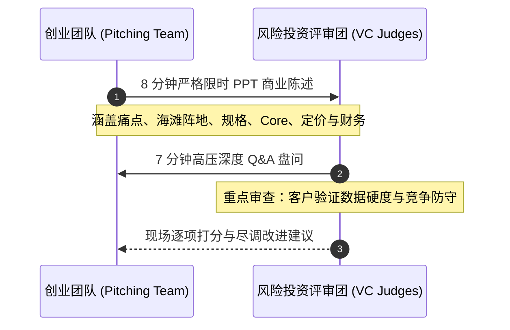

# Lec 23 创业项目终期实战路演（上） (Student Team Final Presentations I)

> MIT 15.390 · New Enterprises · 模块六：组织法律、规模化与逆境管理

## TL;DR

- 终期实战路演是为期一学期严谨创业法学习成果的真刀真枪实战检阅。
- 顶级风险投资人与成功连续创业者组成评审委员会，按照真实尽调标准进行高压拷问。
- 评分标准严格挂钩痛点真实性、海滩阵地聚焦度、量化价值主张以及 $LTV/COCA$ 经济学逻辑。
- 实战答辩展示了高科技团队如何在 10 分钟内完成从技术参数到商业价值的降维传达。

## 终期实战路演的严谨评审机制

在 15.390 课程的第 23 讲，经过层层筛选的各学生创业团队登上斯隆管理学院大讲堂，向波士顿与纽约的顶级投资人展开面对面路演。

::: definition 终期路演五维评审准则 (Final Pitch Rubric)
1. **痛点与客户验证硬度 (Customer Validation, 25%)**：团队是否亲自访谈了 20+ 真实买家？是否提供了有温度的真实用户画像与一手痛点反馈？
2. **海滩阵地聚焦度 (Beachhead Focus, 20%)**：市场切入点是否足够狭窄且具备明确统治潜力？TAM 测算是否自下而上严谨推导？
3. **核心壁垒与防御性 (Core & Defensibility, 20%)**：企业的 Core 是否清晰可辨？是否有能力抵御行业在位者的迅速抄袭？
4. **单元经济模型自洽性 (Unit Economics, 20%)**：$LTV/COCA$ 比例是否合理？获客流程是否考虑了真实的组织阻力与审批周期？
5. **团队协作与演讲风貌 (Team Execution, 15%)**：团队分工是否清晰？回答问题是否直面要害、数据详实而不推诿狡辩？
:::

## 首批典型项目路演实况与评审交锋

在第一场路演中，三个典型高科技创业切片展示了深刻的商业启发：

### 项目 A：光纤智能周界安防系统
- **技术卖点**：采用分布式光纤声波传感（DAS）技术，实现长达 50 公里的周界微震动实时入侵定位。
- **评委犀利质询**：
  > “你们声称海滩阵地是边境巡防与监狱。请问你们团队里有谁拥有最高安全保密资质？你们知不知道政府国防采购需要耗费 3 年的安全审计？在首笔合同落地前，你们靠什么活过这 3 年？”
- **复盘反思**：团队的技术极其惊艳，但对政府采购的漫长周期缺乏准备，被评委一针见血指出了现金流致命陷阱。

### 项目 B：工业级 3D 打印航空专用耐高温陶瓷喷嘴
- **技术卖点**：独特纳米复合浆料配方，可在 1600℃ 超高温下稳定服役。
- **评委肯定与建议**：
  > “你们锁定的通用电气航空发动机某型号外协件痛点非常明确，且已拿到该工厂副总监的试用测试报告。建议立即与该供应商锁定独家联合研发协议，以合同抵押撬动天使轮融资。”

::: insight
投资人在答辩中打断你的发言并提出尖锐质询，不是为了刁难你，而是测试创始人的心理韧性与临场反应。如果创始人面对质疑立刻神情慌乱或强词夺理，投资人会立刻判断其在面对真实复杂客户时缺乏解决危机的成熟定力。
:::

::: pitfall
在路演中把宝贵的 8 分钟耗费在讲解复杂的技术原理与算法公式上，直到时间结束还没讲到商业模式与客户定价。投资人是投资企业商业回报，绝不是在参加学术论文答辩。
:::
