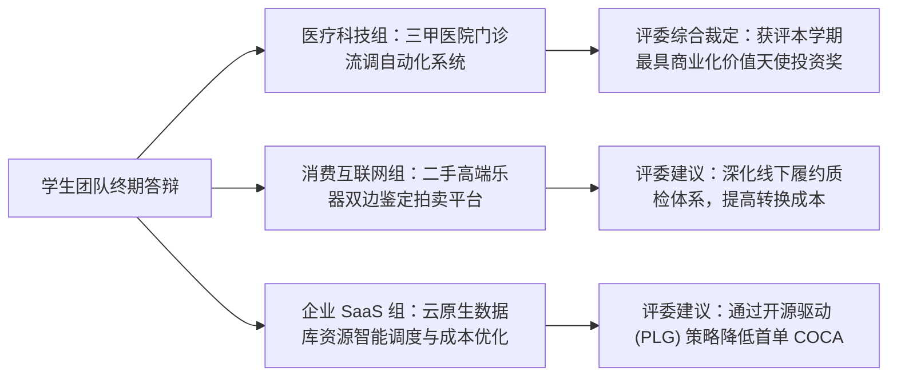

# Lec 24 创业项目终期实战路演（下）与课程复盘 (Student Team Final Presentations II and Retrospective)

> MIT 15.390 · New Enterprises · 模块六：组织法律、规模化与逆境管理

## TL;DR

- 终期路演第二场圆满收官，展示了医疗、消费与企业级软件多赛道的实战推演成果。
- 严谨创业法（Disciplined Entrepreneurship）24 步构筑了完整的闭环思维逻辑，从“谁是客户”直至“规模化扩张”。
- 创业教育的终极目的不仅是孵化独角兽，更是塑造面对不确定性世界时的科学探索与终身行动主义心态。
- 创业者必须带着理性的纪律、炽热的激情与坚定的道德底线，踏上改变世界的真实征程。

## 第二场路演高潮与评委终评

在第二场终期路演中，更多跨学科团队展示了商业模式设计的巧妙平衡：

评委代表在总结发言中强调了三个核心共识：
1. **扎实的调研胜过花哨的 PPT**：真正打动投资人的团队，无一例外展示了其深入工厂、医院或农田现场拍摄的真实一手视频与客户手写评价。
2. **严密的逻辑胜过宏大的幻想**：将一个 3000 万美元的海滩阵地算得水落石出的团队，远比张口闭口“万亿赛道”的项目更具可信度。
3. **团队的凝聚力是无价之宝**：合伙人之间在台上展现出的默契配合与相互补位，是抵御未来无数次暴风雨的唯一压舱石。

## 严谨创业法 24 步体系全景闭环复盘

Bill Aulet 在课程结语中带领全班同学回顾了这一学期穿越的完整 24 步导航地图：

严谨创业法（Disciplined Entrepreneurship）绝不是教条主义的清单勾选，而是一套高度非线性但逻辑严密的动态迭代操作系统。在整个学期的推演过程中，团队会无数次发现后一步的测算推翻了前一步的假设，例如在计算获客成本（COCA）时发现成本过高，从而不得不倒逼团队重新返回海滩阵地市场进行二次细分，或者彻底重构商业模式。

全套 24 步思维框架由六大核心逻辑主题构成。首先通过市场细分与最终用户画像确立海滩阵地；接着通过全生命周期用例与量化价值主张定义产品高层规格；随后深入分析客户内部的决策购买单元并建立可持续的商业模式；进而识别未经验证的核心假设并打造最小可行商业产品；最终通过保龄球道扩张战略实现跨越鸿沟的规模化增长。

下表梳理了全套 24 步框架在六大主题下的系统全景图：

| 阶段主题 | 步骤序号与名称 | 核心战略目标与交付物 |
| :--- | :--- | :--- |
| **主题一：谁是你的客户？** | **Step 1** 市场细分 (Market Segmentation) **Step 2** 选择海滩阵地 (Select a Beachhead Market) **Step 3** 构建最终用户画像 (Build End User Profile) **Step 4** 测算海滩阵地 TAM (Calculate TAM) **Step 5** 塑造典型用户 Persona (Profile Persona) | 穷尽细分市场选项，选定单一突破口，深入一手调研，描绘具象化 Persona 与自下而上 TAM。 |
| **主题二：你能为客户做什么？** | **Step 6** 全生命周期用例 (Full Life Cycle Use Case) **Step 7** 产品高层规格 (High-Level Product Spec) **Step 8** 量化价值主张 (Quantified Value Proposition) **Step 9** 锁定后续十位客户 (Next 10 Customers) **Step 10** 界定核心能力 (Define Your Core) **Step 11** 确定竞争定位 (Chart Competitive Position) | 梳理用户端到端流程，绘制非技术高层规格，算清量化投资回报率，构筑唯一不可复制的核心壁垒。 |
| **主题三：客户如何获取产品？** | **Step 12** 界定决策购买单元 (Determine DMU) **Step 13** 绘制获客全流程图 (Acquisition Process) **Step 18** 测算获客成本 (Calculate COCA) | 绘制客户内部倡导者与把关人网络，排查合规与审批障碍，建立可持续递减的获客成本通道。 |
| **主题四：你如何从产品盈利？** | **Step 15** 设计商业模式 (Design Business Model) **Step 16** 确立定价框架 (Set Pricing Framework) **Step 17** 计算客户终身价值 (Calculate LTV) | 选择价值捕获机制，基于增量经济价值定价，确保 $LTV / COCA \ge 3.0$ 且 12 个月内回本。 |
| **主题五：如何设计构建产品？** | **Step 14** 测算后续市场 TAM (Follow-on TAM) **Step 19** 梳理核心底层假设 (Key Assumptions) **Step 20** 极限测试核心假设 (Test Assumptions) **Step 21** 定义最小可行商业产品 (Define MVBP) **Step 22** 验证客户买单意愿 (Prove Dogs Eat Food) | 识别高危未知风险，以最低成本进行原型测试，验证客户真实付款意愿与数据反馈闭环。 |
| **主题六：如何规模化业务？** | **Step 23** 制定产品研发路线图 (Product Plan) **Step 24** 绘制规模化扩张战略 (Scale Strategy) | 制定向相邻市场推进的保龄球道（Bowling Pin）路线图，实现跨越鸿沟的可持续规模化增长。 |

这一框架的精髓在于用最低的试错成本逼近客观商业真相。创业者在这个框架中经历的每一次假设证伪与方案重构，都是在真实走向市场前用纸笔和访谈完成的沙盘止损。正是这种将发散的创造力与严谨的工程纪律相结合的方法论，使得 MIT 的毕业生能够在过去数十年间缔造出数千家引领全球技术浪潮的伟大企业。

## 创业的终极真谛：成为掌控命运的行动者

在全课程的最后一刻，Bill Aulet 与 Howard Anderson 向全体未来的创始人送上了斯隆管理学院的寄语：

::: definition 创业精神的现代定义 (The Modern Entrepreneurial Spirit)
创业不仅是一种职业选择，更是一种在资源极度匮乏、未来充满不确定性的环境下，依然能够敏锐捕捉机遇、整合资源并以坚韧不拔的纪律创造全新价值的**思维方式与生命状态**。
:::

走出 15.390 的课堂，每一位同学手中不仅握有一份经过千锤百炼的商业计划书，更掌握了一整套能够伴随一生的理性决策科学。在未来的岁月里，无论大家是创立一家估值数十亿美元的高科技企业，还是在大型机构内部推动破局变革，严谨创业法都将是照亮前路的最可靠灯塔。

::: insight
世界是由那些不满足于现状并敢于亲手改变它的人塑造的。发明是一项孤独的探索，但创新是一场伟大的社会协作。带上科学的纪律、热切的同理心与绝不妥协的道德良知，去建造属于你的新企业吧！
:::
