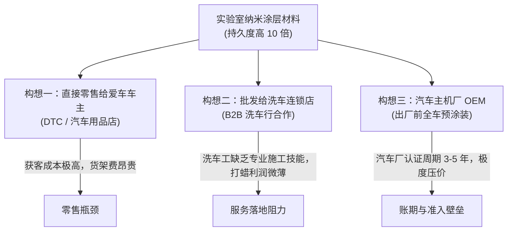

# Lec 3 创意初筛与可行性检验 (Idea Filtering and Sanity Check)

> MIT 15.390 · New Enterprises · 模块一：创业启航与创意初筛

## TL;DR

- 创意初筛的核心是通过客观准则迅速淘汰伪需求与缺乏商业可行性的构想。
- Stealth Wax 隐形车蜡案例揭示了消费级硬件/化学品创业中获客渠道与毛利结构的严峻现实。
- 可行性检验必须穿透产品定义、买方决策链路、潜在买家基数与进入市场（GTM）成本。
- 绝不因对技术的盲目热爱而忽视单位经济模型（Unit Economics）的根本缺陷。

## 经典案例剖析：隐形车蜡（Stealth Wax）的商业化之困

为了让学生直观体会“看似酷炫的技术构想如何撞上商业冰山”，Howard Anderson 在课堂上引入了经典的 **Stealth Wax（隐形车蜡）** 案例。

### 1. 技术构想背景
某材料系博士开发出一种新型纳米聚合物涂层，涂抹于汽车车身后具有极强的抗划痕、疏水与防尘特性，其持久度是传统棕榈蜡的 10 倍以上。

### 2. 商业现实的严酷考验
- **渠道成本瓶颈**：若走线下汽车用品超市（如 AutoZone），需要支付高昂的进场费（Slotting Fee）、账期垫资以及退货保底，初创企业根本无法承担。
- **洗车行 B2B 落地现实**：全美有数万家自动洗车行与人工精洗店。普通洗车行靠走量盈利，每辆车施工时间限制在数分钟内，根本无法进行长达 40 分钟的高精度纳米蜡抛光施工；而高端手工精洗店数量极少且极其分散，获客销售成本（COCA）极高。
- **消费者购买频次**：一瓶车蜡可以使用 1-2 年，复购周期极长，单客终身价值（LTV）极低，无法支撑数字广告与线下推广成本。

::: definition 商业可行性过滤网 (Sanity Check Filter)
评估构想时必须强制回答的四大底线问题：
1. **真实买方是谁**：掏钱的是车主本人、洗车店老板还是保险公司？
2. **买方基数与聚集地**：全国究竟有多少目标客户？通过何种渠道能在 10 分钟内触达他们？
3. **切换摩擦成本**：采用新方案是否要求客户改变现有操作习惯或添置昂贵设备？
4. **单位经济可持续性**：毛利润是否足以覆盖销售、仓储与物流开销？
:::

## 创意初筛的定量评估矩阵

在 MIT 15.390 中，每个初创项目必须使用统一打分矩阵，对备选构想进行横向排序：

| 评估指标 | 权重 | 评分标准 (1 - 5 分) |
| :--- | :--- | :--- |
| **痛点迫切度 (Pain Severity)** | 25% | 1 分: 锦上添花 (Nice-to-have)；5 分: 致命剧痛 (Must-have, 如监管合规) |
| **目标客户集中度 (Customer Accessibility)** | 20% | 1 分: 高度分散、无共同集聚社区；5 分: 拥有明确协会、名录或社群 |
| **付费意愿与能力 (Ability to Pay)** | 20% | 1 分: 预算极度紧张或习惯免费；5 分: 拥有充足自主预算与 ROI 紧迫感 |
| **团队基因匹配度 (Founder-Idea Fit)** | 20% | 1 分: 跨行业小白且无行业人脉；5 分: 具备 5 年以上专业技术积累或客户资源 |
| **MVP 试错成本 (Prototyping Cost)** | 15% | 1 分: 需耗费数百万美元及数年审批；5 分: 几周内即可上线无代码或软硬件雏形 |

::: insight
初筛的核心不是为了证明某个想法有多棒，而是为了用最小的代价**杀死那些注定失败的平庸构想**。越早杀死错误的方向，留给真正商业机会的跑道和资金就越充裕。
:::

::: pitfall
小心“隐形假设”陷阱。团队往往预设“客户只要看到演示就会立刻刷卡”，却忽略了客户组织内部漫长的采购审批、安全审查与系统集成成本。
:::
