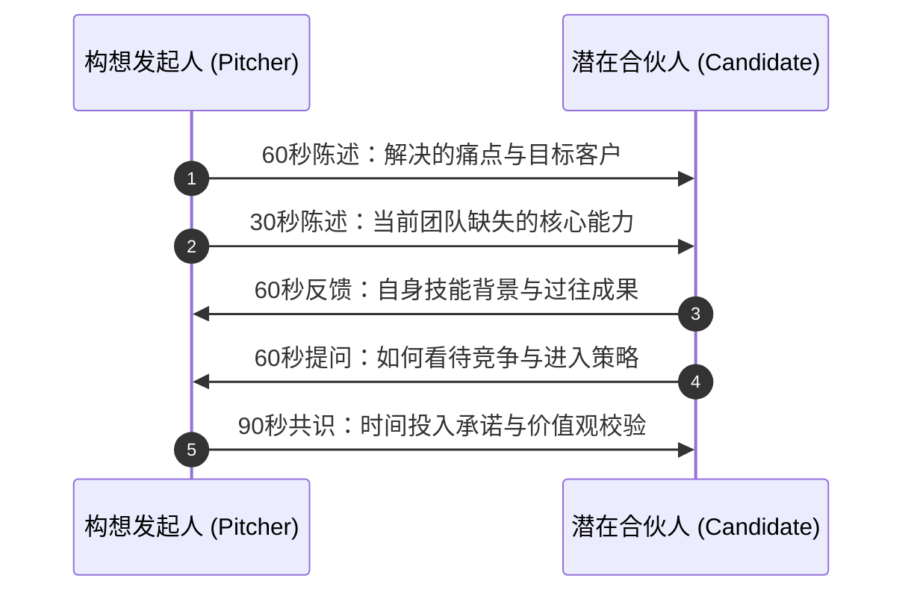

# Lec 4 创业组队与互补匹配 (Speed Dating for Team Formation)

> MIT 15.390 · New Enterprises · 模块一：创业启航与创意初筛

## TL;DR

- 创业失败的第一大主观原因不是市场或资金，而是合伙人团队的破裂与内耗。
- 初创团队必须具备黑客（Hacker）、嬉皮士（Hipster）与商贩（Hustler）三大黄金三角角色。
- 极速配对机制（Speed Dating）通过短周期、高频次的多轮结构化沟通检验技能互补与价值观匹配。
- 早期合伙人必须明确股权动态兑现机制（Vesting）与决策分工，防范日后控制权危机。

## 为什么初创团队往往毁于人？

根据风险投资行业的历史统计，超过 65% 的高科技初创企业失败最终归因于创始人团队内部的冲突。团队初建阶段常陷入两大极端误区：
1. **“熟人俱乐部”**：大学室友或多年好友因为感情深厚而匆忙联合创业，彼此技能高度重叠（例如全是电气工程师），且因为碍于情面而避谈股权分配、退出机制与谁担任 CEO。
2. **“雇佣兵拼盘”**：临时为了参赛或融资拼凑团队，价值观与工作节奏严重不合，一旦遇到第一轮产品延期或融资受阻便作鸟兽散。

```text
           [Hacker (硬核技术研发)]
                 /         \
                /           \
               /   创始团队   \
              /    黄金三角    \
             /                 \
[Hipster (用户体验/设计)] ===== [Hustler (商业变现/销售)]
```

::: definition 创业团队铁三角 (The 3H Model)
- **黑客 (Hacker)**：负责构建技术底座，确保架构可靠、系统可扩展并能攻克核心技术难题。
- **嬉皮士 (Hipster)**：负责用户体验、产品美学、界面交互与品牌格调，让冰冷的代码具备人性化温度。
- **商贩 (Hustler)**：负责拉客户、做销售、谈合作、搞定投资人与催收账款，把产品转化为现金流。
:::

## 极速组队机制（Speed Dating）的实战流程

在 15.390 课堂中，所有带着构想的学生必须经历标准化快速轮转匹配（Speed Dating），通过 5 分钟的限时交谈评估合作潜力：



### 评估候选合伙人的四大核心问题
1. **能力是否互补（Complementary Skillset）**：他是否能胜任我完全不懂且极度恐惧的领域（如我不懂写代码，他是否能独立扛起全栈开发架构）？
2. **全职承诺与时间节奏（Commitment Level）**：他是仅仅把这个项目当成拿学分的兼职作业，还是准备毕业后全职全身心投入？
3. **抗挫力与情绪稳定性（Grit & Resilience）**：在面对客户断然拒绝或投资人无情嘲讽时，他是反思进化还是陷入怨天尤人？
4. **价值观底线（Integrity & Values）**：在利益冲突面前，他是否能够坦诚透明、遵守商业伦理？

::: insight
选合伙人比选配偶更残酷。在婚姻中你们共享生活；但在创业中，你们每天要在极高压力、资源极度匮乏、前途未卜的环境下共同做出上百个关键商业决策。
:::

::: pitfall
切忌按照“均分股权（50/50 或 33/33/33）”的懒惰方式解决早期利益分配。均分往往意味着没有人真正对公司成败承担终极责任，且会在后续关键投票中导致公司治理死锁。
:::
