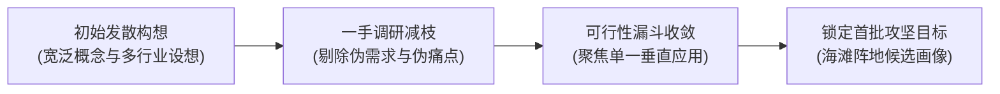

# Lec 5 构想精炼与团队磨合 (Idea Refinement and Team Formation Refinement)

> MIT 15.390 · New Enterprises · 模块一：创业启航与创意初筛

## TL;DR

- 创业初期的核心任务是将宽泛的发散创意收敛为具备执行可行性的聚焦方向。
- 团队组建后的首要考验是建立明确的权责分工、决策权威与信任契约。
- 采用反思机制审视构想背后的隐形技术风险与市场假设，尽早排除致命硬伤。
- 团队磨合期必须明确创始人之间的沟通协议与冲突消解原则。

## 从发散到收敛：商业构想的二次精炼

在完成初步组队后，初创团队往往面临两类极端挑战：要么陷入无休止的头脑风暴，导致构想范围不断无限膨胀（Feature Creep）；要么合伙人之间各执己见，陷入方向争执。



精炼构想的四大检验漏斗：
1. **痛点归属唯一性**：该问题究竟属于哪一类具体职务的人（例如：波士顿大型医院的放射科主任，而非笼统的“医生”）？
2. **现状替代代价**：若不采用本方案，客户目前使用什么凑合应对？客户是否真正愿意支付金钱或时间成本完成替换？
3. **技术可落地时间线**：产品能否在 6 个月内开发出具备实际商业价值的最小原型（而非需要 3 年纯科研攻关）？
4. **资源约束匹配**：当前团队的初始资本与技能储备，是否足以完成第一阶段的原型交付？

## 团队磨合与角色清晰化

合伙人组建初期存在一段“蜜月期”，但随着具体任务推进，权责模糊的隐患会迅速显现。

::: definition 团队权责 RACI 矩阵 (RACI Framework for Startups)
在初创团队中明确关键事务的治理边界：
- **Responsible (执行者)**：实际操盘完成任务的合伙人。
- **Accountable (最终负责人)**：对该事项成果拥有唯一终极决策权与担责权的人（通常仅限一人）。
- **Consulted (咨询者)**：决策前必须征询专业意见的技术或商业专家。
- **Informed (知情者)**：决策做出后需及时同步进展的团队成员。
:::

```text
[事务类别]          | [CEO (商业)] | [CTO (技术)] | [CPO (产品)]
-------------------|--------------|--------------|--------------
产品核心功能裁剪   | Consulted    | Consulted    | Accountable
云端架构与技术选型 | Informed     | Accountable  | Consulted
商务谈判与定价确认 | Accountable  | Informed     | Consulted
融资条款清单谈判   | Accountable  | Informed     | Informed
```

::: insight
初创企业最大的组织毒瘤是“共识决策陷阱”——以为每一件小事都需要所有合伙人举手表决通过。初创公司面对的是极端的不确定性，速度是唯一的护城河；分工之后必须充分信任各自领域的负责人，赋予其独立决断权。
:::

::: pitfall
在磨合期避谈敏感话题是极其危险的。例如：“如果 6 个月后融不到钱，大家能接受降薪或者零薪水坚持多久？”“如果有大厂开出百万年薪挖角，你是否会离队？”这些问题必须在创业初期摆在台面上坦诚沟通。
:::
