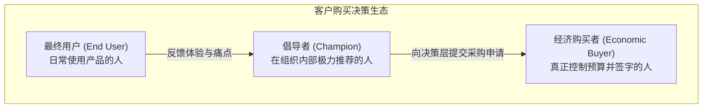

# Lec 6 目标客户定义与最终用户画像 (Target Customer Definition and End User Profile)

> MIT 15.390 · New Enterprises · 模块二：目标客户与市场切入

## TL;DR

- 创业成功最根本的基石在于清晰界定最终用户（End User）与购买决策者（Economic Buyer）。
- 最终用户画像（Persona）必须极其生动具象，涵盖人口统计学特征、日常工作流、核心动机与最大恐惧。
- 经典的 Elite 运动监测器案例与 HR Vision 案例警示：脱离真实用户工作流的所谓“刚需”往往是臆想。
- 严谨创业法第 3 步与第 5 步要求团队在海滩阵地中建立唯一的基准用户画像。

## 谁是你的真正客户？最终用户 vs. 经济决策者

许多初创企业耗费数年研发产品，最后却发现找不到买单者，根源在于混淆了**最终用户（End User）**与**经济决策者（Economic Buyer）**。



::: definition 最终用户 (End User) 与 经济购买者 (Economic Buyer)
- **最终用户 (End User)**：日常实际操作并使用产品的人。产品的可用性与功能体验直接决定其工作效率。
- **经济购买者 (Economic Buyer)**：拥有预算支配权、从组织投资回报率（ROI）或财务合规角度决定是否采购的人。两者往往不是同一个人（如学校里的学生是最终用户，教务处主管是购买者；医院里的护士是最终用户，设备采购委员会是购买者）。
:::

## 经典失败案例剖析

Bill Aulet 在本讲深入剖析了两个麻省理工团队的真实创业血泪教训：

### 1. Elite 运动监测仪案例
- **产品构想**：一款高科技穿戴设备，能实时监测运动员的“相对体能消耗（Relative Energy）”，帮助教练优化训练计划。
- **致命盲区**：团队以为高中体育教练会成为忠实买家。然而实地访谈发现：高中教练根本没有购买专业监测设备的独立预算；教练日常忙于排兵布阵，根本没有时间和精力下载数据、分析波形图；学生运动员更在乎器材是否外观酷炫，而不是冰冷的体能数据。

### 2. HR Vision 人力资源分析系统
- **产品构想**：基于算法对企业员工的日常沟通与绩效进行多维可视化建模，预测骨干离职风险。
- **致命盲区**：系统威胁到了中层管理者的权力与利益。部门主管担心算法评估会暴露自身管理缺陷，因而在采购审批中投出否决票。

::: insight
产品不仅要能创造功能价值，更要符合使用者的**政治与心理利益**。如果一款软件在提升组织效率的同时，增加了最终用户的工作负担或威胁到了把关者的既得利益，它必将在落地执行阶段被无声绞杀。
:::

## 构建具象化的最终用户画像（Persona）

在海滩阵地市场中，团队必须塑造一个唯一的、具体的、具象化的**基准用户画像（Persona）**，他是该细分市场最典型代表的化身：

```text
[Persona 核心档案表]
姓名：Dr. Sarah Jenkins
年龄：42岁
职位：波士顿某三甲教学医院放射科主任
下属团队：14 名主治医师与住院医
工作痛点：每日需复核超过 120 份复杂的 CT/MRI 影像，视觉疲劳严重，误诊责任重大
最大恐惧：因漏诊微小早期肿瘤而面临医疗诉讼及执业声誉受损
核心诉求：能自动预筛选可疑病灶、标记风险等级并生成初稿报告的辅助诊断系统
购买预算：科室拥有每年 10 万美元的自主技术升级与继续教育专项额度
```

构建 Persona 的三大黄金准则：
1. **真实存在**：必须基于至少 15-30 次面对面一手深度访谈提炼而成，严禁坐在办公室空想。
2. **唯一聚焦**：在当前海滩阵地中，只能有一个主要 Persona，绝不能试图讨好所有人。
3. **全员挂钩**：所有产品功能排期、界面交互设计与销售话术，必须始终对齐 Sarah 的日常诉求。

::: pitfall
绝对不要把用户画像写成抽象宽泛的行业白皮书数据（如“全美 25-45 岁有车男性”）。这种缺乏灵魂的人口统计标签无法为工程师提供任何明确的产品设计边界。
:::
