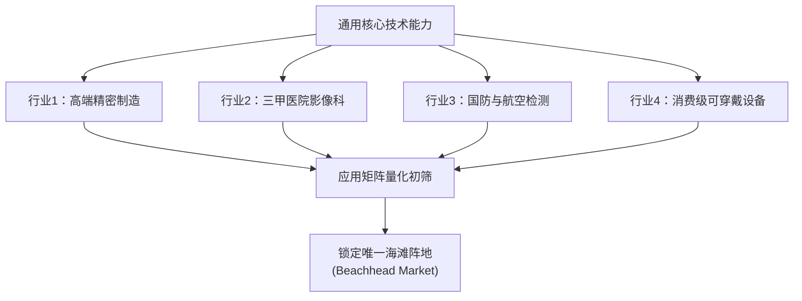

# Lec 7 市场细分与一手客户调研 (Market Segmentation and Primary Customer Research)

> MIT 15.390 · New Enterprises · 模块二：目标客户与市场切入

## TL;DR

- 市场细分是严谨创业法的第 1 步，必须穷尽潜在行业并筛选出单一海滩阵地（Beachhead Market）。
- 一手客户调研（Primary Customer Research, PCR）要求创始人走出办公室，严禁用问卷或二手报告替代深度访谈。
- 海滩阵地 TAM 规模应在 2000 万至 1 亿美元之间，既能支撑初创公司自给自足，又不至于过大引来巨头围剿。
- 兰博基尼案例与科技转化案例表明，聚焦战略是弱小团队战胜资源劣势的唯一法则。

## 严谨创业法第 1 步：全方位市场细分

初创企业最大的生存陷阱是“什么市场都想做”。面对一项核心技术，创始人必须首先展开系统化的头脑风暴，列出 6-12 个截然不同的应用行业与细分场景。

### 细分市场矩阵评估七大维度
1. 目标客户是否拥有充足的资金与支付预算？
2. 目标客户是否易于触达？是否存在现成的销售渠道？
3. 目标客户是否拥有紧迫且不可拖延的采购理由？
4. 团队能否在合作伙伴协助下交付整体产品（Whole Product）？
5. 是否存在根深蒂固且难以逾越的在位竞争对手？
6. 攻克该市场后，能否顺理成章地辐射相邻市场（Bowling Pin Strategy）？
7. 该市场是否与创始团队的核心热情与长期愿景一致？

## 一手客户调研（Primary Customer Research, PCR）的铁律

二手行业报告（如 Gartner, IDC）充满由宏观预测编织的乐观数字，对初创企业几乎毫无指导价值。创始人必须直接与终端用户对话。

::: definition 一手客户调研 (PCR) 核心准则
1. **绝不推销，只倾听痛点**：访谈目的是为了理解用户的真实工作流与痛苦，而不是试图向对方演示自己的 Demo。
2. **探寻过去与现在的真实行为，不轻信对未来的许诺**：“你上周遇到这个问题时是怎么解决的？花了多少钱？”远比“如果我做出来这个功能你买不买？”真实一万倍。
3. **识别潜意识工作习惯 (Workarounds)**：观察用户在白板、Excel 或纸质记事本上的非正规记录流程，那些打补丁的环节往往正是最具价值的软件切入点。
:::

::: example 兰博基尼的诞生与细分市场定位
费鲁吉欧·兰博基尼（Ferruccio Lamborghini）原本是极其成功的拖拉机制造商人。当他的法拉利跑车离合器频繁损坏且遭到恩佐·法拉利的傲慢蔑视后，他并未试图与法拉利在全系列赛车上全面开战，而是敏锐锁定了“富有、追求极致奢华与舒适驾乘体验、但厌恶赛道级粗暴离合器与机械噪音”的绅士跑车细分市场，成功撕开了超级跑车领域的口子。
:::

## 测算海滩阵地总潜在市场（TAM）

在选定海滩阵地后，必须严格按照“自下而上（Bottom-Up）”的方式测算 TAM，严禁用自上而下的宏观比例（如“全球医疗市场 3 万亿美元，我们只要拿 1% 就是 300 亿”）。

$$TAM_{Beachhead} = N_{Potential\_Customers} 	imes Revenue\_Per\_Customer\_Per\_Year$$

- **客户数量统计 ($N$)**：通过行业黄页、监管许可名录、专业学会名单精确数出目标客户的个体数。
- **单客年度收益 ($Revenue$)**：基于客户从解决方案中获得的经济效益或成本节约测算定价。

::: insight
理想的海滩阵地 TAM 规模应在 **2000 万至 1 亿美元** 之间。低于 2000 万美元，市场空间过窄，难以产生足够现金流吸引风投并支撑后续研发；高于 1 亿美元，则往往意味着战线过宽，且极易立刻引起微软、谷歌或通用电气等行业霸主的强烈警惕与围追堵截。
:::

::: pitfall
切忌使用“双重海滩阵地”。初创团队若宣布“我们同时进攻牙科诊所和修车厂”，往往意味着团队在战略决策上缺乏定力，资源分散必将导致两个战场同时溃败。
:::
