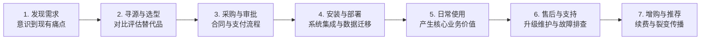

# Lec 8 全生命周期用例与产品高层规格 (Full Life Cycle Use Case and High-Level Product Specification)

> MIT 15.390 · New Enterprises · 模块三：价值主张与产品规格

## TL;DR

- 全生命周期用例（Steps 6）必须覆盖客户从认知、购买、安装、日常使用到续费/报废的完整链路。
- 产品高层规格（Step 7）是一套直观的可视化框架图，清晰勾勒产品边界，绝不陷入代码细节。
- 量化价值主张（Step 8）必须将客户的核心诉求折算为具体的经济收益（节省时间、降低成本或提升收入）。
- 验证海滩阵地必须锁定具体的“后续十位客户”（Step 9），确保早期产品具备高度的可复制性。

## 严谨创业法第 6 步：全生命周期用例（Full Life Cycle Use Case）

大多数工程师只关注客户在按下“开始”按钮后的那一瞬间（即核心使用阶段），却忽视了客户在接触产品前后的漫长摩擦。



必须在用例图中详尽梳理的八大阶段：
1. **客户如何发现自己存在该需求**：谁触发了这种认知？
2. **客户如何获知你的产品存在**：通过行业展会、同行推荐还是搜索引擎？
3. **客户如何进行购买与付款审批**：涉及哪些法务、合规与技术安全审查？
4. **产品如何安装部署并嵌入客户现有环境**：是否需要改造电网、重新配置网络或培训操作工？
5. **客户如何从产品中获得直接商业价值**：初次见效时间（Time to Value, TTV）是几分钟还是几个月？
6. **产品出现故障时如何获得支持**：是否有 SLA 保障？
7. **客户如何进行软件升级或耗材续订**：流程是否顺畅？
8. **客户是否会向同行极力推荐并背书**：净推荐值（NPS）表现如何？

## 严谨创业法第 7 步：产品高层规格（High-Level Product Spec）

在写下第一行代码或开模之前，团队必须绘制一套视觉传达规格图（通常为 1-3 张架构示意图或线框图流程）：

::: definition 产品高层规格 (High-Level Product Specification)
一套面向非技术用户的直观图示，说明产品是什么、包含哪些关键模块、如何与周边生态协同，以及产品**坚决不做什么**。它不包含底层电路图或 API 代码细节，而是作为客户、销售与工程师达成认知共识的沟通契约。
:::

产品高层规格绝不仅仅是一张简单的外观草图，它是连接客户商业期望与工程技术落地的契约基石。在设计高层规格图时，团队必须用非专业人士能够一目了然的形式，清晰界定核心传感模块、边缘处理网关以及云端预警中心之间的边界关系。这一图示向客户直观展示了系统是如何以非侵入式方式嵌入其既有生产线并快速产生价值的。

如下所示的高层规格图清晰展现了工业设备预测性维护系统的三个关键层级：

```text
+--------------------------------------------------------------+
|             Edge Analytics 工业设备预测性维护系统            |
+--------------------------------------------------------------+
|  [硬件采集层]                                                |
|  - 即插即用无线震动/温度传感器模组 (磁吸式安装，电池寿命3年) |
+--------------------------------------------------------------+
|  [边缘计算网关]                                              |
|  - 实时滤波与频谱分析算法 (不上传原始TB级庞大数据，保护内网) |
+--------------------------------------------------------------+
|  [云端预警中心 & 维修工作流集成]                            |
|  - 异常振动提前48小时预警 --> 自动向维修工手机推送工单       |
+--------------------------------------------------------------+
```

通过该图，客户的运维主管可以立刻明白产品无需改造现有大型冲压设备电路，只需磁吸安装即可投入使用；而 IT 主管也能清楚看到原始的海量高频振动数据在本地边缘端直接过滤完成，不会消耗厂区宝贵的公网带宽或引发敏感工业数据外泄的疑虑。这种直观沟通直接消除了决策购买单元（DMU）内部各方的疑虑。

## 严谨创业法第 8 & 9 步：量化价值主张与后续十位客户

### 1. 量化价值主张（Quantified Value Proposition）
价值主张不能是模棱两可的形容词（如“更智能、更高效”），必须量化为财务语言：

$$\Delta Value = (Cost_{Status\_Quo} - Cost_{With\_Product}) + (Revenue_{With\_Product} - Revenue_{Status\_Quo})$$

- **基准线状态（As-Is State）**：客户目前的运营指标、耗时与废品率。
- **目标状态（To-Be State）**：引入本系统后的量化指标对比。

::: example 工业设备预测性维护量化价值
- 现状：一条汽车冲压生产线非计划停机 1 小时损失 80,000 美元，每年平均非计划停机 14 次，总损失 1,120,000 美元。
- 引入方案后：提前预警率达 90%，非计划停机降至每年 1.4 次，每年直接为工厂挽回 100 万美元纯经济损失。
- 产品系统年费 60,000 美元，客户投资回报率（ROI）超过 16 倍，采购理由极其坚实。
:::

### 2. 锁定后续十位客户（Next 10 Customers）
为了避免海滩阵地变成仅为单一定制客户打造的孤岛，团队必须找出并深度访谈**另外十位**与 Persona 具有高度相似特征的具体潜在买家：
- 列出真实公司名称、联系人职务与联系方式；
- 逐一确认他们是否认可该量化价值主张，并具备相同的采购痛点。

::: insight
只有当后续十位客户对你的高层规格表现出极其一致的兴奋度和采购逻辑时，才证明你挖掘出了可规模化复制的市场标准品，而不是陷入无休止的定制化外包泥潭。
:::

::: pitfall
在量化价值主张时过度夸大收益（如“帮您提升利润 500%”）。客户对脱离实际常识的宣称具有天然戒心，务必基于真实客户一手测试数据推导保守合理的财务模型。
:::
