# 15.390 创业（New Enterprises）

> MIT Sloan School of Management · 严谨创业法（Disciplined Entrepreneurship）体系 · 主讲团队：Bill Aulet 等 · 课程代号：15.390

## TL;DR

- **破除创业神话的系统科学**：基于 MIT Sloan 知名创业导师 Bill Aulet 创立的 24 步严谨创业法（Disciplined Entrepreneurship），打破“创业不可教”的迷思，将创业确立为可量化、可验证且可迭代的工程学科。
- **全生命周期方法论闭环**：围绕“客户画像与滩头阵地”、“价值主张与产品规格”、“获客决策与商业模式”、“假设检验与最小可行商业产品（MVBP）”四大核心主线，提供从 0 到 1 创建创新驱动型企业（IDE）的完整工具箱。
- **高密度实战与抗压演练**：通过实地一手市场调研（PMR Field Day）、期中/期末模拟董事会（Mock Board Meetings）、Charlie Tillett 财务模型测算与 5 分钟投资人极限路演，全方位塑造创始团队的商业交付力与认知韧性。

---

## 课程介绍

### 先修课程

（无）

### 课程描述

本课程涵盖识别和量化市场机会、构思、规划和启动一家新型科技企业的整个过程。主题包括机会评估、价值主张、企业家精神、法律问题、创业伦理、商业计划书、创始团队、寻找客户和筹集资金。学生将为一家初创公司制定详细的商业计划。

本课程面向希望创业、进一步发展现有业务、成为新企业管理团队成员或更好地了解企业家精神和创业过程的学生。MIT 的计算机、工程与管理学科有着深厚的科研与产业化传统，本课程正是将前沿科研技术转化为具可持续商业价值实体公司的核心孵化器。

### 培养目标

- **掌握 24 步严谨创业方法论**：理解 Disciplined Entrepreneurship (DE) 全局心智模型与六大核心主题，掌握从模糊技术/创意走向可落地商业实体的系统框架。
- **实战一手市场调研（PMR）能力**：摒弃二手桌面报告的虚假安全感，深入业务一线开展高质量深度访谈，精准刻画滩头阵地最终用户画像（End User Profile）与单一典型人物角色（Persona）。
- **建立单位经济效益量化直觉**：精准测算潜在市场总额（TAM）、获客成本（COCA）与客户终身价值（LTV），严格落实 $LTV > 3 \times COCA$ 且资本回收期小于 12 个月的健康增长法则。
- **敏捷实验与最小可行商业产品（MVBP）**：学会拆解业务中最具毁灭性的前置假设，以最低成本设计科学证伪实验，快速交付满足价值创造、真实付费与反馈闭环的 MVBP。
- **高绩效团队协同与商业叙事**：掌握联合创始人技能互补匹配、股权激励机制、故事板叙事弧线（Storyboarding）及面向专业投资人与董事会的高感染力路演能力。

### 参考书籍与资源

- **核心教材**：Bill Aulet. *Disciplined Entrepreneurship: 24 Steps to a Successful Startup* (Expanded & Updated 10th Anniversary Edition), Wiley.
- **实战练习册**：Bill Aulet. *Disciplined Entrepreneurship Workbook*, Wiley.
- **官方画布与工具**：Disciplined Entrepreneurship Canvas (DE Canvas), MIT Martin Trust Center for MIT Entrepreneurship.
- **财务模型参考**：Charlie Tillett Financial Modeling Spreadsheets & Staffing Plan Inputs.
- **官方课程主页**：[MIT 15.390 New Enterprises (MIT OCW)](https://ocw.mit.edu/courses/15-390-new-enterprises-spring-2013/)

---

## 课程知识体系

严谨创业法（Disciplined Entrepreneurship, DE）的核心理念在于：创业是一项螺旋上升的实证迭代过程，绝非线性的单向流水线。整套方法论将企业创建的复杂探索提炼为六大核心主题与 24 个可操作的离散步骤。在实际推进中，创业团队通常以滩头阵地市场为靶心，通过持续的一手市场调研（PMR）反哺并修订早期假设。

各阶段之间的内在逻辑与知识流向如下所示：

```mermaid
flowchart TD
    subgraph S1["主题一：谁是你的客户？ (Who Is Your Customer?)"]
        direction TB
        A1["步骤 1 & 1A: 市场细分与一手市场调研 (PMR)"] --> A2["步骤 2: 选择滩头阵地市场 (Beachhead Market)"]
        A2 --> A3["步骤 3: 构建最终用户画像 (End User Profile)"]
        A3 --> A4["步骤 4: 测算滩头阵地潜在市场总额 (TAM)"]
        A4 --> A5["步骤 5: 刻画具体人物角色 (Persona)"]
        A5 --> A6["步骤 9: 确定紧随其后的下 10 个客户"]
    end

    subgraph S2["主题二：你能为客户做什么？ (What Can You Do for Your Customer?)"]
        direction TB
        B1["步骤 6: 全生命周期用例 (Full Life Cycle Use Case)"] --> B2["步骤 7: 高层产品规格 (High-Level Product Spec)"]
        B2 --> B3["步骤 8: 量化价值主张 (Quantify Value Proposition)"]
        B3 --> B4["步骤 10: 定义核心竞争力 (Define Your Core)"]
        B4 --> B5["步骤 11: 绘制竞争地位图谱 (Competitive Positioning)"]
    end

    subgraph S3["主题三：客户如何获取产品？ (How Does Customer Acquire Product?)"]
        direction TB
        C1["步骤 12: 确定决策购买单元 (DMU)"] --> C2["步骤 13: 绘制获客决策流程 (DMP) 与机会窗口/触发点"]
        C2 --> C3["步骤 18: 设计可扩展的销售收入引擎"]
    end

    subgraph S4["主题四：如何从产品中盈利？ (How Do You Make Money?)"]
        direction TB
        D1["步骤 15: 设计可持续商业模式 (Business Model)"] --> D2["步骤 16: 制定基于价值的定价框架 (Pricing Framework)"]
        D2 --> D3["步骤 17: 测算客户终身价值 (LTV)"]
        D3 --> D4["步骤 19: 自顶向下严谨测算获客成本 (COCA)"]
    end

    subgraph S5["主题五：如何设计与构建产品？ (Design & Build Product)"]
        direction TB
        E1["步骤 20: 识别未经检验的关键假设"] --> E2["步骤 21: 科学设计低成本实验测试关键假设"]
        E2 --> E3["步骤 22: 定义最小可行商业产品 (MVBP)"]
        E3 --> E4["步骤 23: 实证检验‘狗愿意吃狗粮’ (Dog Food Test)"]
    end

    subgraph S6["主题六：如何规模化业务？ (Scale Your Business)"]
        direction TB
        F1["步骤 14: 测算后续市场潜在总额 (Follow-on TAM)"] --> F2["步骤 24: 制定长期产品与多市场演进规划"]
    end

    S1 --> S2 --> S3 --> S4 --> S5 --> S6
```

六大主题共同构成了初创企业的商业自洽性检验闭环：

1. **主题一：谁是你的客户？（Who Is Your Customer?）**：
   从海量潜在应用场景中通过系统性市场细分（步骤 1）筛选出前 6–8 个候选市场，运用一手市场调研（PMR，步骤 1A）深入一线验证，果断选定单一滩头阵地市场（BHM，步骤 2）。进而构建终身用户画像（步骤 3）、测算滩头阵地潜在市场总额（TAM，步骤 4），并锁定具象化的唯一人物角色（Persona，步骤 5）与后续 10 位种子客户（步骤 9），确保目标客群高度清晰聚焦。

2. **主题二：你能为客户做什么？（What Can You Do for Your Customer?）**：
   描摹客户从接触、购买到日常使用的全生命周期用例（步骤 6），将模糊构想转化为具象的高层产品规格草图与宣传册（步骤 7），进而对比现状量化客户获得的核心价值主张（步骤 8）。在此基础上，提炼团队不可撼动的内在核心竞争力（步骤 10），并依据客户最关切的指标绘制竞争地位图谱（步骤 11），确立差异化壁垒。

3. **主题三：客户如何获取你的产品？（How Does Your Customer Acquire Your Product?）**：
   穿透组织采购决策网络，识别决策购买单元（DMU，步骤 12）中的倡导者、经济决策人、最终用户与否决权人，绘制获客决策流程（DMP，步骤 13），精准捕捉采购机会窗口与关键触发事件，并据此设计从高触碰直销向低触碰自动化演进的可扩展销售收入引擎（步骤 18）。

4. **主题四：你如何从产品中盈利？（How Do You Make Money off Your Product?）**：
   跳出单纯的定价视角，全面设计对齐客户激励机制的商业模式（步骤 15），构建基于价值创造而非成本加成的定价框架（步骤 16）。精准推导客户终身价值（LTV，步骤 17）与自顶向下的真实获客成本（COCA，步骤 19），坚守 $LTV > 3 \times COCA$ 且回收期小于 12 个月的健康单位经济底线。

5. **主题五：如何设计与构建你的产品？（How Do You Design & Build Your Product?）**：
   在投入重金开发前，系统分解阻碍商业成立的未验证关键假设（步骤 20），以最低成本设计科学对照实验实施快速证伪（步骤 21）。在此基础上定义仅保留核心增值属性的最小可行商业产品（MVBP，步骤 22），通过真实的付费与使用数据验证“狗愿意吃狗粮”（步骤 23）。

6. **主题六：如何规模化你的业务？（How Do You Scale Your Business?）**：
   在确立滩头阵地绝对统治地位后，审视后续市场的扩张总额（步骤 14），采用保龄球瓶模型向邻近细分行业或衍生需求纵深推进，并为技术团队与商业团队制定长期的多阶段产品演进规划（步骤 24）。

---

## 结构化编排讲义清单

| 课次 | 日期 | 讲义标题与核心主题 | 课前准备 (Preparation) | 作业与交付物 (Deliverables) |
| :---: | :---: | :--- | :--- | :--- |
| **01** | 周一 2/6 | [01 课程介绍与后勤安排、DE 概述](./lec1.md) 破除创业十大神话、创新公式 $I = I \times C$、SME vs IDE 差异、24 步六大主题总览 | 无 | 无 |
| **02** | 周三 2/8 | [02 Pitch2Match 速配路演与组队、启动黑客挑战赛](./lec2.md) 创业三大发源引擎、创始人能力模型（Susie Suit / Tommy Tech / Bonnie Balance）、Hack Challenge 规则 | 1. 阅读 DE 导言及第 0 步 (p. 1-21) 2. 观看同学视频浏览创意论坛 | 1. 60秒自我介绍视频 2. 创意日志（至少20个点子） 3. 在 Canvas 提交路演创意 |
| **03** | 周一 2/13 | [03 市场细分与选择滩头阵地市场 (步骤 1-2)](./lec3.md) 商业第一戒律、单边/多边市场、细分市场脑暴与 7 大过滤维度、滩头阵地选择标准与主导原则 | 1. 阅读 DE 教材及练习册步骤 1-2 2. 阅读《最被高估的事》文章 | 完成里程碑 #1 (Milestone #1) 表格 |
| **04** | 周三 2/15 | [04 展示黑客挑战赛成果 + 高绩效团队建设](./lec4.md) 黑客挑战赛原型路演、高绩效团队动力学（塔克曼模型）、角色期望对齐、团队冲突与承诺协议 | 与团队一起调研问题并制作解决方案的原型/线框图 | 与团队共同完成解决方案的原型/线框图 |
| **05** | 周二 2/21 | [05 如何开展一手市场调研 (How To Do PMR)](./lec5.md) PMR 黄金法则（探寻事实而非验证偏见）、访谈漏斗提问法、受访者招募策略与承诺签署 | 1. 阅读 DE 练习册 PMR 指南 (p. 23-38) 2. 阅读 DE 博客上的 PMR 技巧 | 1. 头脑风暴市场列表 2. 前 6-8 个细分市场矩阵 3. 签署 15.390 承诺协议 4. 测验：PMR |
| **06** | 周三 2/22 | [06 一手市场调研外勤日 (PMR Field Day)](./lec6.md) 实地访谈执行规范（B2C >30人，B2B >10人）、现场破冰与肢体语言观察、访谈笔记清洗与动机提取 | 1. 开展 PMR 访谈 2. 优化 PMR 访谈脚本 3. 记录目标受访者名单 | 1. PMR 工作表初稿 2. PMR 誓约 (PMR pledge) |
| **07** | 周一 2/27 | [07 终端用户画像、潜在市场总额 (TAM)、人物角色 (Persona) (步骤 3-5)](./lec7.md) 终端用户画像维度、滩头 TAM 自底向上严谨测算、具体人物角色（Persona）锁定与痛点排序 | 阅读 DE 步骤 3-5 | 1. 填写完整的市场细分幻灯片 2. 个人 PMR 反思报告 3. 团队首次 PMR 总结 4. 测验：步骤 3-5 |
| **08** | 周三 3/1 | [08 全生命周期用例、高层产品规格、量化价值主张 (步骤 6-8)](./lec8.md) 全生命周期用例 10 大阶段闭环、高层产品视觉小册子/规格、现状 vs 未来量化收益对比 | 阅读 DE 步骤 6-8 | 1. 步骤 3-5 幻灯片 2. 测验：步骤 6-8 |
| **09** | 周一 3/6 | [09 确定下 10 个客户 (步骤 9) & 定义核心竞争力、竞争定位 (步骤 10-11)](./lec9.md) 后续 10 位具体客户接触验证、核心竞争力护城河分类（网络效应/转换成本/IP）、竞争定位图谱绘制 | 阅读 DE 步骤 9-11 | 1. 步骤 6-8 幻灯片 2. 测验：步骤 9-11 |
| **10** | 周三 3/8 | [10 一手市场调研外勤日 #2 (PMR Field Day #2)](./lec10.md) 第二轮现场验证实战：携带高层规格与量化价值回到客户现场、假设压力测试与真实买单意愿刺探 | 阅读“市场测试策略” (Market Testing Tactics) PDF | 无 |
| **11** | 周一 3/13 | [11 验证人物角色、高层产品规格及价值主张的策略](./lec11.md) 市场测试战术体系、定性访谈与定量测验结合、虚假热情与真实投入识别、红旗指标排查 | 阅读《市场测试策略》 | 步骤 9-11 幻灯片 |
| **12** | 周三 3/15 | [12 期中模拟董事会会议 (步骤 1-11)](./lec12.md) 步骤 1-11 首份整合商业方案路演、模拟董事会质询反思、答辩逻辑自洽性检验与迭代方向确认 | 准备步骤 1-11 首份整合幻灯片，明确模拟董事会上需重点评审的领域 | 修订后的步骤 1-11 整合幻灯片 |
| **—** | 3/20 - 3/29 | **斯隆创新周 (SIP Week) 与春假 (Spring Break)** | — | — |
| **13** | 周一 4/3 | [13 决策单位 (DMU) 与决策流程 (DMP) (步骤 12-13)](./lec13.md) DMU 六类核心角色剖析（Champion / Buyer / User / Veto）、B2B 采购决策路径、机会窗口与触发事件 | 阅读 DE 步骤 12-13 | 测验：步骤 12-13 |
| **14** | 周三 4/5 | [14 滩头阵地市场是否足够聚焦？后续市场拓展 (步骤 14)](./lec14.md) BHM 聚焦度深度自检、保龄球瓶扩张战略（Bowling Pin Model）、后续市场 TAM 测算与防涣散策略 | 阅读 DE 步骤 14 | 测验：步骤 13-14 |
| **15** | 周一 4/10 | [15 商业模式、定价与客户终身价值 (LTV) (步骤 15-17)](./lec15.md) 商业模式全景分类、基于价值的科学定价框架、客户终身价值 LTV 现值折现模型与毛利流失率驱动因素 | 阅读 DE 步骤 15-17 | 1. 步骤 12-14 幻灯片 2. 测验：步骤 15-17 |
| **16** | 周三 4/12 | [16 客户获取成本 (COCA) 及其优化调整 (步骤 18-19)](./lec16.md) 销售渠道生命周期演进（高触碰 -> 低触碰）、COCA 自顶向下测算、创业者四大盲区、单位经济学金法则 ($LTV > 3 \times COCA$) | 阅读 DE 步骤 18-19 | 1. 步骤 15-17 幻灯片 2. 测验：步骤 18-19 |
| **—** | 周一 4/17 | **爱国者日假期 (Patriots' Day)** | — | — |
| **17** | 周三 4/19 | [17 整体财务规划 (Overall Financials)](./lec17.md) 初创企业三张财务报表联动、Charlie Tillett 财务电子表格应用、现金跑道测算、盈亏平衡点与敏感性分析 | 1. 查阅 Canvas 上的 MIT 训练营工作表 2. 查阅 Charlie Tillett 财务电子表格 | 步骤 18-19 幻灯片 |
| **18** | 周一 4/24 | [18 识别并测试关键假设 (步骤 20-21)](./lec18.md) 未经验证假设的清单式排查、优秀假设五大特征、低成本低风险科学对照实验设计与快速证伪 | 阅读 DE 及练习册步骤 20-21 | 1. 整体财务计划 (Overall Financial Plan) 2. 测验：步骤 20-21 |
| **19** | 周三 4/26 | [19 定义最小可行商业产品 (MVBP) 与成功指标 (步骤 22-24)](./lec19.md) MVBP 三大铁律（价值创造/付费转化/反馈闭环）、Concierge 模式、实证“狗吃狗粮”指标与长期产品路线图 | 阅读 DE 及练习册步骤 22-24 | 测验：步骤 22-24 |
| **20** | 周一 5/1 | [20 模拟董事会会议 (步骤 1-24 及 DE 画布应用)](./lec20.md) 全套 24 步逻辑闭环串联、DE Canvas 画布穿透式推演、模拟董事会实战抗压答辩与漏洞排查 | 准备整合幻灯片，为模拟董事会做准备 | 修订后的步骤 1-24 整合幻灯片 |
| **21** | 周三 5/3 | [21 团队间模拟董事会、人力资源计划讨论、全局整合与路演呈现技巧](./lec21.md) Charlie Tillett 人员配置模型、早期期权与薪酬结构、故事板叙事弧线、5 分钟高燃路演结构解构 | 1. 审视 Charlie Tillett 模型人员配置输入 2. 构思简短故事板讲述商业故事 | 无 |
| **22** | 周一 5/8 | [22 期末路演展示 (Final Presentations I)](./lec22.md) 商业计划实战大路演（第一场）：团队 5 分钟路演演示、顶级投资人评审团现场提问与商业逻辑交锋 | 演讲演练、精炼幻灯片、准备应对挑战 | 用于 5 分钟路演的精炼版演示文稿 |
| **23** | 周三 5/10 | [23 期末路演展示 (Final Presentations II)](./lec23.md) 商业计划实战大路演（第二场）：后续团队汇报、跨赛道商业模式横向横评、评委综合反馈与同侪互评 | 团队演练与路演答辩 | 1. 最终完整版修订整合幻灯片 2. 期末团队互评 |
| **24** | 周一 5/15 | [24 结课后的下一步行动 (Next Steps After New Enterprises)](./lec24.md) 从课程走向真实初创公司：MIT 创业生态（Sandbox / delta v / $100K）、公司设立与股权结构、融资节奏与天使/VC 对接指南 | 梳理团队下一步行动清单 | 最终完整版修订整合幻灯片（含 HR 计划） |

---

## 官方资源与学习支持

- **MIT 官方课程主页**：[ocw.mit.edu/courses/15-390-new-enterprises-spring-2013/](https://ocw.mit.edu/courses/15-390-new-enterprises-spring-2013/)
- **Martin Trust Center for MIT Entrepreneurship**：[entrepreneurship.mit.edu](https://entrepreneurship.mit.edu/)
- **Disciplined Entrepreneurship 官方平台**：[disciplinedentrepreneurship.com](https://www.disciplinedentrepreneurship.com/)
- **MIT 创业扶持矩阵**：
  - **MIT Sandbox Innovation Fund Program**：提供高达 $25,000 的早期无股权种子资助与导师辅导。
  - **MIT delta v (Martin Trust Center 加速器)**：MIT 旗舰夏季创业加速营，提供办公场地、生活津贴与 Demo Day 展示。
  - **MIT $100K Entrepreneurship Competition**：全球知名的学生商业计划大赛。
