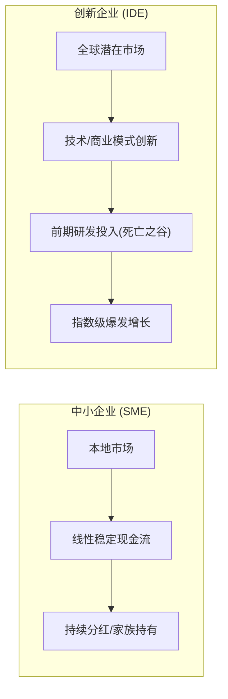
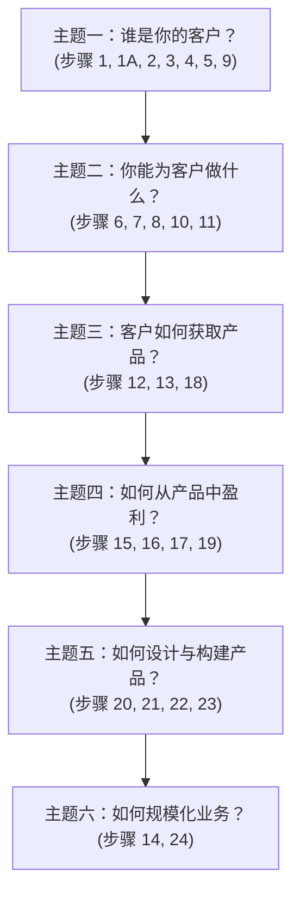

# Lec 1 课程介绍与后勤安排、DE 概述 (Class Intro & Logistics, DE Overview)

> MIT 15.390 · New Enterprises · 模块一：课程导论与创业框架 · 主讲：Bill Aulet

## TL;DR

- 破除创业纯靠天赋的十大神话，确立创业是一门通过后天培养（Nurture）可教授、可学习且可重复验证的工程科学。
- 核心创新公式揭示：$Innovation = Invention \times Commercialization$；若商业化能力为零，技术价值再高实际创新产出亦为零。
- 明确区分中小微企业（SME）与创新驱动型企业（IDE），15.390 专注培养具有全球野心与指数级规模化潜力的 IDE 企业家。
- 严谨创业法（Disciplined Entrepreneurship）提供 6 大核心主题与 24 步结构化画布（DE Canvas），为初创团队构建动态迭代的实证闭环。

## 创业的本质：破除十大神话与确立工程范式

大众文化往往将创业者神话为具备超凡直觉的天才冒险家或不可预测的孤独独行侠。然而在 MIT Sloan 的教学体系中，创业被重新定义为一项具有内在严谨结构的方法论工程。

::: definition 创新公式 (Innovation Formula)
$$Innovation = Invention \times Commercialization$$
创新是发明与商业化两者的乘积。若一项发明的商业化能力为 0，即便技术价值再高，其对社会的实际创新贡献亦为 0。
:::

托马斯·爱迪生（Thomas Edison）与尼古拉·特斯拉（Nikola Tesla）的经典案例深刻印证了这一原理：
- **尼古拉·特斯拉**：发明了交流电系统、无线电遥控、早期雷达概念与感应电动机，其技术天赋极其罕见。但他缺乏对客户决策、定价模型、商业契约与资本运作的理解，最终穷困潦倒。
- **托马斯·爱迪生**：不仅改良了耐用碳丝灯泡，更系统设计了中央发电站、地下输配电网络、电表计量与成套插座，构建了全球第一套商业化电力公用事业体系（成为通用电气 GE 的前身）。

Bill Aulet 指出，要想真正踏上创业旅程，首先必须破除关于创业的十大流行神话：
1. **神话一：创业者是天生的，不可后天培养**（真相：创业是系统的技能组合与心态，完全可以通过刻意练习掌握）。
2. **神话二：创业者都是极度狂热的风险赌徒**（真相：成功的创业者擅长将不确定性分解为可验证假设，极度厌恶并持续消除非受控风险）。
3. **神话三：创业者是孤独的天才个人**（真相：创业是一项团队运动，互补的联合创始人团队成功率远高于单打独斗）。
4. **神话四：必须拥有颠覆性原创专利才能创业**（真相：绝大多数成功企业依靠商业模式创新与对客户痛点的深刻理解）。
5. **神话五：创业必须依赖大量风险投资**（真相：资金过早过量往往掩盖商业模式缺陷，客户现金流才是最健康的资本）。
6. **神话六：创业是一场没有规则的混乱冒险**（真相：没有严谨纪律的自由探索只会加速烧光现金）。
7. **神话七：产品足够优秀就会自动卖出去**（真相：没有设计良好的获客与分销流程，好产品必然胎死腹中）。
8. **神话八：创业成功主要归功于运气**（真相：严谨方法论极大增加被运气眷顾的概率表面积）。
9. **神话九：创业者必须外向且极具魅力**（真相：深度倾听能力与实事求是的执行力比外向口才更重要）。
10. **神话十：一旦有了商业计划书就只需执行**（真相：商业计划书在接触第一位真实客户后就会改变，创业是动态假说验证过程）。

::: insight
创业者的第一堂必修课是认清自己的角色定位：你不能仅仅充当醉心于技术参数的发明家（Inventor），而必须进化为打通技术、市场、定价与组织的创新者（Innovator）。
:::

## 两大创业范式：SME vs. IDE

在开始 24 步之前，团队必须清楚所投身的企业类型。MIT 将创业企业划分为两大截然不同的类型：

| 维度 | 中小微企业 (SME: Small & Medium Enterprises) | 创新驱动型企业 (IDE: Innovation-Driven Enterprises) |
| :--- | :--- | :--- |
| **创新属性** | 基于成熟商业模式与已有技术（如餐馆、干洗店、咨询顾问） | 基于技术突破或商业模式颠覆，具备高进入壁垒 |
| **目标市场** | 服务本地或区域性有限市场 | 瞄准全国乃至全球潜在市场 |
| **发展路径** | 线性稳步增长，早期即可实现现金流打平 | 早期经历漫长“死亡之谷”持续烧钱，随后呈现指数级曲棍球棒增长 |
| **资金需求** | 依靠个人储蓄、银行贷款或亲友借款，通常不出让控股权 | 依赖天使与风险投资（VC）接力注资，出让股权换取扩张速度 |
| **退出目标** | 家族长期持有、持续分红 | 通过 IPO 上市或被行业巨头并购实现资本退出 |

MIT 15.390 的全部方法论均专为 **IDE（创新驱动型企业）** 打造：在面对高度不确定的全球市场时，如何以最高效的资源利用率跨越死亡之谷。

## 严谨创业法 24 步六大主题全景架构

严谨创业法（Disciplined Entrepreneurship）绝非机械的填表清单，而是一个螺旋上升的知识建构系统。24 步被提炼为六大核心主题：

1. **谁是你的客户？（Steps 1-5, 9）**：从市场细分脑暴出发，果断选定单一滩头阵地市场（BHM），通过一手市场调研（PMR）构建最终用户画像，锁定唯一典型人物角色（Persona）与后续 10 位种子客户。
2. **你能为客户做什么？（Steps 6-8, 10-11）**：描绘客户全生命周期用例，绘制产品高层规格草图，对比现状量化价值主张，确立团队不可撼动的内在核心（Core）与竞争地位。
3. **客户如何获取你的产品？（Steps 12-13, 18）**：穿透决策购买单元（DMU）与决策流程（DMP），识别采购机会窗口与触发因素，设计可扩展的销售收入引擎。
4. **你如何从产品中盈利？（Steps 15-17, 19）**：设计对齐利益的商业模式，制定基于价值的定价框架，测算客户终身价值（LTV）与自顶向下的获客成本（COCA），落实 $LTV > 3 \times COCA$ 铁律。
5. **如何设计与构建你的产品？（Steps 20-23）**：识别致命假设，设计低成本实验快速验证，定义最小可行商业产品（MVBP），用真实付费验证“狗吃狗粮”。
6. **如何规模化你的业务？（Steps 14, 24）**：以保龄球瓶战略测算后续市场 TAM，制定技术与产品长期多阶段演进路线图。

## 课程后勤与实操工具：DE Canvas

在接下来的 24 节课中，课程设置了一套高强度的实战训练机制：
- **PMR 外勤日（Field Day）**：走出演讲厅，直面真实客户开展深度访谈，B2C 需访谈超过 30 人，B2B 需深度走访超过 10 家企业。
- **模拟董事会（Mock Board Meetings）**：在期中（步骤 1-11）与期末（步骤 1-24）面对真实投资人与创业导师组成的模拟董事会进行答辩。
- **DE 画布（Disciplined Entrepreneurship Canvas）**：每支团队需动态维护一份一页纸 DE 画布，实时记录 24 步各个模块的假说状态与实验数据，识别各步骤之间的内在冲突与逻辑断裂。

::: pitfall
年轻创业者最常犯的错误是“拿着锤子找钉子”：基于自己在实验室开发的一项前沿算法或新材料，到处寻找可以套用的应用场景，而对行业真实购买流程与经济效益视而不见。DE 体系要求你始终从客户与市场出发，倒推技术实现。
:::
