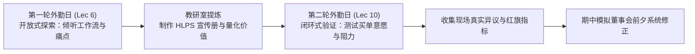
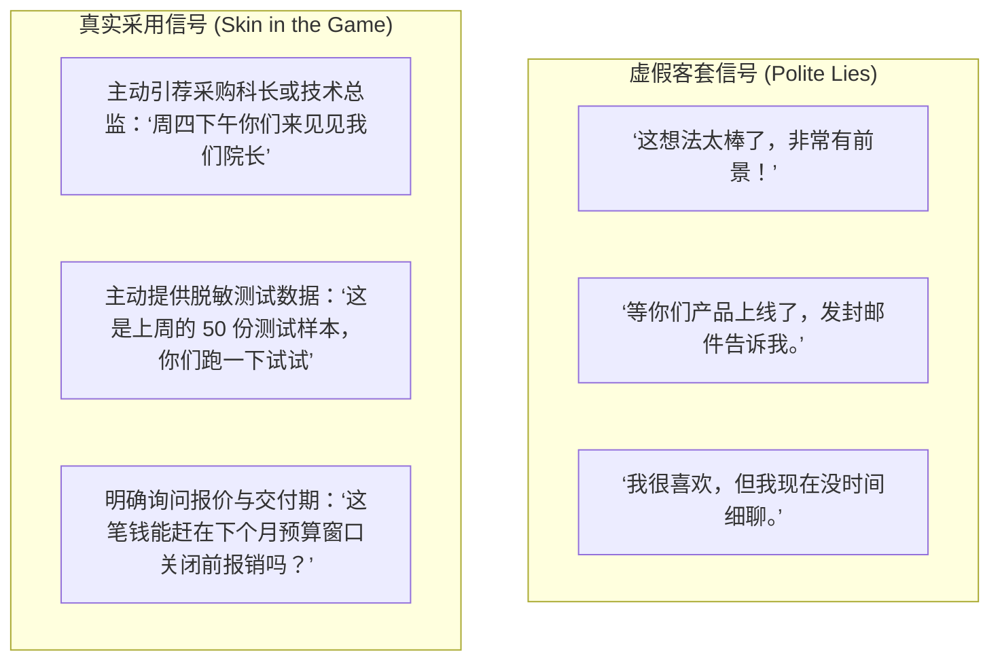

# Lec 10 一手市场调研外勤日 #2 (PMR Field Day #2)

> MIT 15.390 · New Enterprises · 模块三：价值主张与产品规格 · 主讲：Bill Aulet

## TL;DR

- 第二轮 PMR 外勤日（Field Day #2）从泛泛的需求探寻升级为具体的方案验证，重点测试步骤 9 的下 10 位种子客户。
- 携带高层产品规格（HLPS）单页与量化价值主张直面客户，观察其非语言微表情，探查真实工作流切入阻力。
- 运用市场测试战术（Market Testing Tactics）探查客户的真实付费意愿（Willingness to Pay），收集完整的异议清单（Objections）。
- 严格区分“客套赞美”与“真金白银承诺”，以无情事实检验商业假设的脆弱点。

## 第二轮外勤日定位：从“听痛点”转向“验方案”

在第一轮 PMR 外勤日（Lec 6）中，团队的核心任务是“倾听与观察”——了解客户的日常工作流、挖掘未经满足的痛点与妥协方案。

而到了第二轮外勤日（Field Day #2），团队已经完成了步骤 6（全生命周期用例）、步骤 7（高层产品规格 HLPS 宣传册）、步骤 8（量化价值主张）与步骤 9（下 10 位客户锁定）。**本次外勤日的任务是带着具体的解决方案回到这 10 位客户面前，进行高强度的“实弹压力测试”**。

## 直面步骤 9 下 10 位客户的实战测试

团队全员再次走出演讲厅，与锁定的 10 位种子客户逐一开展面对面深度访谈。访谈分为三步递进环节：

1. **出示高层规格（HLPS）宣传单页**：
   - 将打印精美的单页递给对方，**前两分钟内团队全体保持沉默**；
   - 仔细观察对方的目光聚焦在哪里、是否皱眉、是否指着某个功能提问；
   - 随后询问：“在不听我解释的情况下，你第一眼觉得这个产品是用来做什么的？”如果对方的理解与团队设计大相径庭，说明产品规格的表达存在严重认知障碍。

2. **呈送量化价值主张（As-Is vs. Possible）**：
   - 向客户展示对照表：“我们推算如果采用该系统，你每天可以节省 4 小时阅片时间，科室每年增加 240 万美元检验收入。这个数字符合你的直觉吗？”
   - 鼓励客户主动拿起笔修改计算公式中的假设参数：“不，你们估算的单次阅片费太高了，实际医保报销只有 45 美元。”这才是最高价值的反馈。

3. **探测真实接入摩擦**：
   - 追问：“如果明天把这套系统免费安装到你的工位上，你会立即使用吗？如果不，最大的障碍是什么？”
   - 往往能炸出极其关键的隐蔽阻力：IT 部门的安全审计、院内服务器端口限制、或者某位资深副主任的抵制。

## 市场测试战术：探寻真实买单意愿 (Willingness to Pay)

在课前必读的《市场测试策略》（Market Testing Tactics）中，Bill Aulet 强调：**询问客户是否愿意付费，必须采用科学的区间逼近战术（Bracketing Technique）**。

::: definition 区间试探报价法 (Bracketing Technique)
不要直接问“你愿意付多少钱”，因为客户必然尽量往低报。应当给出上下锚点进行区间夹击：
1. **测试上限阻力**：“如果我们按企业级解决方案收费，每年收取 10 万美元，你的反应是什么？”（如果对方毫无犹豫说行，说明定价严重偏低；如果对方瞬间摇头说绝不可能，追问其组织内无需董事会审批的签字上限是多少）；
2. **测试下限怀疑**：“如果这套系统每年只收 500 美元，你敢不敢部署？”（过低的价格往往引发客户对数据安全、系统稳定性与团队存续能力的巨大质疑）。
:::

## 现场异议记录与阻力分类 (Objection Catalog)

在外勤走访中，客户提出的每一句“但是……”都必须被完整记录并分类归档：

| 异议类别 | 典型客户原话 | 底层真实原因 | 应对与产品迭代方向 |
| :--- | :--- | :--- | :--- |
| **技术兼容阻力** | “我们还在用 Windows 7 和 10 年前的老 PACS 系统，你们的云端无法连通。” | 基础设施极其陈旧，上云阻力巨大。 | 必须开发轻量本地化 Docker 镜像，支持内网离线运行。 |
| **合规与责任阻力** | “如果 AI 漏掉了恶性肿瘤，导致医疗纠纷，谁承担法律赔偿责任？” | 对失误责任产生极度恐惧。 | 坚决不自称“诊断系统”，在界面显著标注“辅助预警”，责任主体保留在医生。 |
| **工作流负担阻力** | “我还要专门多打开一个窗口、重新输一遍账号密码？太麻烦了！” | 增加认知切换成本，破坏既有连贯性。 | 做成无感挂件或快捷键唤醒，直接集成到现有影像查看软件内。 |

## 识别虚假热情与真实采用信号

外勤日最危险的结果不是被客户臭骂，而是**收获了一堆虚假的赞美**。

::: insight
如果下 10 位客户中没有任何人向你发脾气或提出尖锐挑剔，而是一味点头微笑，你的创业项目大概率已经处于极度危险的边缘。**挑剔才意味着真正动了购买的念头**，因为只有真正准备使用的人，才会为具体的功能瑕疵与流程摩擦据理力争。
:::

::: pitfall
千万不要在被客户拒绝后试图当场与客户争辩“是你没看懂我们的前沿技术”。客户永远是对的，客户的认知就是事实。如果你无法用简单的语言让客户看懂并认同价值，错误百分之百出在你的产品定义与沟通策略上。
:::
