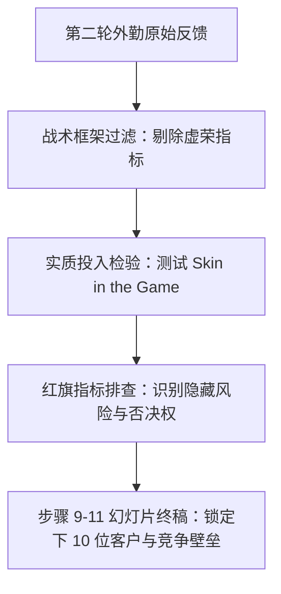

# Lec 11 验证人物角色、高层产品规格及价值主张的策略 (Tactics for Validating Persona, HLPS, and Value Proposition)

> MIT 15.390 · New Enterprises · 模块三：价值主张与产品规格 · 主讲：Bill Aulet

## TL;DR

- 市场测试的核心是将定性洞察升级为可证伪的科学实验，严防被客户的客套赞美误导。
- 区分虚荣指标与实质投入（Skin in the Game）的四大层级：时间投入、声誉背书、核心数据开放与真金白银预付款。
- 运用反向测试与红旗指标排查（Red Flags），精准识别隐藏的决策否决者与假需求。
- 完成步骤 9-11 幻灯片整合，形成经受过真实市场检验、逻辑自洽的期中商业方案。

## 市场测试战术框架：从定性共情到量化实证

在经历了两轮 PMR 外勤日（Lec 6 与 Lec 10）之后，团队已经收集了大量一线素材。然而，未经验证的感性素材无法直接说服投资人与董事会。

Bill Aulet 在《市场测试策略》（Market Testing Tactics）中指出，团队必须建立一套结构化的战术验证框架，对前期产出的三项核心资产展开严格质询：
1. **Persona 是否经受住了考验？**（步骤 5 的画像是否真实代表了海滩阵地内的普遍痛点，还是仅仅反映了某一位受访者的个人偏执？）
2. **高层产品规格（HLPS）是否足够精简直观？**（步骤 7 的宣传册在没有创始人解说的情况下，客户能否自主看懂？客户是否提出了大段无法实现的定制需求？）
3. **量化价值主张是否真正诱人？**（步骤 8 计算出的 ROI 是否让客户的第一核心指标产生了不可逆的改变？）



## 实质投入指标金字塔 (Skin-in-the-Game Hierarchy)

评估客户兴趣真伪的最硬核标准，是考察客户是否愿意**以自身稀缺资源为质押（Skin in the Game）**。课堂将客户投入分为四个由弱至强的层级：

::: definition 实质投入金字塔 (Skin in the Game Hierarchy)
1. **第一级：时间投入 (Time Commitment)**：客户是否愿意连续两周、每周抽出 1 小时与你的工程团队深度联调或测试原型？（时间是职场人士最宝贵的资产，愿意付出时间即证明存在真实痛点）；
2. **第二级：声誉背书 (Reputational Commitment)**：客户是否愿意向其直属主管、采购部长或跨部门同行引荐你的项目？（以个人职业声誉为初创小团队背书，意味着对方案的高度认可）；
3. **第三级：数据开放 (Asset Commitment)**：客户是否愿意签署保密协议（NDA）并向你提供其内部高度敏感的真实历史脱敏数据以供算法回测？
4. **第四级：资金质押 (Financial Commitment)**：客户是否愿意签署不具约束力的意向采购书（Letter of Intent, LOI），甚至支付小额预付款（Deposit）锁定首发交付名额？
:::

```text
       ▲ [第四级：真金白银] 签署意向书(LOI) / 支付小额预付款
      ▲▲▲ [第三级：数据开放] 提供内部脱敏真实测试数据集
     ▲▲▲▲▲ [第二级：声誉背书] 主动引荐上级领导与采购部门
    ▲▲▲▲▲▲▲ [第一级：时间投入] 每周稳定投入数小时配合测试
   ════════════════════════════════════════════════════════
   [地下层：虚荣指标] 口头夸奖 / 交换名片 / 点击点赞 (毫无价值)
```

## 识别致命红旗指标 (Red Flag Detection)

在推进步骤 9（下 10 位客户）与价值验证的过程中，团队必须对以下**红旗指标（Red Flags）**保持高度警惕：

| 红旗表象 | 客户底层真实心态 | 潜在毁灭性风险 |
| :--- | :--- | :--- |
| **无限期要求免费试用** | “反正不要钱，放着试试看，但我们并不打算买。” | 初创团队耗费巨资提供专属技术支持，试用期结束后客户立即流失。 |
| **提出海量边角料定制需求** | “只要你们把这 20 个定制报表做出来，我们就考虑采购。” | 沦为廉价外包公司，产品彻底失去标准化与规模化可能。 |
| **会议不断推迟、邮件已读不回** | “这根本不是我的当务之急，只是碍于面子不好意思当面拒绝你。” | 团队误将对方的客套推脱当成正在推进，在死线索上浪费数月生命。 |
| **突然冒出未知否决者** | “方案挺好，但我们合规部门和法务总监坚决不允许外部软件接入内网。” | 前期调研未穿透决策购买单元（DMU），直接导致商务成单流产。 |

::: insight
一个优秀的创业者必须学会**主动给客户出难题**。在访谈结束时，要求对方下周提供脱敏数据或签署一份无偿试用协议。**如果对方找借口推脱，你应该感到庆幸而不是沮丧**——因为你用 30 秒的试探，成功排除了一个根本不会买单的伪客户。
:::

## 步骤 9-11 交付物整合：期中董事会冲刺

本讲课后，团队必须提交 **步骤 9–11 整合幻灯片**，作为下一讲期中模拟董事会的关键材料：
- **步骤 9 幻灯片**：清晰列出 10 位具体客户的名单、组织头衔、PMR 访谈日期、确认的核心痛点以及各自达到的“实质投入层级（Skin in the Game）”；
- **步骤 10 幻灯片**：用极简陈述界定团队内在唯一的“核心能力（Core）”，明确阐述为何行业巨头投入 10 倍资本与人力也无法在短期内轻易复制；
- **步骤 11 幻灯片**：基于 Persona 的前两大关键购买标准（Priority #1 和 Priority #2），绘制直观的 2x2 竞争定位图谱，标出直接竞品、间接替代品与客户“什么都不买的老套路（Status Quo）”，证明团队方案位于右上角的绝对制高点。

::: pitfall
在准备步骤 10 的核心能力时，切忌把“我们的算法比开源模型高 5 个百分点”当成护城河。算法代码在工业界迭代极快，单点的参数优势在几个月后就会被大模型开源社区抹平。唯有结合特定业务场景形成不可替代的**数据资产闭环与工作流嵌入**，才是不可撼动的 Core。
:::
