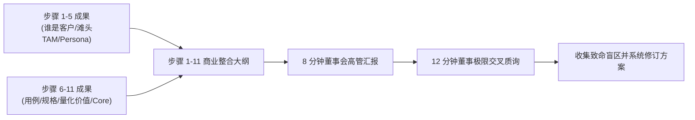

# Lec 12 期中模拟董事会会议 (步骤 1-11) (Interim Mock Board Meetings (Steps 1-11))

> MIT 15.390 · New Enterprises · 模块三：价值主张与产品规格 · 主讲：Bill Aulet

## TL;DR

- 期中模拟董事会是 15.390 的关键里程碑，强制团队将步骤 1–11 的零散分析整合为逻辑闭环的商业方案。
- 会议采用“8 分钟极简陈述 + 12 分钟高压质询”机制，由真实风险投资人、行业领袖与资深教授担任独立董事。
- 董事会围绕“客户真实性、滩头 TAM、时机拐点（Why Now）、核心防御力（Core）与种子客户意向”展开穿透式拷问。
- 团队必须保持求真务实的防守姿态，将董事会的尖锐质疑转化为后续春假期间产品迭代与商业模式重构的行动清单。

## 期中模拟董事会的战略定位

在完成了严谨创业法的第一阶段（谁是你的客户？步骤 1–5）与第二阶段（你能为客户做什么？步骤 6–11）之后，初创项目迎来了成立以来的第一次严峻大考：**期中模拟董事会会议（Interim Mock Board Meeting）**。

在真实的商业世界中，董事会并非给管理层歌功颂德的俱乐部，而是公司治理、资本监管与战略校准的最高权力机构。本次模拟董事会的根本目的在于：
1. **打破团队内部的自嗨泡沫**：在封闭开发数周后，强制接受外部资深投资人与产业专家的冷水泼淋；
2. **检验步骤 1–11 的逻辑链条自洽性**：排查从市场细分、滩头 TAM、Persona 到产品规格与核心能力之间是否存在前后矛盾；
3. **完成从学生作业向专业商业路演的心智蜕变**。



## 模拟董事会的角色配置与实战规则

课堂将每个创业团队置于真实董事会会议室情境中：
- **董事会构成**：每组由 3 位外部专家组成，通常包括一位顶级早期风险投资机构（如 Sequoia、Bessemer）合伙人、一位 MIT 知名校友连续创业者、以及一位 Sloan 商学院资深教授；
- **8 分钟精炼汇报规则**：团队必须在 8 分钟内完成步骤 1–11 的核心陈述，严禁超时；超时一秒即被强行打断叫停；
- **12 分钟极限交叉质询（Cross-Examination）**：董事会成员不听寒暄客套，直接翻到幻灯片最薄弱的一页，展开尖锐提问。

## 董事会五大必答灵魂拷问

根据多年执教经验，Bill Aulet 梳理了董事会必然抛出的五大核心问题：

::: definition 董事会五大灵魂拷问 (The 5 Core Inquiries)
1. **客户证据的真实度（Customer Proof）**：“你说这个痛点极其剧痛，证据何在？你们面对面访谈的这 10 个人里，有几个人愿意下周给你们写意向书（LOI）？”
2. **滩头阵地 TAM 的可信度（TAM Sanity）**：“你们自底向上统计的最终用户总数来自哪个公开权威数据库？客单价假设依据的是客户目前的哪笔支出预算？”
3. **时机拐点何在？（Why Now?）**：“这个问题存在很多年了，为什么过去行业巨头不做？是技术成本降到了阈值，还是出台了强制性的行业监管新规？”
4. **巨头进场防御力（Defensibility against Incumbents）**：“如果微软、Google 或西门子明天宣布在下一个免费版本中内置你们的功能，你们能撑几个月？你们的 Core 到底是什么？”
5. **单位经济学的直觉检验（Initial Unit Economics）**：“虽然还没测算完商业模式，但直觉上获客渠道依靠什么？客户的采购审批周期需要几个月？”
:::

```text
[董事会质询交锋典型场景]
董事: "你们的 Core 是什么？"
团队: "我们拥有顶级的深度学习模型架构，并在 arXiv 上发表了顶会论文。"
董事: "荒谬！论文发表意味着全世界都能看到你们的思路，开源社区两周就能复现。
       这不仅不是护城河，反而是把商业机密双手奉上！
       告诉我：你们是否锁定了排他性的医院私有数据源？还是有不可逆的临床嵌入流程？"
```

## 专业答辩准则：如何像优秀 CEO 一样应对质询

在董事会的高压质问下，许多缺乏经验的学生会下意识陷入争辩、抵赖或支支吾吾。MIT 确立了专业创始人的答辩准则：

1. **绝对实事求是（Never Bullshit the Board）**：面对没有数据支撑的问题，诚实回答：“这是一个极其关键的盲区，我们目前的 PMR 数据尚未覆盖这一点。我们已将该问题列为春假外勤的第一优先级，下周三前向董事会补交实测报告。”
2. **区分“事实依据”与“团队推测”**：陈述时明确指出哪些来自客户真实原话与合同，哪些是团队的初步推测假说，绝不混淆；
3. **团队全员默契协同**：由 CEO 统筹控场，根据问题属性精准将质询分发给 CTO（技术实现）或 CMO（客户访谈证据），严禁合伙人当着董事会的面当场拆台或互相争吵。

::: insight
期中模拟董事会是一面镜子。它摧毁的是创始人的傲慢与虚假幻想，赋予团队的则是经过专业拷打后沉淀下来的坚定信仰。**在董事会上被挑出 10 个致命漏洞并不可怕，可怕的是带着这 10 个漏洞盲目开工写代码半年后才在市场上被撞得粉身碎骨**。
:::

## 会后复盘与修订版幻灯片交付

董事会结束后，团队必须在 48 小时内召开内部闭门复盘会：
- 整理董事会提出的所有批判意见与未解问题；
- 重新对照 DE 步骤 1–11，彻底重写存在逻辑脱节的页面；
- 提交 **修订后的步骤 1–11 整合幻灯片**，作为下半学期进军获客流程、商业模式与财务测算（步骤 12–24）的基准战略蓝图。

::: pitfall
最糟糕的应对方式是“会后怨天尤人”，认为“董事会成员不懂我们深奥的技术”。如果连顶级产业专家与投资人都听不懂或不认同你的商业逻辑，真实市场上的普通客户更不可能掏出真金白银。
:::
