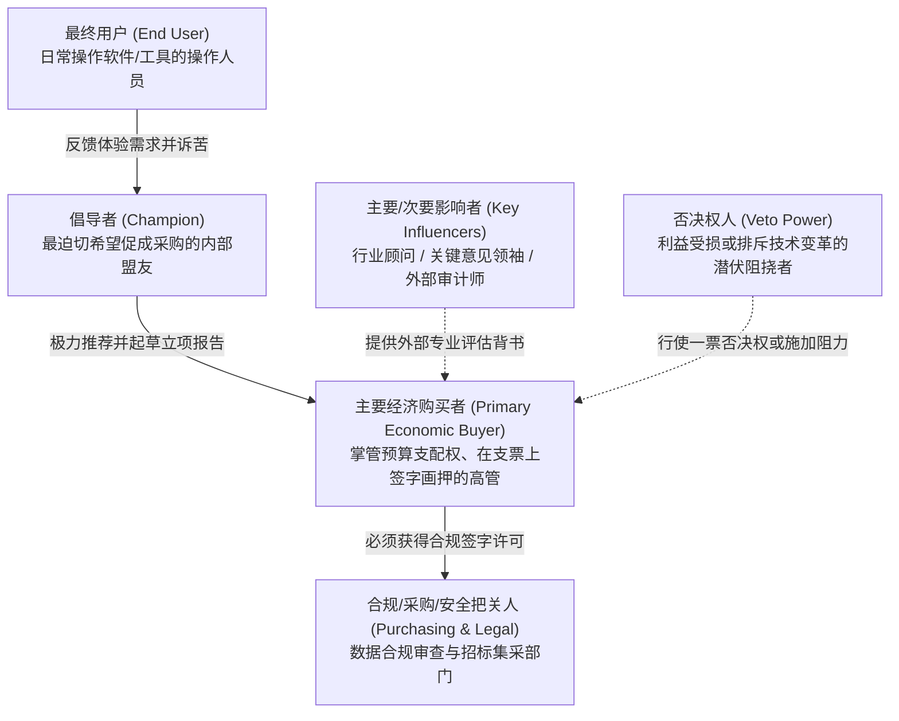
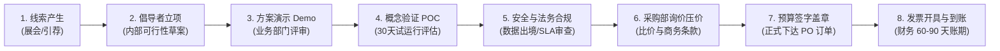
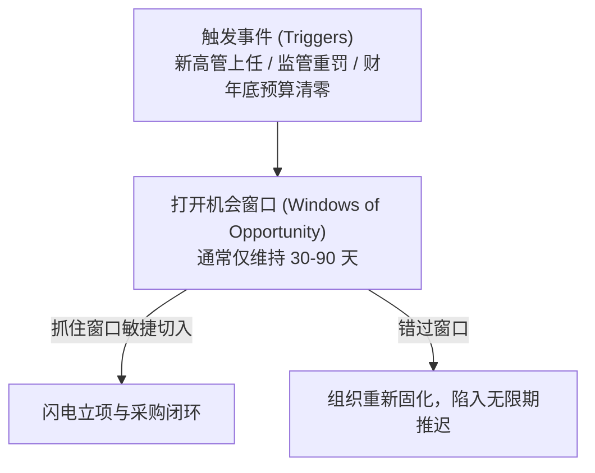

# Lec 13 决策单位 (DMU) 与决策流程 (DMP) (步骤 12-13)，含机会窗口与触发因素

> MIT 15.390 · New Enterprises · 模块四：获客决策与商业模式 · 主讲：Bill Aulet

## TL;DR

- 步骤 12 绘制决策购买单元（DMU），全面解构倡导者、最终用户、主要经济购买者、影响者与一票否决权人的权力图谱。
- 步骤 13 绘制获客决策流程（DMP），厘清从需求感知、合规审查、招标试用到最终付款结算的全部离散步骤与时间跨度。
- 步骤 13A 捕捉关键触发事件（Triggers）与机会窗口（Windows of Opportunity），在客户组织变动、预算编制或政策强监管周期精准切入。
- 赋能内部倡导者（Champion）是缩短 B2B 漫长采购周期与突破官僚阻力的核心抓手。

## 步骤 12：穿透企业客户采购决策网络 (DMU)

在复杂的机构客户采购中，敲定订单绝非“向某一位负责人推销”那么简单。初创企业常犯的悲剧是：与某位业务人员聊得非常投机，以为胜利在望，数月后却突然被对方公司法务或采购部门一票否决。

Bill Aulet 强调，团队必须像专业侦探绘制情报网络一样，清晰解构目标客户内部的 **决策购买单元（Decision-Making Unit, DMU）**。

::: definition 决策购买单元 (Decision-Making Unit, DMU)
在目标客户组织内部，所有直接或间接参与、影响、审查并批准产品采购决策的个体与部门集合。它包括最终使用产品的最终用户，但更核心的是控制资金审批与合规准入的利益相关方。
:::

### DMU 的六大核心角色深度剖析
1. **倡导者 (Champion)**：组织内部最希望看到你方案落地的人。通常是因为你的系统能直接帮其达成关键 KPI、消除繁琐加班或争取年终晋升；
2. **最终用户 (End User)**：每天具体坐在电脑前操作软件的人。其核心诉求是“好用、不添乱、不增加工作负荷”；
3. **主要经济购买者 (Primary Economic Buyer)**：真正掌管预算资金支配权、拥有自主签字限额的高管。TA 关心的唯一指标是投资回报率（ROI）与业务风险；
4. **主要与次要影响者 (Key Influencers)**：深得经济决策人信任的外部智囊、行业分析师或技术架构师；
5. **采购与合规部门 (Purchasing Department & Legal/IT Compliance)**：负责压低采购单价、严审合同条款、进行网络安全渗透测试与合规审查的防线；
6. **否决权人 (Veto Power)**：拥有权力一票否决采购的利益相关方。通常包括 IT 安全总监（因数据上云风险否决）、工会（因系统导致裁员否决）或受威胁的中层干部。

## 步骤 13：绘制获客决策流程 (Map the DMP)

明确了“谁参与决策（DMU）”之后，步骤 13 的任务是绘制“他们如何具体做出决策”：**获客决策流程（Decision-Making Process, DMP）**。

### 绘制 DMP 流程全景图
团队必须将客户从初次接触到资金真正转入初创公司银行账户的每一个离散节点完整列出：

在绘制流程图时，团队必须标注三项核心参数：
- **各节点的耗时（Cycle Time）**：每个审批环节需要等待几天或几周？全流程累计需要耗费几个月？
- **签字权限门槛（Approval Limit）**：倡导者拥有的免审批自主报销额度是多少（如 1 万美元以内可直接刷企业信用卡，超过 5 万美元必须上报副总裁甚至董事会审批）？
- **沉没风险点（Friction Points）**：在哪个环节历史流失率最高？

## 步骤 13A：机会窗口 (Windows of Opportunity) 与触发因素 (Triggers)

许多 B2B 销售陷入僵局，并非因为产品不够好，而是因为“**客户目前没有紧迫的改变理由**”。客户组织具备巨大的惰性，唯有外力冲击才能打破平衡。

::: definition 触发因素 (Triggers) 与 机会窗口 (Windows of Opportunity)
- **触发因素 (Triggers)**：打破客户组织常态平衡的突发事件。例如高管换届（新官上任三把火）、遭遇重大安全事故通报、被监管机构开出巨额罚单、或财年即将结束必须在年底前把未花完的预算突击花掉（Use-it-or-lose-it Budget）；
- **机会窗口 (Windows of Opportunity)**：在触发事件发生后，客户对外部全新解决方案持高度开放态度的一段短暂时间窗口。一旦窗口关闭，既有流程重新固化，销售阻力将暴增十倍。
:::

## 赋能倡导者：以巧破千斤的实战抓手

初创企业资源匮乏，绝无可能逐一搞定客户公司几十位利益相关者。因此，**顶尖的 B2B 创业者不做直接推销，而是把 80% 的精力投入到武装内部倡导者（Champion）上**。

- 为倡导者准备一份“傻瓜式内部汇报 PPT”，替 TA 算清项目如何帮 TA 所在部门节约成本；
- 为法务与 IT 安全部门准备好完备的白皮书与合规检测报告，让倡导者在被质问时能够直接甩出权威证据；
- 紧盯客户的财年预算周期（通常在每年的 Q3 编制次年预算，在 Q4 冲刺清零），在机会窗口刚刚开启的瞬间将方案送入审批通道。

::: insight
在 B2B 采购中，**没有人会因为采购了 IBM 或 Oracle 的平庸产品而被开除；但如果采购了一家不知名初创公司的软件却发生事故，决策人可能会断送职业生涯**。因此，向企业客户推销的本质不是展示技术多么激进，而是向经济购买者提供坚不可摧的安全感，证明选择你的方案是风险最小的决定。
:::

::: pitfall
小心“隐形采购程序陷阱”。很多年轻创业者以为部门总监口头答应签约就大功告成，殊不知大企业必须经过公开招标网公示、三家竞标比价、入围供应商资质审核（Vendor Onboarding）等严苛流程。不把这些后勤链路算入销售周期，初创公司往往会在“合同审批”的过程中活活饿死。
:::
