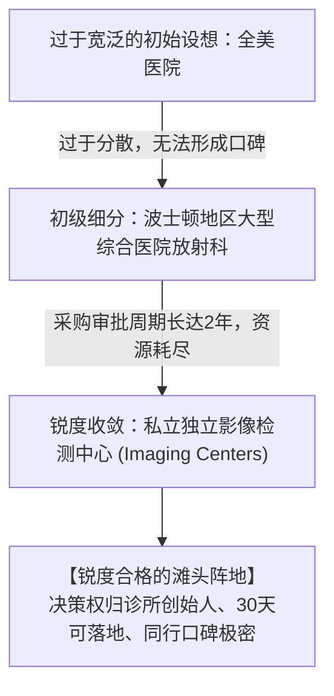
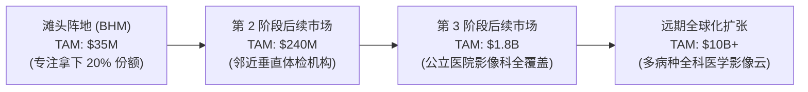

# Lec 14 滩头阵地市场是否足够聚焦？后续市场拓展 (步骤 14) (Is Your BHM Sharp Enough? Follow on Markets (Step 14))

> MIT 15.390 · New Enterprises · 模块四：获客决策与商业模式 · 主讲：Bill Aulet

## TL;DR

- 滩头阵地锐度测试（Sharpness Test）强制团队自检是否违背了“单一客户、单一用例、紧密口碑”的绝对聚焦纪律。
- 严厉警惕过早多元化（Premature Diversification）——在未主导滩头前四处出击是初创企业夭折的头号元凶。
- 保龄球瓶模型（Bowling Pin Model）清晰界定扩张逻辑：攻克 1 号瓶后，沿纵向衍生产品与横向邻近垂直行业形成多米诺骨牌效应。
- 步骤 14 测算后续市场潜在总额（Follow-on TAM），验证百亿美元长期增长天花板，为公司提供远期战略定力。

## 滩头阵地锐度检验 (BHM Sharpness Test)

经过期中模拟董事会的洗礼以及步骤 12–13 对决策流程（DMP）的穿透，许多团队会震惊地发现：**自己选定的滩头阵地其实根本没有聚焦，依然过于庞大和松散**。

初创团队常陷入“假聚焦”的幻觉——声称自己的海滩阵地是“中小企业”或“医院”。然而，一家 10 人的软件工作室和一家 500 人的制造工厂对软件的采购流程天差地别；三甲公立医院与私立牙科诊所的准入合规完全是两个世界。

::: definition 滩头阵地锐度四问 (BHM Sharpness Test)
在继续推进商业模式前，团队必须强制自问以下四个底线问题：
1. **产品一致性**：该市场内的所有目标客户，购买的是否是**几乎完全相同且无需二次开发的标准产品**？
2. **销售周期同质性**：他们的采购审批流程（DMP）、预算限额与决策链是否高度一致？
3. **口碑网络紧密性**：当客户 A 购买并使用后，客户 B 和 C 是否能通过同行交流、行业圈子迅速获知并视其为关键背书？
4. **统治力可行性**：以团队现有资源，能否在 **12–18 个月内拿下该细分市场 20% 以上的绝对市场份额**？
:::

若上述任一问题的答案为“否”，说明滩头阵地依然过于模糊，必须进一步向下细分（Segment Further）直至切口锐利无比。



## 保龄球瓶扩张战略 (The Bowling Pin Model)

投资人常常会质问：“如果你们的滩头阵地只有 2000 万到 5000 万美元规模，这算什么风投支持的创新驱动型企业（IDE）？”

Bill Aulet 指出，初创企业的扩张逻辑必须遵循 **保龄球瓶模型（Bowling Pin Strategy）**：

```text
               [4号瓶: 更多邻近行业]   [5号瓶: 全球化出海]   [6号瓶: 生态平台]
                        \              /             /
                         [2号瓶: 邻近垂直行业]   [3号瓶: 衍生新产品线]
                                  \             /
                                   \           /
                                  [ 1号主瓶 (Head Pin) ]
                                  (单一锐利滩头阵地 BHM)
```

::: definition 保龄球瓶模型 (Bowling Pin Model)
在打保龄球时，球手绝不可能同时瞄准所有球瓶；球手唯一要做的是以全部力量精准击中**最前端的 1 号主瓶（Head Pin，即滩头阵地）**。一旦 1 号瓶被坚决击倒，它所释放的冲击力与信誉资产将自然撞倒相邻的 2 号瓶与 3 号瓶，最终引发全中（Strike）。
:::

### 撞倒相邻球瓶的两大战略向量
1. **横向扩张：邻近垂直行业（Adjacent Verticals）**：将经过 1 号滩头验证的标准产品，复制销售给痛点相似的新行业客户（如将用于私立影像中心的秒筛软件，平移至大型体检连锁机构）；
2. **纵向扩张：衍生产品增购（Follow-on Products / Upsell）**：向已经建立深度信任的 1 号滩头客户，销售全新的功能模块或配套耗材（如在肺结节筛查软件基础上，向同一批影像科医生增售骨折检测模块）。

## 步骤 14：测算后续市场潜在总额 (Follow-on Markets TAM)

严谨创业法第 14 步要求团队在锁定滩头阵地的同时，系统性梳理并测算 **5–10 个后续市场的潜在总额（Follow-on TAM）**。

$$TAM_{\text{Total}} = TAM_{\text{Beachhead}} + \sum_{i=1}^{k} TAM_{\text{Follow-on } i}$$

- **证明远期天花板**：后续市场的综合 TAM 规模通常应达到 **10 亿至 100 亿美元以上**，向资本市场清晰证明：公司并非甘于平庸的本地中小企业（SME），而是一家拥有十倍甚至百倍扩张潜力的创新驱动型独角兽（IDE）；
- **明确演进优先级**：根据技术重用度与渠道协同度，为后续市场排定严格的时间序列（第 2 年进攻哪一个，第 3 年拓展哪一个）。



## 坚决抵制“过早多元化” (Premature Diversification)

创业团队最致命的诱惑莫过于**过早分兵**。在滩头阵地尚未站稳脚跟时，突然遇到一个来自其他行业的潜在客户挥舞着支票说：“只要你们帮我定制一个新版本，我就给你们 10 万美元！”

许多初创公司禁不住诱惑，立刻抽调核心工程师去开发定制需求：
- 结果导致滩头阵地的标准产品延期，首批种子客户因体验不佳纷纷流失；
- 新行业的定制需求越陷越深，公司彻底沦为低毛利的项目外包商；
- 失去了在任何一个单一细分市场建立绝对统治地位的历史契机。

::: example 戈登·马修斯（Gordon Mathews）语音信箱的历史教训
现代语音信箱发明人戈登·马修斯虽拥有核心基础专利，但他试图同时向跨国企业、电信运营商、中小企业全面推销语音硬件。由于战线拉得太长，没有在任何一个细分领域筑牢垄断壁垒，最终被 IBM 与 AT&T 凭借雄厚的行业定制与分销能力各个击破。
:::

::: insight
**战略的本质就是克制贪婪**。在你的滩头阵地市场份额没有达到 20% 之前，任何试图进军第二个市场的冲动都是自杀性的。把所有的资源、所有的智慧、所有的激情死死钉在 1 号球瓶上，彻底打穿打透，这才是严谨创业法的铁血纪律。
:::

::: pitfall
小心“后续市场反客为主”。测算步骤 14 的 Follow-on TAM 只是为了验证公司的远期价值与叙事逻辑，绝不意味着你现在就要为后续市场写代码。如果在当前产品规格里预留一堆后续市场才用得上的复杂架构，只会让滩头产品变得无比臃肿脆弱。
:::
