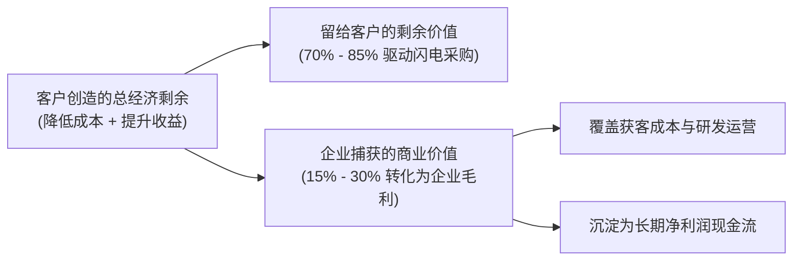

# Lec 15 商业模式、定价与客户终身价值 (LTV) (步骤 15-17) (Business Model, Pricing & LTV (Steps 15-17))

> MIT 15.390 · New Enterprises · 模块四：获客决策与商业模式 · 主讲：Bill Aulet

## TL;DR

- 步骤 15 强调商业模式是捕获客户价值的结构化契约，涵盖买断、耗材、订阅制 SaaS、使用量计费与交易抽成等主流架构。
- 步骤 16 坚决摒弃成本加成法，确立基于价值的定价框架（Value-Based Pricing），以客户增量效益的 15%–30% 作为价格基准。
- 步骤 17 严格推导客户终身价值（LTV）折现公式，证明客户流失率（Churn Rate）是影响长期现金流的最大杠杆。
- 健全的商业模式创新能够从底层重塑行业激励，使初创企业在与传统在位者的博弈中占据非对称优势。

## 步骤 15：设计可持续的商业模式 (Design a Business Model)

许多创始人常常把“商业模式”与“定价”混为一谈。Bill Aulet 明确指出：**商业模式不是价格标签，而是企业从为客户创造的经济剩余中提取回报的结构化机制**。

好的商业模式能够从根本上对齐所有利益相关方的激励，降低获客阻力，并筑造长期的竞争护城河。



### 经典商业模式类型全景
1. **单次买断 + 年度维保（One-time Upfront + Maintenance）**：传统大型设备与本地部署软件标配，通常每年收取 15%–20% 的维保服务费；
2. **耗材模式 / 剃刀与刀片（Razor and Blades）**：基础主机以极低利润甚至平价销售，依靠专属高毛利耗材（如胶囊咖啡、专用试剂盒）持续锁定终身现金流；
3. **软件即服务订阅制（SaaS / Subscription）**：按月或按年收取固定席位费，提供持续云端算力、功能更新与数据备份，现金流可预测性极高；
4. **按实际使用量计量（Usage-Based / Metered）**：如云计算平台按 API 调用次数或存储容量计费，与客户自身的业务规模同频放大，采购门槛极低；
5. **双边交易平台佣金（Marketplace / Transaction Fee）**：撮合供需双边交易，按总交易流水（GMV）抽取固定比例佣金（Take Rate, 通常 5%–20%）；
6. **免费增值模式（Freemium）**：核心基础功能永久免费，以零边际获客成本快速占领市场，向 2%–5% 的专业重度用户收取高级功能费；
7. **按成果分成（Shared Savings / Performance-Based）**：直接按帮客户节省的实际电费或追回的坏账按比例提成（如提取节能金额的 30%），客户零前期预算风险。

::: insight
商业模式的创新往往比纯粹的技术突破更具颠覆性。Salesforce 的真正革命不是其 CRM 数据库架构有多神秘，而是它开创了“免安装服务器、按月按人头扣款、随时退订”的 SaaS 订阅模式，从商业模式底层彻底粉碎了 Siebel 传统的百万美元本地预付授权壁垒。
:::

## 步骤 16：制定基于价值的定价框架 (Pricing Framework)

初创公司在定价时最容易犯的错误是**成本加成法定价（Cost-Plus Pricing）**——核算自己的研发工时与服务器成本后加上 20% 利润率。

在严谨创业法中，成本加成法被严格禁止。**定价必须完全基于客户获得的量化价值（Value-Based Pricing）**：

::: definition 基于价值的定价黄金准则 (Value-Based Pricing)
1. **价格与成本脱钩，与价值挂钩**：客户根本不在乎你花了多少钱写代码，客户只在乎你的产品能帮 TA 节省多少工时、赚取多少增量营收或规避多少合规罚款；
2. **价值截取区间（The 15%–30% Rule）**：初创企业应将步骤 8 中测算出的“量化净经济效益”的 **15% 至 30%** 作为产品定价，将剩余 70% 至 85% 的巨大经济红利留给客户，以此促成采购决策；
3. **早期客户折扣锚定（Anchor High, Discount Transparently）**：可以给前 3 家灯塔客户高达 50% 的测试折扣，但合同上必须显式注明“标准年费为 \$100,000，扣除早期灯塔伙伴战略补贴 \$50,000”，严守基准价格锚点，为后续续费提价保留法理依据。
:::

## 步骤 17：测算客户终身价值 (Calculate the Lifetime Value, LTV)

客户终身价值（Lifetime Value, LTV）代表一个新获客户在与企业合作的整个生命周期中，能够为企业贡献的**折现净毛利现值**。

### 严谨贴现公式

$$LTV = \sum_{t=1}^{T} \frac{\text{Revenue}_t \times \text{Gross Margin}_t}{(1 + r)^t}$$

其中：
- $\text{Revenue}_t$：客户在第 $t$ 期支付的经常性与一次性总收入；
- $\text{Gross Margin}_t$：扣除服务器算力、部署实施与售后客服成本后的真实毛利率；
- $r$：资本成本贴现率（Cost of Capital），初创企业面对极高经营风险，通常取 **20%–30%**；
- $T$：客户生命周期长度（受流失率限制）。

### 稳态 SaaS 订阅业务的简化估算公式

在流失率（Churn Rate）处于稳态的订阅制业务中，LTV 公式可精炼推导为：

$$LTV = \frac{ARPU \times \text{Gross Margin}}{\text{Churn Rate} + r}$$

```mermaid
flowchart TD
    A["年度客单价 (ARPU)"] -->|正向拉动| LTV["客户终身价值 (LTV)"]
    B["交付毛利率 (Gross Margin)"] -->|正向拉动| LTV
    C["客户流失率 (Churn Rate)"] -->|负向侵蚀(分母)| LTV
    D["资本成本贴现率 (r: 20%-30%)"] -->|负向侵蚀(分母)| LTV
```

### 驱动 LTV 爆发的四大关键杠杆与“负流失”

1. **提升交付毛利率（Gross Margin）**：软件业务毛利通常应维持在 75%–85% 以上；软硬一体或含人工作业的业务若毛利低于 40%，LTV 空间将被严重压缩；
2. **消灭流失率（Churn Reduction）**：年化流失率从 15% 降至 5%，客户留存周期将从 6.6 年大幅延长至 20 年，LTV 瞬间翻倍；
3. **实现负净流失（Negative Net Churn）**：通过向上增购模块、按使用量扩容席位，使得既有存量客户群体的**增购总金额大于流失客户的损失金额**（净收入留存率 NRR > 110%）。此时即便不获取任何新客户，存量业务也在自动膨胀。

::: pitfall
计算 LTV 时绝不能直接使用总营收（Revenue）替代毛利（Gross Profit）！很多创始人算出的 LTV 高达 50 万美元，却忽视了每个客户需要配备两名驻场工程师和大量硬件服务器，实际毛利率只有 20%，导致真实 LTV 仅有 10 万美元，最终在后续获客支出中严重失血倒闭。
:::
