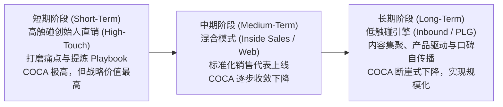
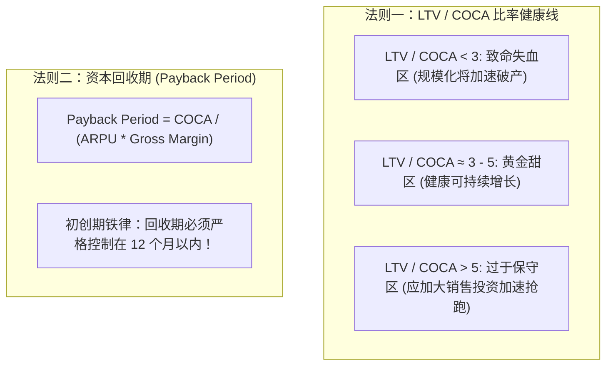

# Lec 16 客户获取成本 (COCA) 及其优化调整 (步骤 18-19) (COCA and Adjustments (Steps 18-19))

> MIT 15.390 · New Enterprises · 模块四：获客决策与商业模式 · 主讲：Bill Aulet

## TL;DR

- 步骤 18 规划销售引擎在生命周期中的三阶段演进：短期高触碰直销、中期混合内勤销售、长期低触碰自动化引流。
- 步骤 19 坚决摒弃自底向上微观估算法，确立自顶向下（Top-Down）严谨测算获客成本（COCA）的行业公理。
- 揭示创业者在测算 COCA 时的四大常见盲区：忽视底薪社保、忽视 90% 流失线索沉没成本、忽视售前支持与周期滞后。
- 坚守单位经济效益金法则：稳态下 $LTV > 3 \times COCA$ 且资本回收期小于 12 个月，筑牢企业健康扩张的底线。

## 步骤 18：设计可扩展的销售收入引擎 (Design a Scalable Revenue Engine)

初创企业不可能从第一天起就拥有一套完全自动化的销售机器。Bill Aulet 强调，**销售流程在企业的生命周期中必须经历三个递进演变阶段**：

### 三大阶段的战略特征
1. **短期阶段（Short-Term: High-Touch Direct Sales）**：
   - **执行主体**：创始人亲自充当头号销售代表（Founder-Led Sales）；
   - **目标**：不计成本地拿下前 10–20 个标杆客户（Lighthouse Customers），在第一线捕捉客户的所有刁钻异议，摸清真实购买链路；
   - **特点**：此时每获取一个客户的成本（COCA）极高，甚至可能超过客户支付的合同额，但这笔开支应被视为产品研发与市场探索的必要学费。
2. **中期阶段（Medium-Term: Structured Inside Sales）**：
   - **执行主体**：将创始人经验沉淀为标准销售手册（Sales Playbook），招聘专业内勤销售代表（Inside Sales Reps）；
   - **目标**：主要通过电话会议、线上产品演示（Zoom Demos）与行业增值代理商（VAR）协同转化，消除高昂的跨国出差差旅；
   - **特点**：线索流转开始标准化，COCA 显著下降。
3. **长期阶段（Long-Term: Low-Touch Scalable Engine）**：
   - **执行主体**：产品驱动增长（Product-Led Growth, PLG）与集客式入站营销（Inbound Marketing）；
   - **目标**：依靠优质的技术白皮书、开源社区工具、社交媒体口碑与自助式免费试用（Free Trial）促成自发传播；
   - **特点**：新客户无需人工介入即可自主在网站刷信用卡开通服务，单客获客成本边际递减。

### 销售管道流速方程 (Pipeline Velocity)

量化评估销售漏斗运转效率的经典方程为：

$$V = \frac{N \times W \times S}{L}$$

- **$V$ (Velocity)**：销售管道每日/每月产生的预期新增收入；
- **$N$ (Number of Opportunities)**：管道中合格商机（SQL）的总量；
- **$W$ (Win Rate)**：商机从接触到最终成单的平均转化胜率；
- **$S$ (Average Deal Size)**：单笔合同的平均客单价；
- **$L$ (Sales Cycle Length)**：商机从初次接触到最终合同生效回款的平均周期天数。

## 步骤 19：自顶向下严谨测算获客成本 (Calculate COCA)

在初创商业计划书中，最容易出现严重虚假的模块就是获客成本（Cost of Customer Acquisition, COCA）。

许多创始人习惯采用“自底向上法（Bottom-Up）”计算：
> “我们在 Google 上买关键词点击每次 2 美元，转化率 5%，所以我们的获客成本是 $2 / 0.05 = 40$ 美元！”

这种计算方式在现实中必然导致公司破产。它完全忽略了为了促成这笔交易，公司支付的全职销售代表底薪、出差机票酒店、展会展位费以及另外 95% 未转化客户所耗费的全部沉没成本。

::: definition 自顶向下获客成本公式 (Top-Down COCA)
在特定会计周期 $t$ 内，为获取新客户所投入的全部销售与营销支出总额，除以该周期内实际成功签约的新客户净数量：
$$COCA_t = \frac{\text{TMSE}_t - \text{Retained Marketing Cost}_t}{\text{New Customers Acquired}_t}$$
其中：
- $\text{TMSE}_t$（Total Marketing & Sales Expenses）：该期全部销售人员与市场团队的薪资底薪、五险一金、佣金提成、办公场地租金分摊、线上广告投放费、公关展会费以及售前技术支持工程师（SE）的人工成本；
- $\text{Retained Marketing Cost}_t$：专门用于维护老客户、防止既有客户流失的售后服务开销（通常取 10%–20%）；
- $\text{New Customers Acquired}_t$：该周期内真正完成签约打款的新增客户总数。
:::

### 创业者在测算 COCA 时的四大常见致命盲区

1. **忽视全职销售的高昂底薪与间接成本**：一名年薪 12 万美元的 B2B 销售，加上社保、工位与软件许可，实际综合成本高达 15 万美元；若 TA 一年只能签 5 单，仅此一人带来的单客摊薄成本就达 3 万美元；
2. **忽视 90% 失败线索的沉没代价**：销售代表拜访了 10 家客户，9 家最终没有购买；自底向上计算往往只计算最后成单客户的费用，而忽视了那 9 家被白白浪费的差旅与时间支出；
3. **忽视售前解决方案工程师（SE）的技术支持工时**：高科技 B2B 产品在客户现场做 POC 概念验证时，往往需要 2 名高薪核心算法工程师驻场调试 3 周，这部分高额研发成本必须作为销售开支计入 COCA；
4. **忽视销售周期的长尾滞后效应（Lag Effect）**：今天的营销广告支出往往在 6 个月甚至 9 个月后才产生签约客户。若直接用当月支出除以当月成单数，会造成严重的周期错配与虚假指标。

## 创业经济学黄金双法则 (The Golden Rules of Unit Economics)

在严谨创业法体系中，以下两条单位经济学黄金法则决定了初创企业的生死存亡：

::: definition 单位经济学两大铁律
1. **LTV 必须大于 3 倍 COCA**：
   $$\frac{LTV}{COCA} > 3$$
   当达到稳态运营时，LTV 必须至少是 COCA 的 3 倍以上。因为除了直接销售与营销费用外，企业还需要用毛利结余支付行政管理（G&A）、基础研发（R&D）以及为投资人提供风险回报。
2. **获客成本回收期必须小于 12 个月**：
   $$\text{Payback Period} = \frac{COCA}{ARPU \times \text{Gross Margin}} < 12 \text{ 个月}$$
   初创企业最容易因为“现金流枯竭”而猝死。如果获取一个客户需要预先垫付 10 万美元，而该客户按月订阅需要 3 年才能还本，即便 LTV 看起来再高，初创公司在扩张过程中也会因为现金垫付过大而瞬间断粮倒闭。
:::

::: insight
许多创始人向投资人夸耀自己的毛利率高达 90%，却在半年后黯然倒闭。**杀死初创企业的绝大多数不是产品质量，而是失控的获客成本（COCA）**。在没有打通低成本、可预测的获客引擎前盲目扩大销售队伍，无异于给漏油的跑车猛踩油门。
:::

::: pitfall
绝对不要通过将早期创始人不拿薪水、朋友免费帮推销等“非正常福利”计为零成本来美化 COCA。投资人在尽职调查时会无情地将所有无偿要素还原为市场公允全额薪酬。掩耳盗铃的财务模型只会迅速摧毁专业投资人对团队诚信的信任。
:::
