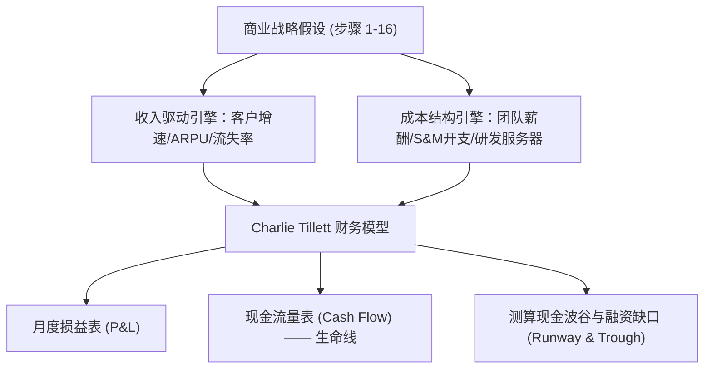

# Lec 17 整体财务规划 (Overall Financials)

> MIT 15.390 · New Enterprises · 模块五：财务建模与假设检验 · 主讲：Bill Aulet

## TL;DR

- 创业失败的直接物理死因有且仅有一条：账面现金耗尽（Running out of cash）。
- 整体财务模型不是空洞的远期预测，而是检验商业假设内在逻辑自洽性的沙盘引擎。
- Charlie Tillett 财务模型通过三张报表联动，精准推算现金波谷（Trough）、净烧钱率（Net Burn）与生存跑道（Runway）。
- 必须基于研发与商业里程碑规划融资节奏，始终维持 6 个月以上的最低安全现金缓冲。

## 财务模型的底层逻辑：利润是观点，现金是事实

许多工程师背景的创业者对财务建模抱有本能的轻视，认为“初创企业未来充满不确定性，预测 3 年后的财务数据毫无意义”。

Bill Aulet 与 MIT 驻校财务专家 Charlie Tillett 对此提出严厉纠偏：**投资人和董事会看财务模型，不是看你预测的数字准不准，而是看你商业假设的算账逻辑能否自洽**：
- 如果你预测第二年营收增长 5 倍，但销售费用预算只增长了 10%，你的模型就是自相矛盾的谎言；
- 如果你声称 6 个月内能拿下 50 家大企业客户，但每个客户的采购审批周期长达 9 个月，你的公司将在合同签下来之前因发不出工资而猝死。

::: definition 会计名言 (Cash vs. Profit)
“Profit is an opinion, but Cash is a fact.”（利润只是一种会计观点，而现金才是唯一的物理事实。）
损益表上的账面盈利无法直接发薪水，唯有躺在银行账户里的真金白银现金流，才能决定企业明天是否能够开门营业。
:::

## Charlie Tillett 财务模型结构拆解

Charlie Tillett 在 MIT Sloan 开发的创业财务电子表格（Financial Spreadsheet）被公认为初创企业从 0 到 1 建模的行业标杆。其核心模块包含：

### 1. 营收驱动引擎 (Revenue Drivers)
营收绝不能凭空拍脑袋，必须从底层运营动作自底向上推导：
- **销售团队产能（Sales Capacity）**：拥有几名一线全职销售代表（AE）？每名销售代表爬坡期结束后月均能完成几单？
- **客单价与付款节奏（Payment Terms）**：客户是按月支付、按年预付、还是拥有 90 天付款账期？
- **流失与续费（Retention & Expansion）**：既有存量客户的月度流失率是多少？老客户的增购率（Net Retention Rate）是多少？

### 2. 费用三驾马车 (Operating Expenses)
- **研发费用（R&D）**：工程师与架构师薪酬包、第三方云端算力（AWS/GCP/GPU 租用）、开源开发工具授权；
- **销售与营销（S&M）**：销售人员底薪与业绩提成、公关展会费、线上投放与客户拜访差旅；
- **行政管理（G&A）**：合规法务、财会审计外包、办公场地租金与商业保险。

## 核心现金流指标测算

在财务模型中，管理层必须时刻紧盯四大生命线指标：

### 1. 烧钱率 (Burn Rate)
- **总烧钱率 (Gross Burn Rate)**：企业每月现金总流出额（包括工资、房租、服务器费等一切支出）；
- **净烧钱率 (Net Burn Rate)**：企业每月现金的**净亏损额**：
  $$\text{Net Burn Rate} = \text{月度总现金流出} - \text{月度实际到账现金收入}$$

### 2. 现金跑道 (Runway)
企业在当前没有新资金注入的前提下，能够维持正常运营的剩余月数：

$$\text{Runway (Months)} = \frac{\text{当前银行可用现金储备}}{\text{Net Burn Rate}}$$

### 3. 现金波谷 (The Trough / Maximum Cash Required)
在企业实现月度经营现金流转正（Cash Flow Breakeven）之前，**累计净现金消耗的最大值**。这个波谷底部的绝对数值，直接决定了企业在种子轮与 A 轮中累计必须募集的最低融资金额（外加 25% 的安全垫）。

## 敏感性压力测试 (Sensitivity Analysis)

初创企业必须在 Excel 中进行极限压力测试，回答以下生死拷问：
- **情境一：销售周期翻倍**：如果原定 3 个月的销售审批周期被客户拉长到 6 个月，公司的现金波谷会加深多少？
- **情境二：客单价折让 30%**：如果为了在海滩阵地抢夺份额不得不打折，盈亏平衡点（Breakeven）会推迟几个月？
- **情境三：融资延期 6 个月**：如果宏观资本市场遭遇寒冬，VC 尽调周期拉长，团队是否有备用裁撤方案以确保现金撑到交割？

::: insight
**最好的融资时机是在你不需要钱的时候**。当你银行账户里还有 18 个月充裕跑道、关键业务指标正在健康翻倍时，投资人会排队给你送钱；而当你只剩 2 个月跑道、急需资金救命发工资时，投资人会借机开出极其严苛的腰斩估值或对赌清算条款。
:::

::: pitfall
在编制财务模型时，最致命的毒药是“曲棍球棒式的虚假暴增（Hockey Stick Projection）”——前 12 个月营收平平，第 13 个月突然毫无理由地呈现 90 度垂直向上暴涨。没有任何现实商业是这样运转的；脱离营销投入与销售人效支持的暴涨曲线，只会让专业投资人瞬间判定团队极度不成熟。
:::
