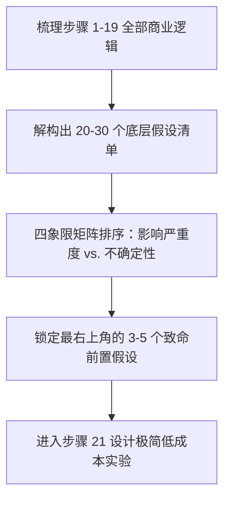
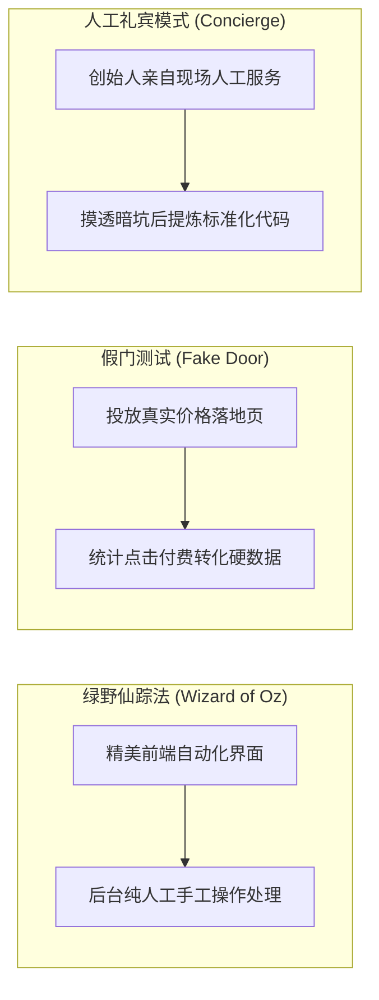

# Lec 18 识别并测试关键假设 (步骤 20-21) (Identify and Test Key Assumptions)

> MIT 15.390 · New Enterprises · 模块五：财务建模与假设检验 · 主讲：Bill Aulet

## TL;DR

- 步骤 20 系统性识别潜伏在商业计划底层的“未经验证关键假设”，涵盖成本、技术、客户行为与合规四大维度。
- 优秀的关键假设必须具备具体性、可量化性与可证伪性，通过“影响严重度 $\times$ 不确定性”矩阵锁定最致命的 3–5 个前置假设。
- 步骤 21 强调科学实验设计：采用绿野仙踪法（Wizard of Oz）、落地页假门测试与人工礼宾模式，以最低成本获取硬数据。
- 在未通过快速低成本实验排查致命风险之前，严禁投入巨资进行大规模重资产工程开发。

## 步骤 20：识别未经检验的关键假设 (Identify Key Assumptions)

许多技术创业者拥有极强的工程执行力，但他们最致命的盲区是：**直接把商业计划书中的“推测”当作“既定事实”，并基于这些未经检验的推测投入重金写代码或开模**。

在严谨创业法中，步骤 20 的核心任务是开展全面的**风险假说分解**：

::: definition 关键假设 (Key Assumption)
商业模式或产品成立所依赖的底层前提条件。若该假设被证明不成立，整个商业大厦将轰然倒塌，且无法通过简单的战术修补来挽救。
:::

### 必须严格排查的四大假设领域
1. **成本与技术可行性假设**：
   - 云端每千次推理的算力成本能否稳定压在 0.05 美元以内？
   - 算法在真实工业强电磁干扰环境下，误报率是否真能达到低于 1% 的可用门槛？
2. **客户行为与习惯改变假设**：
   - 客户是否真的愿意放弃使用多年的纸质表单，每天登录一个新网页录入数据？
   - 最终用户是否愿意为了节省 20% 的时间而承担新系统的学习曲线？
3. **决策与预算审批权限假设**：
   - 基层科室主任手中是否真有 5000 美元以内的自主免审批采购额度？
   - 购买我们的软件是否需要通过全院统一的 HIPAA/网络安全委员会长达一年的严格渗透测试？
4. **渠道与交付依赖假设**：
   - 第三方老旧 PACS 影像系统是否允许我们通过开放 API 接口无缝读取底层原始 DICOM 数据？

### 优秀假设的五大黄金特征
- **具体明确 (Specific)**：不能写“客户会喜欢我们的软件”，必须写“客户愿意连续使用 5 天且每天操作超过 3 次”；
- **可量化 (Measurable)**：设定明确的硬性数值门槛（如转化率 $\ge 8\%$）；
- **可证伪 (Falsifiable)**：必须存在能够明确判定“假设失败”的反向证据指标；
- **强相关 (Relevant)**：直接关乎单位经济学（LTV/COCA）或业务存亡；
- **有时限 (Time-Bound)**：必须能在 1–2 周内通过实验得出明确结论。

## 步骤 21：科学测试关键假设 (Test Key Assumptions)

识别出致命假设后，步骤 21 的原则是：**小步快跑、低成本、快速证伪（Fail fast and cheap）**。

传统的错误做法是花费 6 个月、耗资 50 万美元把完整产品开发出来，然后再去看假设是否成立。科学的创业方法是通过精巧的原型实验，在几周内以不到 1000 美元的成本获取决定性数据。

### 经典低成本测试战术体系

1. **绿野仙踪法（Wizard of Oz）**：
   - **机制**：前端向客户展示一个看起来高度智能、全自动运行的现代化软件界面；但在系统后台，根本没有任何算法后端，全靠创始人与实习生通宵手动录入数据、人工比对并生成分析报告发回给客户；
   - **目的**：先验证客户是否真的需要并珍视这个输出结果，待付费意愿得到铁证后，再投入资金将后端流程代码化。

2. **落地页假门测试（Landing Page Fake Door Test）**：
   - **机制**：搭建一个单页营销网站，清晰呈现高层产品规格与明确价格标签，页面核心位置放置“立即付费购买”或“预付 \$99 锁定首批交付”按钮；
   - **数据捕获**：当用户点击购买按钮后，弹出弹窗提示“首批内测名额已满，请输入邮箱进入候补名单”；
   - **目的**：通过真实的点击支付率与转化漏斗，以最小成本测试真实广告转化率与客单价接受度。

3. **人工礼宾服务模式（Concierge MVP）**：
   - **机制**：创始人亲自作为“专属顾问”进驻客户现场，完全依靠人工提供端到端的一揽子服务；
   - **目的**：在不写一行代码的情况下，近距离摸清客户工作流程中的每一个隐秘暗坑与突发异常。

## 设立止损线与科学反思机制

在启动实验前，团队必须白纸黑字写下**预设成功阈值（Success Criteria）**：
- 例如：“向 100 家目标诊所发出附带报价的宣传单，若点击预订咨询的诊所少于 5 家，则证明假设不成立”；
- 严禁在看到惨淡数据后事后找借口修改合格标准（“虽然只有 1 家预订，但那家态度非常好，所以算通过”）。

::: insight
**证伪一个致命假设是巨大的商业胜利**。如果你花 500 美元和一周时间证明了“独立影像中心根本没有独立购买预算”，你刚刚为团队和投资人挽救了未来两年的青春与数百万美元的亏损。科学创业的本质是在低成本试错中不断逼近商业真相。
:::

::: pitfall
小心“分析瘫痪（Analysis Paralysis）”。很多完美主义团队花费几个月时间罗列了上百个琐碎假设，却迟迟不敢走出办公室设计第一个实验。挑出最致命的 3 个假设，立刻用最粗糙但最直接的方式展开测试。
:::
