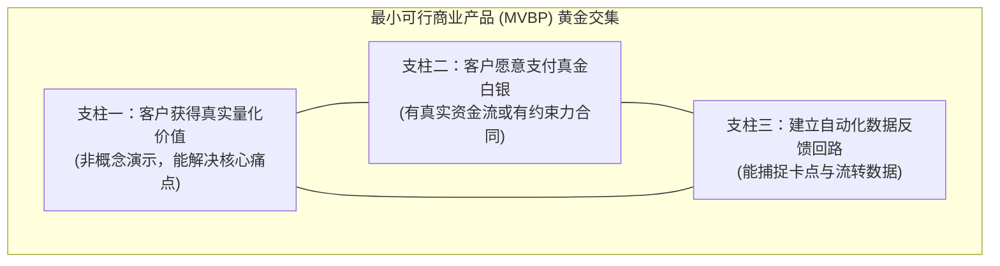
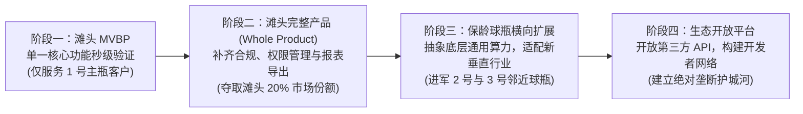

# Lec 19 定义最小可行商业产品 (MVBP) 与成功指标 (步骤 22-24) (Define MVBP and Metrics of Success (Steps 22-24))

> MIT 15.390 · New Enterprises · 模块五：财务建模与假设检验 · 主讲：Bill Aulet

## TL;DR

- 步骤 22 定义最小可行商业产品（MVBP），必须同时满足三大铁律：客户获得实际价值、客户为之真实付费、建立完整数据反馈闭环。
- 步骤 23 实证检验“狗愿意吃狗粮”（Dog Food Test），通过高频自主使用、净推荐值（NPS）与无强迫主动续费等硬指标验证真需求。
- 步骤 24 制定长期产品演进路线图，严格遵循保龄球瓶战略，规划从滩头核心单品向完整产品与后续市场的演进路径。
- 坚决杜绝“功能镀金（Feature Creep）”与“第二系统综合征”，保持产品的极端精简与快速交付。

## 步骤 22：定义最小可行商业产品 (MVBP)

在硅谷，“MVP（Minimum Viable Product）”是一个被极其滥用的词汇。许多团队把 Bug 百出的半成品或一个粗糙的 PPT Demo 当成 MVP，宣称“根据精益创业理论，只要上线就算成功”。

Bill Aulet 对此严厉驳斥，并在 MIT 15.390 中确立了更为严肃的概念：**MVBP（Minimum Viable Business Product，最小可行商业产品）**。

::: definition 最小可行商业产品三大铁律 (The 3 Pillars of MVBP)
一个合格的商业产品（而非实验室科研玩具），必须同时满足以下三大绝对支柱：
1. **客户能从中获得明确的量化价值（Real Value）**：系统必须能真正解决 Persona 的第一核心痛点，帮助客户节省时间、降低成本或提升业务收入；
2. **客户愿意为此支付真金白银（Customer Pays）**：客户真正掏出企业信用卡付款、签署具备法律效力的对公采购订单（PO），或者支付一笔不菲的意向定金；
3. **建立了快速的数据反馈回路（Feedback Loop）**：系统能够实时捕捉客户的使用行为、调用频率与出错日志，为下一轮敏捷冲刺提供客观证据。
:::



### 坚持“极小（Minimal）”的残酷裁剪法则
- 软件工程师最容易患上“功能镀金症（Feature Creep）”：总觉得再加一个面板、再加一个导出格式才能给客户看；
- **极简原则**：把所有“看起来很酷但与 Persona 第一优先级无关的功能”全部无情砍掉；如果产品上线时没有让团队感到一丝简陋带来的尴尬，说明产品发布得太晚了。

## 步骤 23：实证检验“狗愿意吃狗粮” (Dog Food Test)

商业界有一句著名的讽刺谚语：一家宠物食品公司请了顶级广告大师、设计了极其奢华的包装盒、烧了数百万美元打电视广告，但公司最终依然破产倒闭。原因只有一个：**狗不肯吃这种狗粮**。

在严谨创业法第 23 步中，团队必须拿出无可辩驳的量化硬数据，证明你的目标客户真的在日常工作中离不开你的产品：

```text
[验证客户真实采用度的四大硬核指标]
1. 依赖度与使用频次 (Engagement & Frequency)
   - 在没有团队任何电话催促的情况下，客户是否每周主动登录系统并在核心功能上停留？
2. 任务完成率 (Task Completion Rate)
   - 用户能否独立操作并顺利导出预期结果，还是在某一步卡死后直接关掉网页？
3. 净推荐值 (Net Promoter Score, NPS)
   - 询问受访者：“你有多大可能向同行同僚极力推荐本产品？(0-10分)”
   - 滩头阵地内合格的初创产品，其 NPS 通常应维持在 +50 以上。
4. 无强迫的主动续费率 (Spontaneous Retention & Renewal)
   - 免费测试期结束后，当系统弹出“试用期满，请输入信用卡支付续费”时，有多少比例的客户毫不犹豫完成了扣款？
```

::: insight
**虚假的使用往往比彻底的冷漠更具欺骗性**。很多时候，因为客户是创始人的校友、朋友或熟人，对方出于礼貌让实习生每天在网页上点几下，制造出活跃的虚假繁荣。测试的唯一黄金标准是：**当系统出现故障短暂下线半小时时，客户是否会极其抓狂地给你打电话质问？如果他们根本没发现系统挂了，说明你对他们可有可无**。
:::

## 步骤 24：制定长期产品演进规划 (Develop a Product Plan)

在 MVBP 获得初步真金白银验证后，团队不能停滞不前，必须制定一份跨越 24–36 个月的**长期产品演进路线图（Product Roadmap）**：



### 规避“第二系统综合征” (The Second System Syndrome)
初创团队在交付了成功的轻量 MVBP 后，在规划第二代产品时极易产生盲目自大：
- 试图将所有过去没能实现的庞大架构、多租户微服务、全自动化分布式部署全塞进第二代系统中；
- 导致第二代产品研发周期无限拖延，整整一年无法交付新特性，最终被轻装上阵的后续竞争对手弯道超车；
- 正确的工程规划必须坚持**小步快跑、持续集成、增量重构**，绝不搞一次性推倒重来的冒险大跃进。

::: pitfall
千万不要在第一阶段就试图为“未来的可能需求”过度设计底层架构。不要在只有 50 个用户的时候去预先搭建能够承受 1000 万人并发的高可用集群。在初创期，**浪费工程资源去过早优化根本不存在的规模问题，是对资本和时间的极大犯罪**。
:::
