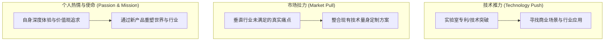

# Lec 2 Pitch2Match 速配路演与组队、启动黑客挑战赛 (Pitch2Match & Team Building Kick Off Hack Challenge)

> MIT 15.390 · New Enterprises · 模块一：创业启航与创意初筛 · 主讲：Bill Aulet

## TL;DR

- 创业启航（Step 0）源自技术推力、市场拉力与个人使命三大驱动力，但创业成败的核心决定因素在于团队而非孤立构想。
- 创始人典型画像包含苏西商业型（Susie Suit）、汤米技术型（Tommy Tech）与邦妮平衡型（Bonnie Balance），异质互补是化解组织风险的基石。
- Pitch2Match 机制通过 60 秒限时路演与高频速配，帮助学生在价值观、愿景与时间承诺上实现深度对齐。
- 启动 48 小时黑客挑战赛（Hack Challenge），倒逼团队通过低保真原型与线框图快速实战磨合，完成从临时结对向行动共同体的跨越。

## 步骤 0：创业启航驱动力与团队构建

在正式步入 24 步之前，Bill Aulet 提出了**第 0 步（Step 0: Getting Started）**。创业者通常因以下三大驱动引擎之一而踏入征程：



### 创意先来还是团队先来？(Which Comes First?)

创业者常常争论：究竟是应该先有一个绝妙的想法，再去寻找团队；还是先组织一支卓越的团队，再共同探索想法？

MIT 的实证研究得出了明确结论：**创业是一项团队运动（Team Sport）**。
- 单打独斗的创业者（Solo Founders）在面对技术攻关、销售拓客、融资受挫与法律风险时，极易因精力透支与认知盲区而崩溃。
- 一支具备高度互补技能与共同价值观的创始团队，即便最初的想法被证明不可行，也能快速调头转向（Pivot），在同一赛道内找到真正的生机。

## 创始人三大人格画像与互补模型

在组队过程中，Bill Aulet 将商学院与工学院的学生划分为三类经典画像：

::: definition 创始人三大人格画像
1. **苏西商业型 (Susie Suit)**：擅长商业分析、财务建模、商务拓展、市场调研与路演表达。弱点是对底层技术实现细节缺乏直觉，容易轻信过于乐观的技术交付排期。
2. **汤米技术型 (Tommy Tech)**：掌握核心硬科技、代码架构、算法与硬件工程。弱点是往往轻视销售、市场营销与法律合约，容易抱有“只要产品够好，客户自然会来”的技术自负。
3. **邦妮平衡型 (Bonnie Balance)**：具备复合学科背景（如工程+管理），兼通技术架构与商业运作，能够在工程师、客户与投资人间充当翻译官与粘合剂。
:::

```text
[Susie Suit (商)] <====== 信任与分工 ======> [Tommy Tech (技)]
            \                                /
             \                              /
              \===> [Bonnie Balance (桥)] <=/
```

::: insight
最脆弱的初创团队是由三个背景完全相同的“汤米”或三个“苏西”组成的同质团队。三个汤米的悲剧是把所有时间花在重构完美的代码架构上，直到账面资金耗尽也没有走出实验室接触真实客户；三个苏西的悲剧是产出了一份精美绝伦的商业计划书，却没有任何人能写出第一行代码或焊好第一块电路板。
:::

## 创意日志（Idea Log）与高产出脑暴法则

为了摆脱“无想法可创”或“死守单一狭隘想法”的困境，课程要求每位学员在课前完成至少 20 个商业构想的**创意日志（Idea Log）**。高产出构想的挖掘路径包括：

1. **工作与学术痛点沉淀**：自己在实验室、前雇主公司或日常科研中，每天重复且极其厌恶的低效环节是什么？
2. **监管与宏观政策突变**：近期出台的行业新规、环保政策或税收法案，强制企业改变了哪些既有业务流程？
3. **技术成本拐点到来**：传感器、大语言模型推理或储能成本的大幅断崖式下跌，让曾经经济上不可行的哪些场景突然变得有利可图？
4. **反向移植与交叉套利**：在某一行业（如消费互联网）已经被验证的成熟协同交互工具，能否降维移植到落后的传统工业（如建筑工地或农业采摘）？

针对每个构想，必须填写五维结构化评估卡：
- **形态**：它究竟是 SaaS 软件、智能硬件模组、API 还是咨询代运营？
- **功能**：它将哪项具体指标改善了多少？
- **买家**：谁是最终用户，谁是最终付钱的人？
- **商业模式**：一次性购买、按月订阅还是交易抽成？
- **核心差异**：对标现有替代方案（包括用 Excel 和人工），客户非换不可的动力何在？

## Pitch2Match 极速速配机制

为促成异质技能的高效匹配，课堂采用 **Pitch2Match** 机制：
1. **60 秒电梯路演（Elevator Pitch）**：每位拥有初步构想的学员上台，用且仅用 60 秒陈述：痛点是什么、目标受众是谁、期望寻找什么样技能背景的联合创始人。
2. **速配走动（Speed Dating Rounds）**：全场学员根据技术栈与商业兴趣进行多轮 3 分钟高频一对一沟通。
3. **期望与承诺审查**：在达成组队意向之前，必须就每周投入时长、全职意愿、决策权力边界与股权分配心理底线展开坦诚对齐，严防后期反目。

## 启动黑客挑战赛 (Hack Challenge)

组队完成后，课程立即启动 48 小时**黑客挑战赛（Hack Challenge）**。该挑战赛的目标不是交付可上线的完美系统，而是强制团队进行压力测试：
- **目标**：选定团队最具共识的一个现实痛点，共同设计解决方案的低保真原型（Lo-Fi Prototype）或可交互线框图（Wireframe）。
- **交付要求**：在下一讲展示清晰的客户问题场景、用户操作流程步进、解决方案的核心界面/硬件示意图，以及团队成员之间的分工记录。

::: pitfall
组队时切忌“面子文化”和“顺从陷阱”：很多学生出于礼貌，与第一个向自己示好的人草草组队，却隐瞒了自己在工作投入度或长期愿景上的根本分歧。黑客挑战赛正是为了通过短期高强度的实际协作，让潜在问题在第一周就暴露出来。
:::
