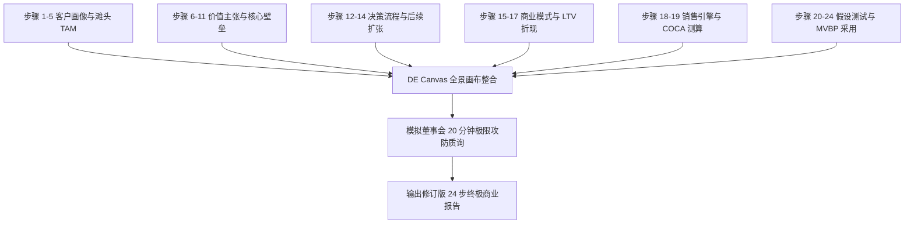

# Lec 20 模拟董事会会议 (步骤 1-24 及 DE 画布应用) (Mock Board Meetings (Steps 1-24 plus using DE Canvas))

> MIT 15.390 · New Enterprises · 模块六：模拟董事会与实战路演 · 主讲：Bill Aulet

## TL;DR

- 模拟董事会会议是对严谨创业法全部 24 步成果的终极大合拢，强制检验全盘商业逻辑的闭环自洽性。
- 借助一页纸 DE 画布（DE Canvas），系统排查跨模块冲突，如长销售周期与短现金跑道、高获客成本与低毛利定价等隐形死穴。
- 由顶级风险投资人与产业领袖组成的董事会就“单位经济学真实性、核心防御力与 MVBP 真实付费凭据”展开穿透式质询。
- 团队必须全面消化董事会严苛反馈，完成步骤 1–24 最终商业蓝图的系统性修订，为终期大路演做好临战准备。

## 模拟董事会的终极使命：全局商业自洽性大检阅

如果说期中模拟董事会（Lec 12）是针对前 11 步的“中期体检”，那么本讲的模拟董事会则是针对 **全套 24 步严谨创业法体系的“终极压力对抗”**。

在真实的商业世界中，许多初创项目在各个单项上表现极其优异（拥有顶级的科研论文、精美的前端线框图、热情的客户访谈口头支持），但一旦将这些模块拼装在一起，就会瞬间暴露出**严重的内在逻辑断层（Internal Inconsistencies）**。

本次董事会会议的唯一目的：**在团队真正将产品推向不可逆的大规模市场前，通过高压模拟把全盘商业计划中的所有暗雷彻底引爆**。

## 核心分析武器：DE 画布 (Disciplined Entrepreneurship Canvas)

为了在极短时间内穿透复杂的商业系统，团队必须在会前完成并呈送一份一页纸 **DE 画布（DE Canvas）**。

DE 画布将 24 个离散步骤有机压缩在六大互动板块中，任何一处的变动都会立即在其他板块引发多米诺骨牌效应：

::: definition DE 画布四大交叉审计核验 (Canvas Cross-Audit Checks)
1. **核验一：TAM 与 LTV 逻辑匹配度 (Steps 4 & 17)**：
   步骤 4 中假设每个客户每年支付 5 万美元，而步骤 17 算出的 LTV 是否合理体现了这一现金流？还是在计算 LTV 时暗中假设了无法兑现的 90% 极高毛利率？
2. **核验二：销售周期与现金跑道死锁 (Steps 13 & 17)**：
   步骤 13 描绘的机构客户审批流（DMP）平均需要 9 个月，而步骤 17 的财务模型中账面现金跑道只够支撑 6 个月。这意味着在第一笔客户回款进账前，公司已经断粮倒闭！
3. **核验三：核心壁垒与竞争定位真实性 (Steps 10 & 11)**：
   团队在步骤 10 声称自己的 Core 是“深厚的算法 IP”，但在步骤 11 的定位图中却将自己放在“服务响应更快”的维度上。内部核心能力与外部客户感知产生严重错位；
4. **核验四：单位经济学黄金比例铁律 (Steps 17 & 19)**：
   严格检验 $LTV$ 是否真正达到 $COCA$ 的 3 倍以上，且资本回收期是否严格压在 12 个月以内。
:::

## 董事会高阶穿透式质询交锋实录

在本次模拟董事会中，外部评委不再纠结于基础的理论定义，而是直接针对商业计划书的软肋发起凌厉攻势。一个极具代表性的质询交锋场景如下：

> **董事（顶级早期风险投资机构合伙人）质询**：  
> “请全体翻到商业计划书第 19 页。你们测算的获客成本（COCA）是 \$12,000，而客户终身价值（LTV）是 \$48,000，表面看正好满足 4 倍法则的健康区间。但我注意到，你们的获客模型完全建立在‘电话内勤销售（Inside Sales）’的假设之上。  
> 
> 可你们在步骤 12 的决策购买单元（DMU）中明确写道：买方包括医院副院长、IT 合规主管和设备采购委员会。试问：全美有哪家综合医院的副院长会仅仅通过接听你打来的远程推销电话，就批复 5 万美元的年度服务合同？你们必须派出销售经理飞到现场做面对面高触碰销售。如果把来回机票差旅、售前工程师驻场调试费和销售代表底薪全部算进去，你们的真实 COCA 至少是 \$50,000。这直接意味着你们卖一单亏一单，商业模式瞬间变成净亏损！你们打算怎么向董事会解释这个致命漏洞？”

> **CEO 现场答辩策略**：  
> “董事指出的问题直击我们要害，这正是我们在第二轮实地外勤调研中发现的最严重阻力。为了解决高额现场差旅推高 COCA 的问题，我们已在会前对海滩阵地进行了二次收敛重构：  
> 
> 我们果断放弃了层级森严、审批极其漫长的大型公立三甲医院，转而攻坚决策链极短的‘私立连锁影像诊所’。在私立诊所中，诊所创始人即是唯一买家，通过远程 Zoom 演示与沙箱测试即可完成签约，从而将销售周期从 9 个月压缩至 28 天，确保真实获客成本完全收敛在预测区间内。”

## 董事会答辩的三大攻防准则

在董事会的高压质问下，团队的现场表现将直接决定投资人的信任评级：
1. **数据归位，杜绝泛泛而谈**：回答问题绝不使用“我认为”、“理论上来说”等空洞主观词汇，必须直接调用数据：“根据我们在步骤 9 中与 10 位客户面对面签署的意向书，其中 7 家明确确认了……”；
2. **直面软肋，展示迭代进化力**：当董事指出致命缺陷时，优秀团队不会强词夺理，而是展现敏捷反应力：“董事的判断非常敏锐，这确实是模型中最脆弱的环节。为此我们设立了两个应急方案……”；
3. **展示真实的 MVBP 现金流或强约束凭据**：在幻灯片中直接贴出真实客户支付的小额订金收据、签署的正式试点协议扫描件，以硬事实终结一切理论层面的质疑。

::: insight
一个平庸的创业者害怕被董事会挑刺，以为董事会是考官；**顶尖的创业者则把董事会视为免费的顶级战略智囊团**。如果能在董事会上借助全球最聪明的投资大脑，免费替你排查出 3 个足以致命的商业逻辑地雷，这是初创企业能获得的最大战略财富。
:::

## 课后行动：整合终版步骤 1-24 商业蓝图

董事会会议结束后，团队必须连夜召开复盘闭门会：
- 逐条梳理董事会评委在评分表上留下的批注；
- 重新计算被质疑的财务模型与获客参数；
- 提交 **修订后的步骤 1–24 完整版整合幻灯片**，作为期末商业实战大路演的终版基准材料。

::: pitfall
在修改步骤 1–24 整合材料时，切忌“按下葫芦浮起瓢”——修补了步骤 19 的获客成本参数，却忘记同步修改步骤 17 的财务模型和步骤 18 的人员预算。专业投资人会在 10 秒钟内抓住前后数字不一致的破绽，从而彻底怀疑整份商业方案的严谨性。
:::
