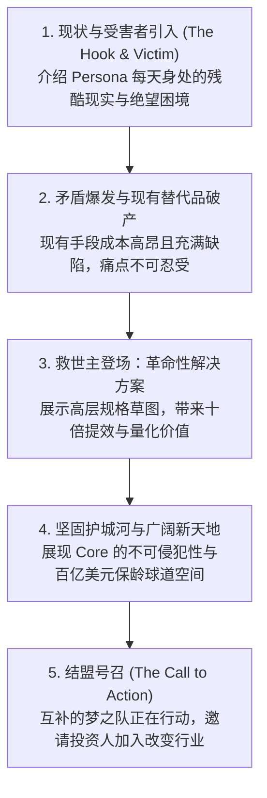

# Lec 21 团队间模拟董事会、人力资源计划讨论、全局整合与路演呈现技巧

> MIT 15.390 · New Enterprises · 模块六：模拟董事会与实战路演 · 主讲：Bill Aulet

## TL;DR

- Charlie Tillett 人力资源模型强制将业务目标翻译为具体的人力招聘时间线，严格计入 1.25–1.35 倍的全额用工成本（Fully-Loaded Cost）。
- 建立规范的 4 年动态股权兑现机制（4-Year Vesting with 1-Year Cliff）并预留 10%–15% 期权池，筑牢团队长期利益共同体。
- 掌握商业叙事的故事板（Storyboard）与经典戏剧叙事弧线，将冰冷的 24 步数据转化为打动投资人的高感染力英雄旅程。
- 精通 5 分钟路演标准结构与呈现气场，为即将到来的期末终极商业大路演完成最后一次团队间高压预演。

## Charlie Tillett 人力资源配置模型 (Staffing & HR Plan)

许多初创企业在编制财务模型时，最容易出现脱节的就是**团队招聘规划**：既低估了招募人才的真实耗时，又低估了真实用工成本。

Charlie Tillett 强调，团队必须将步骤 18 的销售扩展引擎与步骤 24 的产品演进路线图，严格转化为**月度人员配置计划（Headcount & Staffing Plan）**：

### 全额用工成本测算公理 (Fully-Loaded Cost)
- **致命盲区**：很多创始人以为招聘一名年薪 10 万美元的软件工程师，公司一年的开销就是 10 万美元；
- **真实财务公理**：员工的实际综合成本通常是其**名义底薪的 1.25 至 1.35 倍**：
  $$\text{Fully-Loaded Cost} = \text{Base Salary} + \text{社保公积金/商业医保 (15\%–20\%)} + \text{办公工位/软硬件津贴} + \text{招聘佣金摊销}$$
  这意味着一名 10 万美元的员工，公司每年的实际现金流出高达 13 万美元左右。

### 创始人股权动态兑现与期权池 (Vesting & Option Pool)
无论合伙人私交多么深厚，在进入期末路演与外部融资前，必须在法律层面落实规范的股权结构：
1. **4 年兑现伴随 1 年悬崖（4-Year Vesting with 1-Year Cliff）**：
   - 第一年内离职，所获股权为 0；
   - 满 12 个月整当天一次性解锁 25%，随后 36 个月按月平均线性解锁（每月解锁 1/48）；
   - 该机制彻底防范了某位合伙人在公司创立半年后甩手离开、却继续永久持有公司三分之一原始股的灾难局面；
2. **早期员工期权池（ESOP Pool）**：
   - 在种子轮融资前，在股权结构表中预留 **10% 至 15% 的未分配期权池**，专门用于未来 18 个月内吸引资深架构师或顶级销售主管加盟。

## 商业叙事与故事板 (Storyboarding & Narrative Arc)

投资人每天要审查数十份路演方案。如果你的汇报只是一板一眼地背诵“步骤 1 是什么、步骤 2 是什么”，受众会在 60 秒内陷入审美疲劳。

**顶尖的创始人都是卓越的商业故事大师（Storytellers）**。商业路演的本质是经典戏剧学中的“英雄之旅（Hero's Journey）”：

### 故事板（Storyboard）设计要领
在打开 PowerPoint 制作幻灯片之前，先用 6 张便利贴在白板上画出故事板的关键分镜：
- **画面一（开场钩子）**：展示一张令人窒息的现场真实照片（如医生被海量胶片淹没、或工厂停机警报闪烁），用真实故事抓住全场眼球；
- **画面二（核心冲突）**：量化痛点损失，指出这是行业数十年来无法根治的痼疾；
- **画面三（灵感突破）**：展示你们的独特创新视角，以及它为何能以极简方式解决问题；
- **画面四（实证硬数据）**：展示 10 家种子客户的真实反馈与早期现金流回款凭据；
- **画面五（战舰远航）**：展现从滩头阵地向全球万亿级市场的保龄球扩张蓝图；
- **画面六（行动契机）**：明确本次融资规模与达成下一个关键里程碑的具体承诺。

## 经典 5 分钟投资人路演标准架构

期末大路演严格限制在 **5 分钟（300 秒）** 内。标准幻灯片结构精炼为 10 页，每页传达一个核心信息：

| 顺序 | 幻灯片模块 | 核心传达信息 | 建议分配时间 |
| :---: | :--- | :--- | :---: |
| **01** | **封面与定位 (Title & Hook)** | 公司名称、一句话定位口号（One-Liner）与演讲人介绍 | 20 秒 |
| **02** | **剧烈痛点 (Problem & Persona)** | 具象化 Persona 的日常痛苦，指出不可忍受的现实损失 | 40 秒 |
| **03** | **解决方案 (Solution & Spec)** | 高层产品规格示意图，阐明产品如何直观解决核心痛点 | 40 秒 |
| **04** | **量化价值 (Value Proposition)** | 现状（As-Is）vs 采用后（Possible）的不可辩驳量化收益 | 30 秒 |
| **05** | **滩头与市场 (Beachhead & TAM)** | 自底向上测算的滩头 TAM 与后续保龄球扩张空间 | 30 秒 |
| **06** | **商业模式 (Business Model)** | 定价策略、收费机制、单位经济效益 ($LTV > 3 \times COCA$) | 30 秒 |
| **07** | **核心壁垒 (The Core)** | 为何对手投入 10 倍资本与人力也无法在短期内轻易复制 | 30 秒 |
| **08** | **早期牵引力 (Traction & Proof)** | 真实客户付费采用证据、PMR 访谈意向书与 NPS 指标 | 40 秒 |
| **09** | **创始团队 (Dream Team)** | 3H 角色互补基因、过往硬核技术积累与执行力证明 | 20 秒 |
| **10** | **融资需求与里程碑 (The Ask)** | 融资金额、未来 18 个月核心使用规划与估值跳跃节点 | 20 秒 |

## 团队间模拟董事会互评与路演压力演练

在课堂实操环节，各创业团队两两结对，开展高强度的**同侪交叉质询（Peer-to-Peer Review）**：
- A 组上台进行 5 分钟脱稿路演，B 组扮演最苛刻的红杉资本投资人进行现场发难；
- 随后两组角色互换，并依据《15.390 路演评分量规》就**叙事感染力、逻辑严密性、数据可信度与答辩从容度**互相给出尖锐评语。

::: insight
**舞台上的从容自信，来自台下一百次对商业常识的千锤百炼**。凡是讲不清楚、超时或被问倒的路演，表面看是口才问题，底层都是商业逻辑存在漏洞。当你的 24 步每一个数据都有真实客户背书时，你的声音自然拥有穿透全场的力量。
:::

::: pitfall
路演时切忌把幻灯片当成提词器念稿。观众能在 3 秒钟内看完幻灯片上的所有字，如果演讲人只是把屏幕上的文字读一遍，路演将彻底失去魅力。幻灯片只放图表和核心结论，演讲人负责输出故事、激情与深层洞察。
:::
