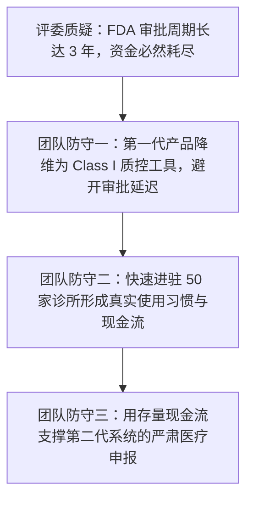

# Lec 22 期末路演展示 (Final Presentations I)

> MIT 15.390 · New Enterprises · 模块六：模拟董事会与实战路演 · 主讲：Bill Aulet

## TL;DR

- 期末商业大路演上半场正式开打，首批创业团队登台接受顶级风险投资人与产业领袖的实弹质询。
- 严格执行“5 分钟脱稿路演 + 8 分钟评审交锋”规则，全方位考核商业叙事感染力与 24 步底层数据硬核度。
- 评审团聚焦“真实客户买单证据、巨头进场防御力与团队全职创业决心”展开高密度穿透式提问。
- 舞台控场实战表明：沉着应对突发故障、直面商业软肋并展现敏捷迭代潜力的团队，最能赢得资本的青睐。

## 期末商业大路演实战舞台

经过整整一个学期对 24 步严谨创业法的刻苦操练，MIT 15.390 迎来了高潮环节：**期末商业实战大路演（Final Venture Presentations）**。

与一般学术课程的期末考试不同，15.390 将讲堂彻底改造为硅谷与波士顿的顶级创投路演大厅：
- **评审团阵容**：邀请来自顶级风险投资机构（如 Sequoia、Bessemer Venture Partners、Matrix Partners）、知名天使投资人网络与 Techstars 加速器的合伙人亲自担任现场评委；
- **极限时间控制规则**：每支团队有且仅有 **5 分钟（300 秒）** 完成全套商业构想展示，大屏幕配备严格的倒计时钟；超时 1 秒立即掐断麦克风；
- **8 分钟实弹质询（Live Cross-Examination）**：评委现场直接就商业模式最薄弱环节发起尖锐交锋，检验创始人真实心力。

## 首批典型项目路演实录与质询交锋

在第一场路演中，涉及医疗健康、工业自动化与垂直企业软件的多支代表性团队率先登台：

### 典型案例：ScanAI 医疗影像智能筛查平台

> **团队路演亮点 (5 分钟精要)**：  
> “全美每年有超过 8000 万人次接受肺部低剂量 CT 筛查，但全职放射科医生缺口达 30%。我们深度调研了波士顿 12 家独立影像中心，塑造了 Persona——Dr. Sarah Lin。她每天疲于奔命阅读 80 份胶片，晚班疲劳状态下漏诊率高达 12%。  
> 
> 我们的解决方案是一个即插即用的本地影像预筛挂件，45 秒内高亮微小结节并自动生成诊断报告初稿，每天为医生释放 4 小时科研时间。经过步骤 9 验证，已有 8 家私立诊所签署了无偿试用协议，2 家诊所签署了带定金的正式意向书（LOI）。  
> 
> 我们的滩头阵地是全美 2200 家私立影像中心，TAM 为 3800 万美元；后续保龄球扩张将切入体检连锁与公立医院，潜在总额达 25 亿美元。核心壁垒在于与麻省总医院联合建立的高壁垒私有标注数据飞轮。本次计划寻求 150 万美元种子轮融资，在未来 18 个月内拿下滩头阵地 15% 市场份额。”

> **评委尖锐质询与团队攻防**：  
> **评委 A (早期医疗 VC 合伙人)**：“你们展示的准确率指标非常惊人。但根据 FDA 医疗器械监管法案，任何用于辅助筛查肺结节的 AI 系统必须通过 510(k) 甚至 PMA 临床审批。你们的团队全是一线计算机博士，没有任何人具备医疗器械法规事务（RA/QA）经验。你们在财务模型里预留的 50 万美元申报预算和 18 个月审批周期完全不切实际，可能需要 3 年以上！你们怎么度过这段监管断崖？”  
> 
> **CEO 现场从容应答**：“评委点出了我们项目最根本的政策壁垒。这正是我们在步骤 22 定义最小可行商业产品（MVBP）时做出的核心战略妥协：**我们的第一代系统坚决不向医生提供‘诊断建议’，而是定位为‘影像质量质控与病灶高亮放大工具’**。根据现行 FDA 指南，纯质控工具属于豁免类（Class I），无需漫长的 PMA 临床试验。我们利用这套轻量工具先进入 50 家诊所建立日常黏性并产生现金流，同时用产生的现金储备聘请了前飞利浦法规总监作为独立顾问，正式启动二类医疗器械的申报流水线。”

## 舞台突发危机应对与临场控场艺术

在万众瞩目的实战大路演中，不可预测的突发事故屡见不鲜：
- **翻页器失灵或屏幕死机**：顶尖创始人绝不慌乱地摆弄电脑，而是面带微笑直接脱稿走到台前，用纯粹的眼神接触与生动故事继续掌控全场；
- **评委中途严厉打断质疑**：弱小团队会不知所措或面红耳赤；优秀团队则礼貌倾听并记下问题核心，在 10 秒内切入关键证据回应，随后迅速拉回既定的叙事主线；
- **关键数据被挑出笔误**：坦诚致谢并大方承认计算口径微调，绝不当场编造新谎言。

::: insight
**投资人投的从来不是一份完美无瑕的商业计划书，而是投能够在狂风暴雨中掌控航船的船长**。在路演中出现小意外甚至被评委尖锐挑刺并不可怕；你在面临质疑那一瞬间所展现出的心理韧性、眼神专注度与团队凝聚力，才是专业投资人评估你是否具备企业家特质（Grit）的核心考量。
:::

::: pitfall
切忌在路演结束被评委提问时“全员抢话”。如果一个问题抛出后，CEO、CTO 和 CMO 同时抢着开口，甚至在台上当着投资人的面各抒己见产生分歧，投资人会瞬间判定该团队内部治理极其混乱，当场在评分表上给出零分。
:::
