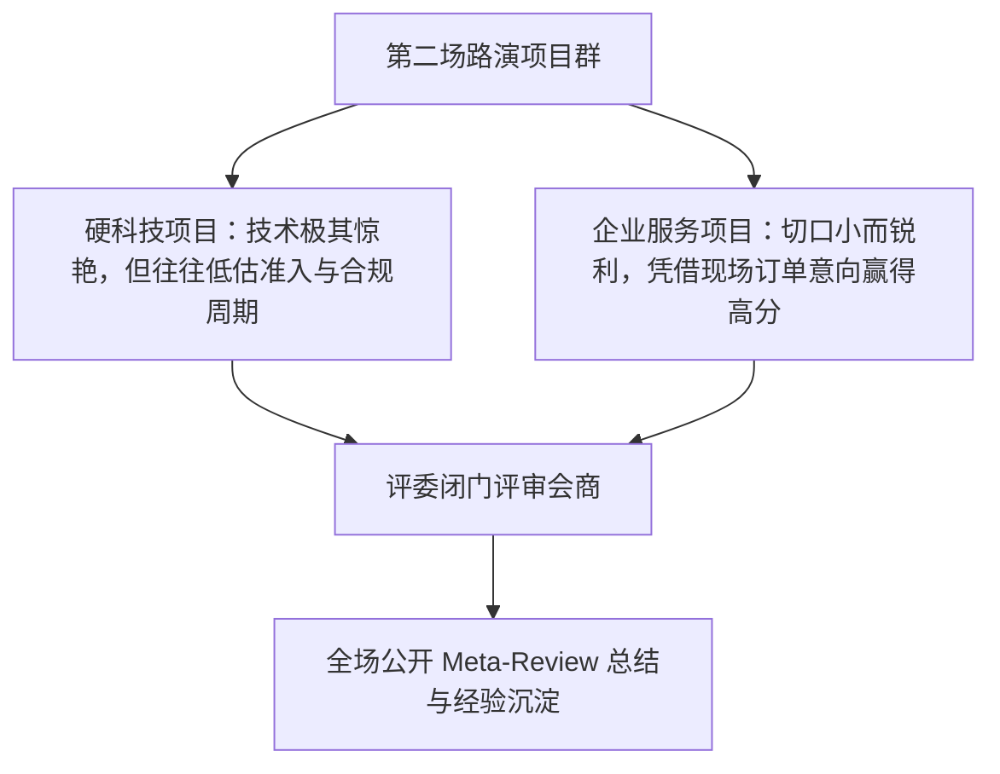

# Lec 23 期末路演展示 (Final Presentations II)

> MIT 15.390 · New Enterprises · 模块六：模拟董事会与实战路演 · 主讲：Bill Aulet

## TL;DR

- 期末商业大路演下半场圆满落幕，后续硬科技、新材料与企业服务团队完成 5 分钟极限路演答辩。
- 评审团展开闭门会商与全场深度复盘，指出创业成败的分水岭在于“真实用户付费证据”与“对非核心诱惑的克制聚焦”。
- 启动全员匿名 360 度同侪互评（Peer Review）机制，依据出勤、交付质量与承诺契约评估合伙人真实贡献度。
- 全体团队必须在规定截止时间前提交包含完整 HR 计划与董事会答辩修订意见的终版 24 步整合商业蓝图。

## 下半场路演实况与跨赛道项目横评

在第 23 讲中，第二批创业团队登台完成了各自的 5 分钟极限路演。本场项目涵盖先进制造、新材料配方、工业声学传感与企业底层工具链等多个硬核技术领域。

### 典型跨赛道项目实战切片

1. **分布式光纤声波工业周界安防系统**：
   - **技术卖点**：利用既有通信光纤实现长达 50 公里的微小振动实时入侵定位；
   - **评委现场穿透**：“你们把滩头市场定为边境巡防与国家电网。请问你们知不知道国防采购需要 3 年的最高涉密资质审查？你们目前的账面跑道只有 6 个月，你们靠什么活过这 3 年？”
   - **战略复盘**：团队的技术极其惊艳，但对大型机构政府采购的漫长周期（DMP）严重缺乏准备，被评委一针见血点出了现金流致命陷阱。

2. **工业级 3D 打印航空专用耐高温陶瓷喷嘴**：
   - **技术卖点**：自主专利纳米复合陶瓷浆料，可在 1600℃ 超高温下持续稳定服役；
   - **评委肯定与建议**：“你们精准锁定了通用电气（GE）航空发动机某外协工厂的具体痛点，并拿到了厂长亲自签字的试用报告，这是极度坚实的牵引力（Traction）。建议立刻以该合同为抵押锁定天使轮融资。”

## 评审团闭门总评与深度洞见 (Judges' Meta-Review)

全部团队路演结束后，由 6 位顶级风险投资人与产业专家组成的评审委员会进行了闭门打分会商，随后向全场同学输出了珍贵的宏观创业洞见：

::: definition 投资人眼中的优质创业者特质 (The Winning Profile)
1. **真实扎实的一手调研证据（Grounded in Reality）**：获得最高分数的团队，从来不是 PPT 做得最花哨的团队，而是把在现场踩坑、被客户拒绝、最终找到真实付费痛点的全过程坦诚呈现的团队；
2. **极端的聚焦与克制（Extreme Focus）**：敢于对大而全的千亿市场坚决说“不”，能在 30 秒内把单一海滩阵地、单一客户画像（Persona）和单一量化价值讲得清清楚楚；
3. **闭环自洽的算账逻辑（Financial Sanity）**：深刻理解单位经济效益，清晰展示获客成本（COCA）从短期高触碰直销向长期低触碰演进的科学路径，恪守 $LTV > 3 \times COCA$ 底线。
:::

评委特别提醒全体同学：**“永远不要在演讲中试图向投资人隐藏问题。商业中永远存在未知风险；投资人最看重的不是你声称没有风险，而是你对风险具备敏锐的清醒认知，并为此准备了可验证的止损里程碑。”**

## 团队内部 360 度同侪互评机制 (Peer Evaluation)

创业不仅是向外开拓业务，更是向内锤炼组织。在路演结束后，课程启动严格匿名的 **360 度团队同侪互评（Peer Review）**：

每位学员必须通过专用系统对本团队的所有联合创始人进行客观量化打分（1–5 分）并撰写定性评语，评估维度涵盖：
- **时间与精力投入（Commitment & Attendance）**：是否严格遵守了 Lec 4 签署的每周工时承诺协议？是否全勤出席团队例会？
- **交付物完成质量（Quality of Deliverables）**：负责的模块（如技术原型开发、PMR 访谈录音清洗、财务模型推导）是否按时保质交付，还是每次都要其他合伙人熬夜擦屁股？
- **团队协作与抗挫力（Collaboration & Grit）**：在面临模拟董事会严厉批评或客户无情拒绝时，是主动承担责任、积极推进迭代，还是怨天尤人、逃避退缩？

::: insight
同侪互评是初创组织治理的重要一课。在走出校园正式创办商业公司前，**提前体验制度化、透明化的团队业绩考核，是对每一位创始人职业素养的重要淬炼**。它让全员明白：在商业世界中，没有任何人能够凭借人情客套混日子，唯有对等的情感投入与硬核交付才能赢得合伙人的真正尊重。
:::

## 最终报告提交与结课冲刺

在本讲课后，全体团队必须根据评审团与董事会的反馈意见完成最后一次冲刺，在规定时间截止前正式提交：
1. **最终完整版修订整合幻灯片**：全面吸收评审意见，补齐基于 Charlie Tillett 模型的 24 个月全额用工 HR 计划、详细的自顶向下 COCA 拆解与步骤 24 产品演进路线图；
2. **全员完成团队同侪互评问卷**。

::: pitfall
千万不要在收到评委的批评后“彻底否定全盘推倒”。投资人提的意见代表一种外部视角，但并不是圣旨。真正的创始人必须具备独立的战略定力——区分哪些是真正致命的商业逻辑漏洞（必须立即修改），哪些是投资人因行业认知局限产生的误解（应在幻灯片中用更清晰的一线证据予以化解）。
:::
