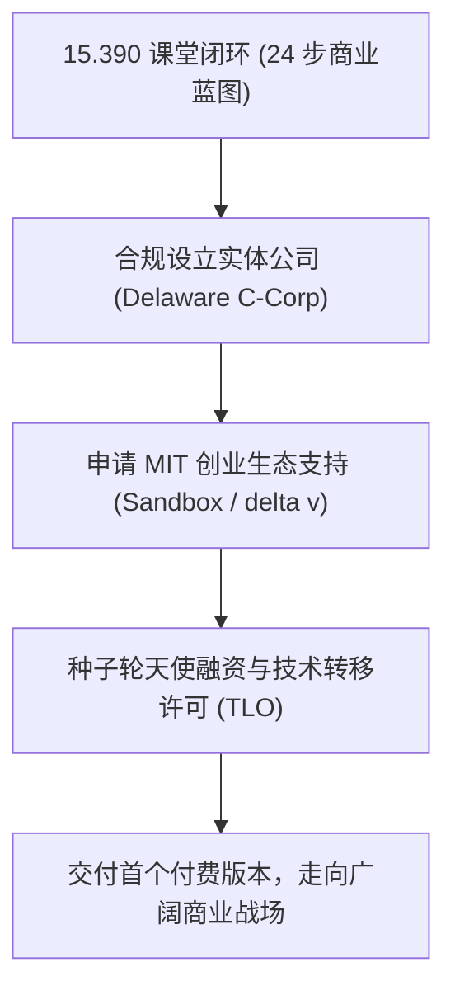
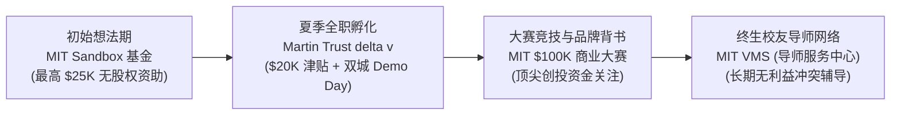

# Lec 24 结课后的下一步行动 (Next Steps After New Enterprises)

> MIT 15.390 · New Enterprises · 模块六：模拟董事会与实战路演 · 主讲：Bill Aulet

## TL;DR

- 课程结课不是终点，而是将学术探索蜕变为真实商业实体的真正起点（Beyond the 24 Steps）。
- 设立公司必须恪守法律与税务合规：注册特拉华州 C 类公司、签署 IP 转让协议、执行 4 年股权兑现并于 30 天内提交 83(b) 税务申报。
- 全面激活麻省理工创业加速生态：衔接 MIT Sandbox 种子基金、delta v 夏季加速营与 MIT $100K 商业大赛。
- 把握股权融资全生命周期节奏，用 SAFE 与可转债平稳起跑，保持对商业常识的敬畏与终身坚毅力（Grit）。

## 课程结束，真实创业征程刚刚开启

在为期一学期的高强度推演中，每支团队都经历了 24 步严谨创业法的完整洗礼：从初始创意的头脑风暴、市场细分、海滩阵地聚焦，到一手调研（PMR）、量化价值主张、单位经济学测算与模拟董事会的严酷拷问。

然而，Bill Aulet 在结课致辞中明确告诫大家：**课堂上的商业计划书即便获得满分，也依然只是一张纸；真正的创业，是当你走出教学楼、向工商部门提交注册文件、向第一位员工发放工资、并在市场上与凶狠的竞争对手刺刀见红的那一刻才真正开始**。

## 迈向实体公司的四大法律生死门

科技创业者往往热衷于讨论估值与技术架构，却在最基础的法律与税务程序上栽大跟头。新企业创立必须严格落实以下四大防线：

### 1. 设立特拉华州 C 类公司 (Delaware C-Corp)
- **为什么不是有限责任公司（LLC）？**：LLC 适用于传统中小商铺（SME），但无法发行优先股、无法设立员工期权池（ESOP），无法被主流机构风险投资人（VC）直接注资；
- **特拉华州法官裁决优势**：全美高科技风险投资完全以特拉华州公司法与衡平法院（Court of Chancery）的判例法为通用商业标准。

### 2. 知识产权全额转让协议 (IP Assignment Agreement)
- 所有创始人与早期核心员工必须签署排他性 IP 转让协议，明确确认：**所有与公司业务相关的代码、设计图、商业秘密与算法专利，100% 归属于公司法人资产，绝非创始人个人私产**；
- 若技术涉及大学实验室成果，必须通过大学技术转移办公室（如 MIT TLO）完成正规的专利确权、排他性商业许可谈判（Exclusive License Agreement），彻底割裂潜在产权纠纷。

### 3. 4 年期伴随 1 年悬崖的股权兑现协议 (Vesting with 1-Year Cliff)
- 团队全员必须将持有的原始股票全部锁定入动态兑现池；
- 设立 1 年悬崖（未满 12 个月离职，股份全部归零；满 12 个月一次性解锁 25%，随后 3 年按月均分解锁），确保只有真正与公司生死与共的伙伴才能分享远期红利。

### 4. 成立后 30 天内向 IRS 提交 83(b) 税务申报表 (The 83(b) Election)
- **致命税务陷阱**：如果不申报 83(b)，随着公司未来估值从 10 万美元暴涨至 1 亿美元，创始人在未来 4 年股票分批解锁时，必须针对未套现的账面升值缴纳数百万美元的巨额个人所得税；
- **合法避税黄金动作**：在公司设立并向创始人发售股份后的 **30 天内（不可延期）**，向美国国税局（IRS）寄送 83(b) 表格，按初始极低的面值（如 0.0001 美元/股）一次性完税，为未来省去天文数字的税务灾难。

## 善用麻省理工创业加速生态矩阵

作为 MIT 孵化的创业项目，团队拥有全球最顶级的校友与高校支持网络：

1. **MIT Sandbox 创新基金（Sandbox Innovation Fund Program）**：为学生项目提供高达 \$25,000 的无股权、无偿早期种子资金，配套资深产业导师一对一辅导；
2. **Martin Trust Center delta v 旗舰夏季加速营**：MIT 官方最顶尖的创业加速器。入选团队在暑期获得专属办公工位、\$20,000 团队生活津贴，并在波士顿与纽约面向数百家全球主流 VC 举办闭门 Demo Day；
3. **MIT \$100K 创业大赛**：拥有 30 余年历史的全球知名商业计划大赛，历届获胜者走出了 Akamai、HubSpot、Ginkgo Bioworks 等数十家上市公司；
4. **MIT 创业导师服务（Venture Mentoring Service, VMS）**：由数百位成功连续创业者与退休高管组成的导师团，为团队提供纯公益、终身且无利益冲突的智囊支持。

## 早期股权融资实战导航

在启动种子轮融资时，初创团队应尽量简化法律文书，加快交割速度：
- **拥抱简单未来股权协议（SAFE, Simple Agreement for Future Equity）**：采用 Y Combinator 打造的后轮估值上限（Post-Money Valuation Cap）标准 SAFE 文书，不涉及繁琐的董事会席位谈判与高昂律师费，几天内即可完成资金到账；
- **警惕恶性资本条款**：严禁签署带有“多倍强参与清算优先权（Participating Preferred）”或“完全棘轮反稀释（Full Ratchet）”的嗜血条款，保护团队在顺境与逆境中的基本控制权。

## 创业者的终极心力修炼：坚毅力与工程理性

Bill Aulet 在最后一堂课上留给全班的一段话：
> “创业不仅是一种创建商业组织的经济活动，它更是一种人生的存在方式。你将学会如何在极度匮乏的资源下创造非凡的价值；你将学会如何在被全世界拒绝 99 次后依然充满激情地去敲第 100 扇门；你将学会用严谨的理性纪律约束内心的傲慢与贪婪。”

::: insight
**真正决定创业者最终高度的，不是智商，不是背景，而是坚毅力（Grit）**——在遭遇背叛、代码崩溃、资金断链、客户毁约的漫漫长夜里，依然能够拍掉身上的尘土，在第二天清晨微笑着继续前行的执着与定力。严谨创业法（DE）是你手中的罗盘与武器，而心中的使命与热爱，才是穿越黑暗森林的唯一灯塔。
:::

::: pitfall
永远不要为了迎合资本的审美而创业。如果你的全部动力只是为了登上福布斯 30 Under 30 榜单或炫耀估值，你将在创业的第一场真实风暴中彻底崩溃。唯有真正渴望解决一个让你寝食难安的真实问题，你才能在这场漫长而孤独的马拉松中跑到终点。
:::
