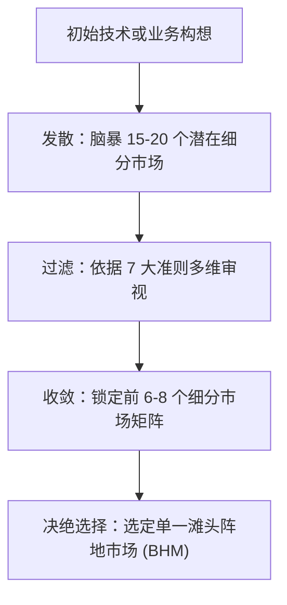

# Lec 3 市场细分与选择滩头阵地市场 (步骤 1-2) (Market Segmentation & Selecting Beachhead Market)

> MIT 15.390 · New Enterprises · 模块二：目标客户与市场切入 · 主讲：Bill Aulet

## TL;DR

- 商业第一戒律：企业存在的唯一充分且必要条件是有且仅有“**付费客户（Paying Customer）**”。
- 步骤 1（市场细分）要求从技术推力中彻底发散，列出所有潜在行业应用，并依据 7 大准则筛选出前 6–8 个细分市场矩阵。
- 步骤 2（选择滩头阵地市场，BHM）要求在面对有限资源时，绝对聚焦于单一可被主导的小市场，以谋求 20% 以上的市场份额。
- 阅读《最被高估的事》（Most Overrated Thing）警示：专利壁垒与先行者优势被严重高估，对滩头客户的极端聚焦与执行闭环才是初创企业的真正护城河。

## 商业第一戒律与复杂客户结构

许多初创企业误以为自己的核心资产是专利代码、前沿算法或精美网站。然而在 MIT 15.390 看来，商业的本质极为纯粹：

::: definition 商业第一戒律 (The First Commandment of Entrepreneurship)
企业存在的唯一充分且必要条件是有且仅有**付费客户（Paying Customer）**。
没有付费客户，即便拥有顶级专利、豪华办公场地或千万美元风投资金，也称不上是一个真正的企业，充其量只是一个昂贵的科研项目或非营利慈善组织。
:::

### 复杂客户结构：单边市场 vs. 双边/多边市场

在定义客户时，团队必须首先分清市场的结构形态：
- **单边市场（One-Sided Market）**：最终使用产品的人同时也是支付对价的人（如工业检测工具由工厂主管采购并供产线质检使用）。
- **双边/多边市场（Two-Sided / Multi-Sided Market）**：存在两类或多类相互依赖的用户群体。典型如 Google 搜索或 eBay，一方是享受免费搜索体验的终端用户（Primary Customer），另一方是提供真实资金流的广告商（Secondary Paying Customer）。在双边市场中，必须同时为两端提供价值闭环，缺一不可。

## 步骤 1：全方位市场细分 (Market Segmentation)

面对一项新技术或初始构想，团队绝不能立即扑向脑海中浮现的第一个场景。步骤 1 的任务是进行无拘无束的**全景市场细分脑暴**，至少列出 15–20 个潜在的行业应用场景。

随后，使用 **DE 7 大过滤准则** 对候选市场进行结构化审视：
1. **目标客户是否资金充裕？**（目标客户是否拥有充足可支配预算解决该问题？）
2. **目标客户是否容易触达？**（是否拥有现成的销售渠道、行业协会或可集聚社群，还是散落于各个角落？）
3. **目标客户是否有紧迫的购买理由？**（是关乎合规生存的必选项 Must-have，还是锦上添花的 Nice-to-have？）
4. **团队能否交付完整的整体产品（Whole Product）？**（客户拿到产品后能否直接产生价值，还是需要另外采购数倍于我们产品的配套组件与集成服务？）
5. **是否存在难以攻破的既有垄断壁垒？**（行业巨头是否拥有无法动摇的分销独占或客户人脉绑定？）
6. **该市场能否作为跳板撬动后续衍生市场？**（在这个细分市场取胜后，能否形成口碑向临近行业扩张？）
7. **该市场是否契合创始团队的激情与核心愿景？**（团队是否愿意在该行业死磕 5 到 10 年？）

最终，团队将候选市场收敛为 **前 6–8 个细分市场矩阵**，并在课下通过一手调研进一步核实。

## 步骤 2：选择单一滩头阵地市场 (Beachhead Market)

初创企业最容易犯的致命错误就是“全面开花”。由于资源、资本与人力极度匮乏，分散兵力进攻多个市场无异于自杀。

::: definition 滩头阵地市场 (Beachhead Market, BHM)
如同盟军在二战诺曼底登陆中选择狭小的奥马哈海滩集结全部优势兵力一样，滩头阵地市场是初创企业全力以赴攻占的**第一个且唯一的细分市场**。一旦在该市场取得绝对统治地位（市场份额达到 20% 以上并产生正向现金流），即可以此为根据地向临近市场纵深推进。
:::

### 选择滩头阵地的三大黄金准则

一个合格的滩头阵地必须满足以下三大特性：
1. **该细分市场内的客户购买的是极其相似的产品**；
2. **该细分市场内的客户拥有极其相似的销售采购周期与预期**；
3. **该细分市场内的客户之间存在高度紧密的“口碑传播网络（Word of Mouth）”**——当客户 A 购买后，客户 B、C 会在行业论坛、高管聚会或微信群中互相打听，从而大幅降低后续获客成本。

::: example 隐形车蜡（Stealth Wax）的滩头阵地选择之痛
某材料博士研发出耐磨度提升 10 倍的纳米车蜡。团队最初试图全面铺开：既卖给个人车主（DTC 零售），又卖给线下洗车行（B2B 渠道），还试图向汽车整车厂（OEM）推销。结果：
- 个人车主单瓶可用 2 年，LTV 极低且进场费高昂；
- 普通洗车行靠走量流水线作业，没有 40 分钟手工精细施工的人工冗余；
- 汽车整车厂认证周期长达 3–5 年且极度压榨供应商毛利。
如果团队当时果断选择“**高端老式古董车收藏俱乐部**”作为唯一滩头阵地，客户极度富有、对车漆抗腐蚀有偏执刚需、社群口碑网络极其严密，团队即可凭借高毛利直销迅速实现正向现金流并主导该小市场。
:::

## 深度阅读：《最被高估的事》(The Most Overrated Thing)

在课前必读文章中，Bill Aulet 犀利指出，初创界最被过度神话的两件事是：
1. **所谓的“先行者优势（First-Mover Advantage）”**：历史证明，第一名往往充当了教育市场的炮灰（如 AltaVista 之于 Google，MySpace 之于 Facebook）。真正的赢家是“最后主导者（Last-Mover Advantage）”——在细分滩头中彻底做深并垄断网络效应。
2. **所谓的“独家专利（Patents & IP）”**：初创团队如果没有雄厚的资金打跨国侵权官司，专利只是一张纸；真正的壁垒来自卓越的客户洞察、极致的执行力与对滩头客户的牢固掌控。

## 里程碑 #1 交付物规范 (Milestone #1)

本讲课后必须提交 **Milestone #1** 矩阵表格，要求清晰列明：
- 脑暴出的全部细分市场；
- 经过 7 大准则打分筛选出的前 6–8 个矩阵；
- 最终锁定的单一滩头阵地市场（BHM）及其充分的定性与定量入选理由；
- 滩头阵地市场的预估边界与进一步细分子集。

::: insight
选择滩头阵地最痛苦的不是决定“做什么”，而是克制内心的贪婪，坚决决定“不做什么”。对另外 7 个看似诱人的大市场坚定说“不”，才是保护初创企业幼苗存活的关键纪律。
:::

::: pitfall
小心“大市场诱惑”。初创团队常常宣称：“中国/美国有 10 亿人口，我只要拿下 1% 的市场就有 1000 万用户！”这种思维是典型的空想。在没有建立滩头阵地统治力之前，任何一个细分市场的 1% 都不会自动掉落到你头上。
:::
