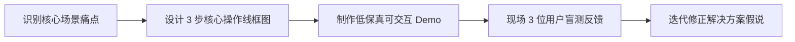
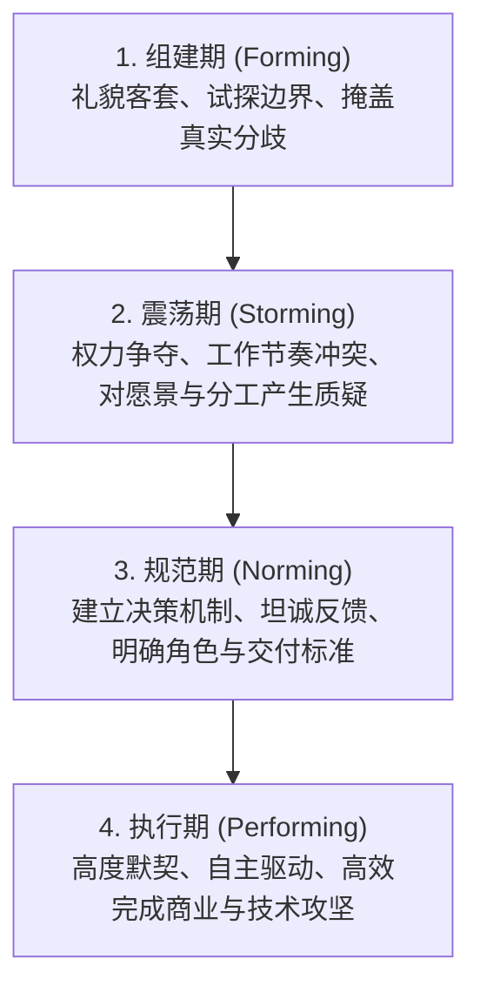

# Lec 4 展示黑客挑战赛成果 + 高绩效团队建设 (Present Results of Hack + High Performance Teams)

> MIT 15.390 · New Enterprises · 模块一：创业启航与创意初筛 · 主讲：Bill Aulet

## TL;DR

- 黑客挑战赛（Hack Challenge）要求团队在 48 小时内完成低保真原型或交互线框图，以此检验团队行动力与问题定义精准度。
- 超过 65% 的高科技初创企业最终死于合伙人内部冲突，团队必须深刻理解塔克曼模型（组建、震荡、规范、执行）并主动加速度过震荡期。
- 团队结构需平衡黑客（Hacker）、嬉皮士（Hipster）与商贩（Hustler）三大黄金角色，确立单一主导决策人（CEO）。
- 建立高绩效团队的核心支柱是心理安全感（Psychological Safety）与刚性的团队承诺协议，用契约锁定投入度与退出准则。

## 黑客挑战赛原型路演与交互线框图评审

黑客挑战赛的核心意图并非检验工程代码的完备度，而是考察新组建团队在极端时间约束下的**协同交付力**与**快速原型能力（Rapid Prototyping）**。

在课堂路演中，各团队必须使用 Figma、Balsamiq 或可交互原型工具展示：
1. **痛点场景还原**：用户在什么具体时刻遇到了无法忍受的麻烦？
2. **核心交互线框图（Wireframe Flow）**：用户如何通过 3 步以内的核心操作解决该问题？
3. **低保真原型的反馈验证**：在过去 48 小时内，是否有至少 3 位潜在用户看过该原型并给出了真实反馈？



评审团对路演提出的三大核心审查维度是：
- **方案是否过于臃肿？**（初创团队常试图把所有功能塞进第一个原型中，失去焦点）；
- **用户是否直观理解？**（无需讲解员在旁解释，用户能否自主操作完成流程）；
- **团队协作是否顺畅？**（展示时是单一成员独揽话语，还是全体成员默契分工）。

## 为什么初创团队往往毁于人？

根据哈佛商学院 Noam Wasserman 在《创始人的两难》（The Founder's Dilemmas）中的实证研究，**超过 65% 的科技初创企业失败直接归因于创始人团队的内部冲突与破裂**。常见的致命陷阱包括：
- **友谊与商业混淆（The Friendship Trap）**：因感情好而草率合伙，出于维护关系而刻意回避股权分配、决策主导权与业绩考核等敏感问题。
- **同质化温室效应（Homogeneous Groupthink）**：团队成员背景极其单一（如全是一线软件工程师），没有人愿意走出去跑客户、做冷启动销售或处理法律与财税杂务。
- **时间与目标不对齐（Mismatched Commitments）**：有的成员渴望全职拼搏打造十亿美元独角兽，有的成员仅将其视为赚取外快或混学分的副业。

## 塔克曼模型：跨越团队震荡期 (Storming)

任何高绩效团队都必须经历社会心理学所揭示的 **塔克曼团队发展阶段模型（Tuckman's Stages of Group Development）**：



::: definition 团队发展四阶段
- **组建期 (Forming)**：成员彼此礼貌客气，表面一片祥和，但缺乏对彼此深层习惯与缺点的认知。
- **震荡期 (Storming)**：随着项目压力增加，关于技术选型、客户定位与代码质量的争执开始爆发。**平庸团队死于震荡期，优秀团队在震荡期中建立深层信任**。
- **规范期 (Norming)**：团队制定出明确的工作公约、例会机制与冲突仲裁协议。
- **执行期 (Performing)**：成员之间形成高度信任与默契，能够以极高的协同速度进行产品与市场迭代。
:::

## 创业团队黄金三角 (The 3H Model) 与单一决策人

Bill Aulet 强调，初创团队在结构上必须实现能力互补：

```text
           [Hacker (硬核技术与算法)]
                 /         \
                /           \
               /   创始团队   \
              /    黄金三角    \
             /                 \
[Hipster (用户体验/交互设计)] ===== [Hustler (商业变现/商务销售)]
```

- **黑客 (Hacker)**：负责构建技术底层架构，攻关工程难点，确保产品可靠与技术可扩展；
- **嬉皮士 (Hipster)**：负责用户同理心洞察、视觉设计、产品交互与品牌美学，让产品具备打动人心的温度；
- **商贩 (Hustler)**：负责走出大楼找客户、谈渠道、拉赞助、做路演与催收货款，将产品价值转化为真金白银。

除了 3H 角色互补外，团队必须尽早确立**单一 CEO（Chief Executive Officer）**。共识驱动（Consensus-driven）在头脑风暴时极具价值，但在面对生死存亡的战略选择时，必须有且仅有一位负责人拍板并承担终极责任。

## 心理安全感与团队承诺协议 (Team Agreement)

为了防止团队在后续的高强度调研与模拟董事会中瓦解，本讲要求每支团队签署 **团队承诺协议（Team Commitment Agreement）**：

1. **每周投入时间下限**：明确规定每位成员每周投入该课程项目的具体小时数（如不少于 15 小时/周）；
2. **沟通与响应时效**：规定工作消息必须在 4 小时内回复，缺席例会需提前 24 小时报备；
3. **坦诚反馈原则（Radical Candor）**：建立**心理安全感（Psychological Safety）**，鼓励在内部“就事论事地对代码与商业假说进行严苛批判”，但“对合伙人的人格与动机给予绝对信任”；
4. **提前退出与清退机制（Shotgun Clause）**：若某位成员连续两周未完成既定交付物，团队有权通过投票将其移出核心名单，其过往贡献以合理机制结清。

::: insight
高绩效团队从不是没有冲突的团队，而是**善于在冲突中逼近真理的团队**。凡是开会时一团和气、没有人提出尖锐反思的初创团队，往往在第一次见真实客户或投资人时被一击击碎。
:::

::: pitfall
千万不要设立“联合 CEO（Co-CEOs）”或把决策权完全均等化。平权表面上照顾了所有人的自尊，但在关键时刻会导致谁也不愿为失败负责，产生长达数周的决策瘫痪。
:::
