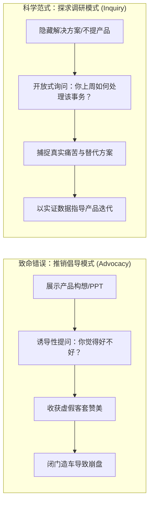

# Lec 5 如何开展一手市场调研 (How To Do PMR)

> MIT 15.390 · New Enterprises · 模块二：目标客户与一手市场调研 · 主讲：Bill Aulet

## TL;DR

- 一手市场调研（PMR）是驱动 24 步严谨创业法的唯一真实燃料，严禁使用咨询公司二手报告替代真实客户走访。
- PMR 黄金铁律：保持好奇心与探究心态（Inquiry Mode），严禁在调研中推销产品或寻求客户赞美（Advocacy Mode）。
- 访谈提问遵循漏斗模型：从无偏见的开放式日常工作流询问切入，探寻真实痛点与替代方案，绝不提“你愿意买一个……吗”的虚假假设。
- 交付成果包含头脑风暴市场列表、前 6-8 个细分市场矩阵与 15.390 承诺协议，以科学态度直面真实市场反馈。

## 什么是真正的 PMR？二手报告的虚假繁荣

在 MIT 15.390 教学体系中，Bill Aulet 将一手市场调研（Primary Market Research, PMR）定义为整套 24 步体系的**核心燃料**：
> "Garbage in, garbage out. Quality PMR fuel into the process, gold out."（输入的是垃圾，输出的就是垃圾；输入高质量 PMR 燃料，输出的才是真金白银。）

很多学生喜欢坐在图书馆里查阅 Gartner、Forrester 或行业券商的研究报告。然而，这些所谓的二手市场报告（Secondary Research）存在致命缺陷：
1. **滞后性**：报告反映的是过去已经成型的成熟大市场，而创业企业寻找的是尚未被定义的未满足需求；
2. **缺乏颗粒度**：宏观报告只会告诉你“全球网络安全市场规模达 1500 亿美元”，却无法告诉你波士顿一家 50 人律所的 IT 主管今天下午为何对备份软件崩溃抓狂；
3. **缺乏情境共情**：没有面对面观察过客户真实的挫败感与妥协方案，团队就无法建立真正打动用户的产品直觉。

::: definition 一手市场调研 (Primary Market Research, PMR)
由创始团队成员亲自直接与潜在终端用户、采购决策者开展的原生实地调研。通过深度访谈、现场工作流暗中观察与情境追问，直接获取未经第三方过滤的一手定性与定量行为证据。
:::

## PMR 黄金铁律：探求事实 vs. 诱导推销 (Inquiry vs. Advocacy)

初创团队进行客户访谈时最致命的本能反应是“开启推销模式（Advocacy Mode）”——急不可耐地向对方展示自己的酷炫算法或 App 原型，并满怀期待地问：“你觉得这个构想棒不棒？如果做出来你会买吗？”

这种提问方式只会引发虚假的礼貌与吹捧（The Mom Test）：
- 客户为了表现友好，通常会回答：“哇，真棒！做出来我一定买！”
- 团队误将客套当成市场验证，回去闭门造车数月，发布后却发现该客户根本不愿掏钱。



::: definition PMR 黄金三原则
1. **闭上嘴巴，保持倾听（Shut up and listen）**：访谈中创始人说话的时间绝对不能超过 20%，80% 的时间交给受访者自由倾诉；
2. **观察实际行为，而非倾听口头意愿（Watch actions, not words）**：人们说的和实际做的往往大相径庭；观察其工位上贴满的便利贴、杂乱的 Excel 宏或手工抄录的账本；
3. **探寻过去发生的事实，不问未来的假设（Past facts, not future predictions）**：不问“你将来是否会买”，只问“上一次发生该故障是在哪天？当时造成了多大损失？你向谁申请了多少预算解决？”
:::

## 漏斗式访谈脚本设计 (The Funnel Approach)

高质量的 PMR 访谈脚本必须遵循结构化漏斗模型：

```text
[宽口：开放式工作流探索] 
    ↓ 
    "能否向我介绍一下你周一早上进办公室后的典型一天？"
    "在处理这件事情时，最耗费你精力或让你感到挫败的环节是什么？"
[中段：具体场景与现状拆解]
    ↓ 
    "上一次遇到这个问题是什么时候？当时你具体采取了什么措施？"
    "你目前正在使用什么工具（包括自建表格、外包人员）应对？"
    "对现有方案最不满意的一点是什么？"
[底部：量化影响与采购决策]
    ↓ 
    "为了解决这个问题，你们团队每月大致耗费多少人时或经济成本？"
    "如果需要购买外部软件解决，审批流程通常经过哪几个层级？你的签字限额是多少？"
```

## 识别并根除确认偏误 (Confirmation Bias)

创始人极易陷入**确认偏误（Confirmation Bias）**：潜意识里只记录符合自己预期的正向反馈，而将客户提出的尖锐反例与冷漠反应视为“这人不专业”、“他不是我的目标客户”。

防范确认偏误的实战手段：
- **双人结对访谈**：一人负责引导提问，另一人全神贯注记录原话、微表情与情绪波动；
- **记录反例日志**：每次访谈后必须在工作表上记录一条“最令团队沮丧的发现”。如果连续访谈 5 个人都没有发现任何负面反馈，说明访谈设计存在严重的诱导性问题。

## 15.390 调研承诺协议与前 6-8 个细分市场矩阵

在本讲课后，团队必须交付：
1. **前 6–8 个细分市场筛选矩阵**：针对每个细分市场清晰定义其最终用户角色、潜在应用场景与触达渠道；
2. **签署 15.390 承诺协议（Commitment Pledge）**：全体联合创始人签字，庄严承诺绝不在办公室内凭空编造用户画像，在接下来的外勤日全面走向真实一线。

::: insight
做 PMR 最难的不是技巧，而是**心理层面的恐惧与脆弱感**。走出熟悉的写字楼或校园，去敲陌生客户的门并遭遇冷遇，是每一位伟大创业者必须跨越的成年礼。
:::

::: pitfall
绝对不要通过发放网上问卷（Google Forms / 问卷星）来代替面对面访谈！问卷调查充其量只能作为大规模定量统计的补充手段，它完全抹杀了语气、肢体语言、办公环境观察等最核心的定性洞察来源。
:::
