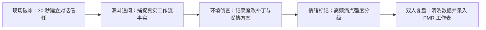

# Lec 6 一手市场调研外勤日 (PMR Field Day)

> MIT 15.390 · New Enterprises · 模块二：目标客户与市场切入 · 主讲：Bill Aulet

## TL;DR

- PMR 外勤日（Field Day）强制团队脱离理论温室，深入现场开展至少 30+（B2C）或 10+（B2B）次深度访谈。
- 现场观察的核心价值在于捕捉客户的“妥协方案”（Workarounds）——贴纸、魔改 Excel 与手工台账往往直接指示最强烈的未满足痛点。
- 访谈记录必须严格清洗并标注情绪编码（如愤怒、无奈、冷漠），以排除礼貌性吹捧的噪音。
- 签署并执行 PMR 誓约（PMR Pledge），坚守以一线实证数据为唯一准绳，严防重回主观臆测。

## 走出演讲厅：外勤日的组织与行动底线

PMR 外勤日是 MIT 15.390 最具标志性的实战环节。Steve Blank 著名的格言在这里被严格执行：
> “There are no facts inside your building, so get the heck outside!”（在你的办公室或教学楼里没有任何客观事实，滚到外面去！）

在外勤日当天，所有常规课堂授课暂停，团队全员扑向各自选定的滩头细分场景：
- **消费级团队（B2C）**：进入商场、健身房、大学食堂、地铁枢纽等目标人群集聚区，完成**至少 30 场以上**有效面对面访谈；
- **企业级团队（B2B）**：走访工业园区、写字楼、律所、医院或仓储物流中心，完成**至少 10 场以上**深度一线访谈（涵盖基层最终用户与部门预算负责人）。

## 现场观察的艺术：寻找客户的“妥协方案” (Workarounds)

访谈中受访者往往会下意识美化自己的工作流程。因此，**现场物理环境观察（Contextual Inquiry）** 比倾听言语更为关键。

Bill Aulet 指出，最强烈的创业机会往往隐藏在客户日常的**妥协方案（Workarounds）**中：
- **屏幕上的便利贴**：如果一位前台或操作员的显示器边框上贴满了密码、格式代码或计算公式，说明现有商业系统极其难用；
- **魔改的 Excel 表格与复杂的宏（VBA/Python 脚本）**：如果一个部门依赖某位老员工自编的庞大 Excel 表格来跨系统搬运数据，这就是一个极其标准的垂直 SaaS 机会；
- **跨平台的手工中转**：用户不得不把 A 软件的数据导出为 CSV，手动整理格式，再上传到 B 软件，中间充斥着无尽的人工差错与抱怨。

::: definition 妥协方案 (Workaround)
指用户在现行标准工具或商业产品无法满足需求时，被迫采用自制脚本、纸质便签、多工具拼凑等低效且容易出错的手工手段来勉强完成任务的变通行为。每一个高频存在的妥协方案，都是一块尚未被开采的商业金矿。
:::

## 访谈数据清洗与情绪编码 (Emotional Coding)

外勤调研结束后，团队必须在 24 小时内进行双人交叉复盘，对原始笔记进行结构化清洗，严防记忆衰减：

1. **逐字记录关键语句（Verbatim Quotes）**：原汁原味地保留客户在描述痛点时的粗话、感叹词与原生行业黑话，不得用团队自己的学术术语润色替代；
2. **情绪强度分级（Emotional Intensity Index, 1–5 分）**：
   - **5 分（极度愤怒/焦虑）**：“上个月因为这个故障，我们在周五晚上被客户疯狂投诉，我差点被开除！”（真正的强刚需）
   - **3 分（中度烦扰）**：“确实挺麻烦的，但习惯了也就多花半小时。”（弱痛点，客户不一定愿意付费）
   - **1 分（礼貌客套/无感）**：“挺有意思的，听起来挺酷。”（伪需求，坚决剔除）
3. **触达路径复盘**：记录该受访者是通过什么具体渠道触达的（领英冷联系、行业协会名录、展会拦截还是熟人引荐），为后续获客成本（COCA）测算积累真实参数。

## PMR 工作表与 PMR 誓约 (The PMR Pledge)

在本讲交付物中，每支团队必须完成并上传：
- **PMR 工作表初稿（PMR Worksheet Draft）**：汇总所有受访者名单、职务、公司规模、痛点归类与情绪评分；
- **PMR 誓约（PMR Pledge）**：全体联合创始人共同宣誓，以白纸黑字的形式确认以下准则：

::: definition 15.390 PMR 誓约 (PMR Pledge)
“我们郑重宣誓：本团队提交的每一份调研数据均来自真实客户的面对面访谈；我们绝不在没有一线证据的情况下主观臆测客户需求；我们勇于接受客户对我们初始构想的无情否定，并以实事求是的科学态度推进 24 步迭代。”
:::

::: insight
许多学生以为访谈客户是为了“证明自己是对的”。**真正的 PMR 大师恰恰相反，他们千方百计试图证明自己是错的**。只有当你竭尽全力想要推翻自己的商业假设却推不翻时，你才真正找到了坚如磐石的商业基石。
:::

::: pitfall
小心“专家访谈替代症”。咨询教授、行业分析师或退休高管固然能提供宏观见解，但他们绝不能替代每天实际操作业务的最终用户（End User）。向非决策且非使用者的“行业专家”问需求，往往会得到脱离实际的空中楼阁。
:::
