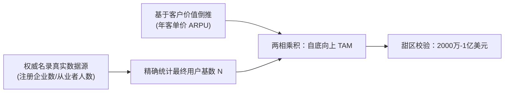

# Lec 7 终端用户画像、潜在市场总额 (TAM)、人物角色 (Persona) (步骤 3-5)

> MIT 15.390 · New Enterprises · 模块二：目标客户与市场切入 · 主讲：Bill Aulet

## TL;DR

- 步骤 3 构建最终用户画像（End User Profile），将人口统计与心理画像结合，严防混淆日常使用者与买单决策人。
- 步骤 4 采用自底向上法测算滩头阵地潜在市场总额（$TAM = N_{users} \times ARPU$），理想甜区位于 2000 万至 1 亿美元/年之间。
- 步骤 5 塑造唯一的人物角色（Persona），必须是有姓名、有照片、有真实痛点排序的具体个人，严禁抽象模糊的统计平均人。
- 经典案例警示：脱离最终用户实际工作习惯与政治利益的构想，即便技术先进也必将在审批与落地环节被无情绞杀。

## 步骤 3：构建最终用户画像 (End User Profile)

在锁定滩头阵地市场（BHM）后，团队必须立即将目光聚焦于产品的实际使用者：**最终用户（End User）**。

::: definition 最终用户画像 (End User Profile)
对滩头阵地内每天实际操作、使用你产品的目标人群的具象描述。它融合了客观的人口统计学特征（Demographics）与主观的心理动机特征（Psychographics），为团队提供统一的用户心智锚点。
:::

### 核心构建维度
1. **人口统计学（Demographics）**：年龄段、受教育程度、职务头衔、收入水平、日常工作的地理环境；
2. **心理与动机画像（Psychographics）**：
   - TA 每天上班最大的焦虑与恐惧是什么？
   - 评判其年终奖或晋升的核心 KPI 是什么？
   - TA 在行业内最崇拜的偶像是谁？TA 业余时间阅读什么网站或播客？
3. **团队基因审视**：联合创始人中是否有人曾经或目前就属于这一最终用户画像？
   - 若团队中有人具有该背景，团队将拥有极强的同理心与产品直觉；
   - 若团队中全无此背景，团队必须通过更高频的一手调研来弥补认知鸿沟。

## 步骤 4：测算滩头潜在市场总额 (Beachhead TAM)

潜在市场总额（Total Addressable Market, TAM）代表如果你在选定滩头阵地中实现 **100% 的市场占有率**，每年能够捕获的年化营业额（Annual Recurring Revenue / Gross Revenue）。

### 自底向上测算法（Bottom-Up Counting）

自顶向下法（Top-Down，如“全美医疗支出 4 万亿，我们拿 1% 是 400 亿”）在 15.390 课堂被严格禁止。团队必须采用严谨的**自底向上法**：

$$TAM = N_{\text{users}} \times ARPU$$

其中：
- $N_{\text{users}}$：滩头阵地内的最终用户总数。必须来自可追溯验证的数据源（如全美认证放射科医生注册名录、行业协会年报、特定工业企业名录）；
- $ARPU$：每位最终用户每年愿意为产品支付的平均客单价（基于客户从替代方案中节省的成本或创造的增量利润倒推）。



::: definition 滩头 TAM 甜区法则 (The Sweet Spot of Beachhead TAM)
滩头市场的年营收规模通常应落在 **2000 万美元至 1 亿美元（\$20M – \$100M）** 之间：
- **若 TAM < 500 万美元**：市场空间过于狭窄，难以支撑一家风投支持的创新驱动型企业（IDE）度过研发死亡之谷；
- **若 TAM > 10 亿美元**：说明市场细分严重不足，初创企业有限的资源会被实力雄厚的行业在位巨头迅速碾压。
:::

## 步骤 5：刻画具体人物角色 (Profile the Persona)

用户画像（Profile）是一群人的集合，而**人物角色（Persona）则是有且仅有一个真实具体的人**。

```text
[细分市场群体] ----> [最终用户画像 (Profile)] ----> [唯一人物角色 (The One Persona)]
(海量潜在场景)       (20-30岁初级放射科医生)        (Dr. Sarah Lin, 31岁, 麻省总医院)
```

### Persona 必须满足的四大标准
1. **真实存在**：必须基于在 PMR 中实际深度访谈过的真实客户，有真实姓名、真实照片、真实家庭与办公桌布置；
2. **唯一性（The One Persona）**：在滩头阵地阶段，**严禁设立多个 Persona**！多角色只会分散工程与营销资源，导致所有功能皆沦为平庸；
3. **痛点与愿望优先级（Top 3 Priorities）**：明确列出该角色生命中最重要的三件事：
   - 优先级 #1（生死攸关的第一优先级，产品量化价值主张必须精准击中此点）；
   - 优先级 #2 与 #3（辅助决策因素）；
4. **决策盲点与最大恐惧**：TA 最害怕在工作中发生什么事故（如被患者起诉、误判肿瘤、丢失数据）？

## 经典失败案例剖析

Bill Aulet 结合两个麻省理工团队的真实创业教训，阐明了脱离 Persona 实际工作流的灾难性后果：

::: example Elite 运动监测仪与 HR Vision 的教训
1. **Elite 运动监测仪**：团队研发了监测运动员体能消耗的高精传感器，预设高中体育教练会狂热购买。实际调研发现：高中教练根本没有独立采购预算；比赛训练期间教练需要时刻盯着球员跑位，根本无暇掏出手机观察复杂的体能波形图。
2. **HR Vision 人力资源分析系统**：团队基于算法对员工日常邮件与沟通建模，预测骨干离职风险并向 CEO 汇报。该构想在落地时遭遇中层经理的联手抵制与否决，因为该算法直接暴露了中层团队的管理缺陷，威胁了其实际政治利益。
:::

::: insight
一个好的 Persona 是团队内部无休止争论的终极裁决者。当工程师与产品经理就“是否要加某个功能”争执不下时，唯一的问题不是“这个功能酷不酷”，而是：**“这是否符合 Sarah Lin 的第一优先级？如果不能，立即删除！”**
:::

::: pitfall
绝不能根据团队自身的想象拼凑一个“弗兰肯斯坦式的完美怪物（Frankenstein Persona）”——把五个不同受访者的优点与预算凭空拼在一个虚拟人物身上。虚拟的人物永远不会在现实中掏出支票本。
:::
