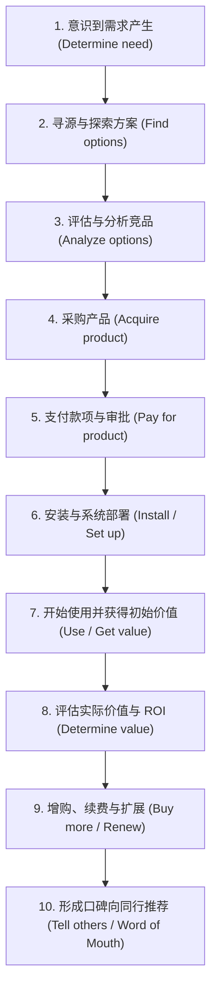
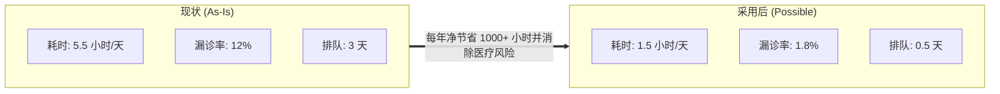

# Lec 8 全生命周期用例、高层产品规格、量化价值主张 (步骤 6-8)

> MIT 15.390 · New Enterprises · 模块三：价值主张与产品规格 · 主讲：Bill Aulet

## TL;DR

- 步骤 6 全生命周期用例（Full Life Cycle Use Case）描绘 Persona 从意识到痛点、采购、安装到复购推荐的 10 大完整阶段。
- 步骤 7 高层产品规格（High-Level Product Spec）要求制作直观的视觉宣传册或线框图，严防过早陷入代码工程细节。
- 步骤 8 量化价值主张（Quantify the Value Proposition）对比“现状（As-Is）”与“未来（Possible）”，将收益严格折算为时间、金钱或风险降低。
- 只有将产品利益与 Persona 的第一优先级直接绑定，才能击破客户的既有惯性并促成采购。

## 步骤 6：全生命周期用例 (Full Life Cycle Use Case)

技术出身的创始人常犯的认知偏差是：只关注用户点击软件界面或按下硬件开关的那几分钟。然而对于真实客户而言，产品的使用只是其漫长业务链路中的一小环。

::: definition 全生命周期用例 (Full Life Cycle Use Case)
系统性追踪 Persona 从最初未感知到问题，到认知、寻源、购买、安装、日常操作，直至系统升级与对外推荐的全部 10 个纵向生命周期阶段。它揭示了产品在不同阶段对客户造成的认知负荷、安装门槛与组织摩擦。
:::

### 全生命周期的 10 大核心节点
1. **意识到需求产生（Determine need）**：是什么事件（如被监管通报、产线停机、客户投诉）触发了 Persona 意识到现有手段不可持续？
2. **寻源与探索替代方案（Find options）**：Persona 会去 Google 搜索、参加行业展会，还是在微信行业大群里向熟人打听？
3. **评估与对比竞品（Analyze options）**：Persona 如何评估不同方案的优劣？TA 最关切的三大指标是什么？
4. **采购产品（Acquire product）**：采购流程涉及哪些部门？是否需要招标委员会介入？
5. **支付款项（Pay for product）**：是直接刷企业信用卡，还是需要走长达 90 天账期的采购订单（PO）与对公转账？
6. **安装与系统集成（Install / Set up）**：是否需要修改现有代码库、在厂房布线打孔，还是开箱即用？
7. **获得初始商业价值（Use / Get value）**：初次见效时间（Time to Value, TTV）是几秒钟还是需要耗费三个月实施？
8. **评估真实价值与投资回报（Determine value）**：Persona 如何向上级或自身证明这笔投资是划算的？
9. **增购与续费（Buy more / Renew）**：是一次性买断，还是按月自动扣款订阅？扩容门槛多高？
10. **口碑传播与背书（Tell others）**：Persona 在什么契机下会向行业同僚极力推荐并愿意充当案例客户？

## 步骤 7：高层产品规格 (High-Level Product Specification)

在没有编写一行生产代码、开出一套模具之前，团队必须制作一份**高层产品规格（High-Level Product Spec）**。

::: definition 高层产品规格 (High-Level Product Spec, HLPS)
一份面向非专业客户的**视觉化宣传册（Visual Brochure）**、着陆页（Landing Page）或线框图序列。它直观展示产品的物理外观或界面交互，清晰勾勒产品功能边界与预期产出，绝不陷入底层电路设计或 API 代码细节。
:::

### 视觉宣传册的核心构成与实践示例

高层产品规格通常由一页纸双面打印的宣传单页（Brochure）或交互式落地页体现。它的核心目标是让客户在 30 秒内完全明白解决方案如何融入其日常工作流，并让工程师清楚功能实现的边界。

在制作宣传册时，团队必须包含以下三大要素：
1. **产品外观或核心主界面线框图**：让客户一眼看懂这是什么东西，消除对黑盒技术的恐惧；
2. **三大核心功能与解决的痛点对照**：明确说明系统每一个模块具体替代了过去哪一项繁琐的手工步骤；
3. **清晰声明“我们不做什么”（What We Do NOT Do）**：初创团队最忌讳向客户承诺大而全的定制。明确告知客户哪些周边需求不在产品范围内，是保持产品标准化的重要防线。

在麻省理工医疗 AI 创新项目中，团队针对放射科医生设计的视觉规格宣传册主要包含三个信息模块：

> **ScanAI 放射科肺结节智能秒筛系统（宣传单页核心内容）**
> - **核心界面呈现**：在主界面中央提供 PACS 影像一键拖拽导入窗口，系统在 3D 肺叶模型上自动生成微小结节高亮红框与良恶性风险概率条，右侧实时生成符合国家卫健委规范的结构化诊断报告预览草稿。
> - **核心收益承诺**：单张 CT 影像全流程阅读耗时从 8 分钟压缩至 45 秒（整体筛查提速 10 倍）；3mm 以下微小磨玻璃结节漏诊率降低 85%；采用院内本地化容器轻量私有部署，患者医疗隐私数据绝对不出医院局域网。
> - **明确功能边界**：系统坚决不替代主任医师的最终执业签字权力，定位为专职辅助医生进行快速预筛、病灶高亮提示与批量初筛分诊的提效工具。

通过这一直观的单页图示，团队可以在尚未开始编写复杂图像识别算法后端前，直接拿着打印出来的宣传册拜访目标主任医生。如果医生在看完单页后提出“我们更需要的是核磁共振（MRI）而非 CT 结节”，或者“我们科室根本不允许使用任何外部格式软件”，团队就能够在数天内以零研发成本迅速调整产品定义。

## 步骤 8：量化价值主张 (Quantify the Value Proposition)

客户采购产品的唯一理由是：**预期获得的价值远大于支付的对价**。量化价值主张必须精准聚焦于 Persona 的第一优先级（Priority #1）。

### 现状与未来对照表 (As-Is vs. Possible)

团队必须用无可辩驳的数据建立“现状（As-Is）”与“采用后（Possible）”的直观对比：

| 评估维度 | 现状：As-Is 状态 (现有替代方案) | 未来：Possible 状态 (采用本方案后) | 量化净收益 (Net Improvement) |
| :--- | :--- | :--- | :--- |
| **耗费时长** | 资深放射科医生每日阅片耗时 5.5 小时 | 系统智能预筛标注后，阅片耗时降至 1.5 小时 | **每日释放 4 小时高价值科研时间** |
| **漏诊风险** | 晚班疲劳状态下微小结节平均漏诊率 12% | 辅助双重校验机制下漏诊率降至 1.8% | **医疗纠纷与误诊诉讼风险降低 85%** |
| **科室营收** | 日均阅片上限 40 人次，患者排队周期 3 天 | 日均处理能力达 120 人次，排队压缩至半天 | **科室年化检验收入增加 240 万美元** |

::: insight
初创团队常常自豪地罗列“我们的系统支持 15 种格式、拥有 28 个分析面板”。然而在真实采购中，**功能越多往往意味着认知负担越重、培训成本越高**。客户只愿为能直接改善其第一核心指标（省时间、省钱、免责）的唯一杀手级功能买单。
:::

::: pitfall
小心“泛泛定性承诺”。诸如“我们让沟通更顺畅”、“我们显著提高协同效率”之类的话语在商业采购中毫无说服力。如果无法把产品价值折算为每季度节省的美元数、释放的人工小时数或合规罚款的规避概率，经济决策者（Economic Buyer）绝不会在支票上签字。
:::
