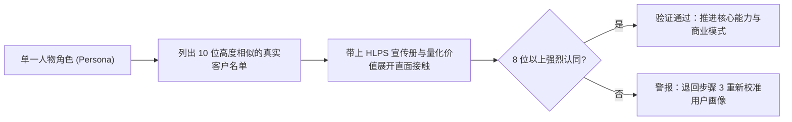
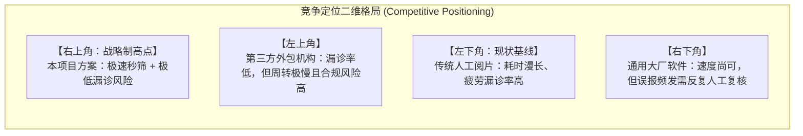

# Lec 9 确定下 10 个客户 (步骤 9) & 定义核心竞争力、竞争定位 (步骤 10-11)

> MIT 15.390 · New Enterprises · 模块三：价值主张与产品规格 · 主讲：Bill Aulet

## TL;DR

- 步骤 9 锁定紧随 Persona 之后的后续 10 位具体客户（Next 10 Customers），直接接触以验证 Persona 的群体代表性与用例可复制性。
- 步骤 10 界定企业内在唯一的“核心竞争力（Core）”，明确网络效应、极高转换成本或专有技术等不可复制的护城河，剔除先发优势等伪核心。
- 步骤 11 以 Persona 的前两大核心购买标准为坐标轴，绘制竞争定位图谱，直观展现自身方案相对替代品与现状的决定性碾压优势。
- 核心竞争力是对内资源配置的最高准则，而竞争定位是对外向客户传递价值差异的战略武器。

## 步骤 9：确定紧随其后的下 10 个客户 (Next 10 Customers)

在完成单个 Persona 的深度刻画与量化价值主张后，团队面临的最严峻挑战是：**这个 Persona 是否只是一个极端特殊的个案？**

为了验证海滩阵地市场的真实同质性，团队必须执行严谨创业法第 9 步：**锁定并接触后续 10 位真实客户（Next 10 Customers）**。

::: definition 后续 10 位客户 (Next 10 Customers)
滩头阵地内与你的 Persona 高度吻合的 10 位具有真实姓名、职务、单位与联系方式的潜在买家。团队必须与这 10 位潜在客户逐一沟通，验证他们是否与 Persona 具有完全一致的痛点、购买标准与使用预期。
:::

### 下 10 位客户验证准则
1. **名单具象化**：不能写“某三甲医院放射科”，必须精确到“波士顿儿童医院影像科副主任 Dr. Robert Hayes”；
2. **用例与规格契合度测试**：将第 6 步的全生命周期用例、第 7 步的高层产品规格（HLPS）宣传册以及第 8 步的量化价值主张展示给他们；
3. **退回修正信号（Pivot Signals）**：
   - 若 10 位客户中有 8 位以上产生强烈共鸣并认可价值主张，说明 Persona 具有高度同质代表性，滩头阵地坚实；
   - 若 10 位客户中仅有 2–3 位认可，其余客户表现出截然不同的需求或采购流程，说明 Persona 只是孤立个案，团队必须立即返回步骤 3 重新修正用户画像。

## 步骤 10：界定企业的内在核心能力 (Define Your Core)

当产品在市场上获得初步验证后，拥有庞大资本与销售团队的行业在位巨头很快就会察觉并迅速跟进复制。初创企业凭什么建立长期竞争壁垒？答案在于明确并坚守自身的 **Core（核心能力）**。

::: definition 核心能力 (The Core)
你在特定维度上做得比全世界任何对手都要优秀的唯一专属能力。它是企业的终极护城河，竞品即使投入十倍的资金、技术与人力，在短时间内也无法轻易跨越与复制。
:::

### 核心能力的四大底层真实形态

在长期的创业实践中，Bill Aulet 总结出真正具有持久防御力的核心能力通常表现为以下四种形态之一：

1. **网络效应（Network Effects）**：
   每增加一个新用户，所有既有用户的系统价值同步倍增。例如双边交易市场、即时通信协议或统一开发者生态。随着网络规模扩大，后来者几乎无法撬动既有网络的流动性壁垒。

2. **极高客户黏性与转换成本（Customer Lock-in / High Switching Costs）**：
   产品深度嵌入客户核心业务工作流或底层数据资产。替换本方案将引发不可承受的业务中断风险、海量数据迁移成本以及全员重新培训的组织摩擦。

3. **持续卓越的低成本结构（Sustainable Low-Cost Advantage）**：
   企业拥有独特的制造工艺、极简供应链协同或零摩擦分销架构（如早期的戴尔直销模式、西南航空单机型低成本运营）。这种成本结构让企业能够以竞品无法承受的低价维持可观利润。

4. **专有知识产权与技术诀窍飞轮（Proprietary Tech & Know-how Flywheel）**：
   不仅仅是一纸静态专利，而是算法结合高壁垒私有业务数据形成的持续正反馈迭代飞轮。系统能够随着使用不断自我进化，算法准确率与交付速度远超任何外部逆向工程模仿。

### 警惕常见的“伪核心”陷阱
- **“我们拥有专利/知识产权”**：专利极易被竞争对手通过微创新变通绕过，且初创公司根本打不起耗资数百万美元的跨国专利诉讼；
- **“我们跑得最快，拥有先发优势（First-Mover Advantage）”**：先发者往往沦为教育市场的行业先烈，后发大厂凭借充沛资金与既有分销网络可瞬间收割战果；
- **“我们的价格比巨头低 30%”**：单纯降价从来不是核心壁垒。巨头一旦开启价格战，可以用存量业务利润长期补贴，轻易将初创公司扼杀在现金流枯竭中。

::: insight
核心能力一旦确立，就必须在公司内部上升为最高宪法。**核心能力决定了你对什么说“不”**。任何无法强化核心能力的业务线或定制化客户需求，无论短期利润看起来多么诱人，都必须坚决拒绝。
:::

## 步骤 11：绘制竞争定位图谱 (Chart Your Competitive Position)

客户在采购时不会关心你的“底层核心算法有多么精妙”，他们只在乎：**你能为我带来什么实际好处？**

为了直观向客户与投资人证明你在滩头阵地中的不可替代性，必须绘制以客户第一优先级为基准的 **竞争定位二维图谱**。

### 坐标轴设定铁律
- **横坐标（X 轴）**：必须是 Persona 的 **第一核心诉求（Priority #1）**，如“单次筛查耗时极短（<1分钟）”；
- **纵坐标（Y 轴）**：必须是 Persona 的 **第二核心诉求（Priority #2）**，如“病灶漏诊率极低（<2%）”；
- **严禁使用自嗨指标**：坐标轴绝不能写“技术架构先进性”或“算法参数复杂度”等内部工程指标。

| 解决方案类别 | 第一优先级：单次阅片耗时 (X 轴) | 第二优先级：漏诊与合规风险 (Y 轴) | 综合定位与客户顾虑 |
| :--- | :--- | :--- | :--- |
| **现状：人工纯手工阅片** | 极慢（单张 8 分钟以上） | 高（晚班疲劳漏诊率高） | 传统基线，效率极低且风险不可控 |
| **通用大厂外挂软件** | 中等（单张 3–4 分钟） | 中等（误报率过高导致二次复查） | 大而全但针对性差，无法无缝嵌入工作流 |
| **外部第三方外包检测** | 极慢（需要跨机构传输与长周期等待） | 较低（由外包专家复核） | 隐私合规风险极高且严重拖慢诊疗节奏 |
| **本项目方案 (右上角制高点)** | **极快（单张 45 秒一键秒筛）** | **极低（3mm 结节漏诊率降低 85%）** | **稳居右上角绝对制高点，与替代品拉开战略鸿沟** |

::: pitfall
绝不能画出一张“自己孤零零在右上角，而其他象限空无一人”的竞争图。如果没有任何对手，通常意味着你所在的市场根本不存在真实需求。图谱中必须明确标出“现状（Status Quo）”，因为初创企业真正的第一大头号竞争对手，永远是客户“什么都不买、继续用老办法凑合”的既有惯性。
:::
