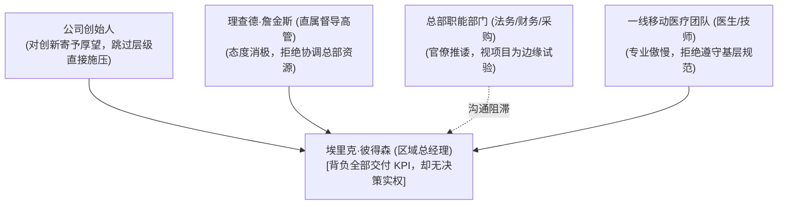

# Lec 01 创业领导力起步与埃里克·彼得森困境（上） (Introduction and Erik Peterson Part One)

> 授课教师：Prof. M. Diane Burton & Prof. Jesper B. Sørensen · MIT Sloan School of Management

## TL;DR

- 初任管理者在创业组织中常面临“权力与职责脱节”的结构性陷阱。
- 埃里克·彼得森案例揭示了缺乏明确汇报线与上级承诺时的执行死锁。
- 向上管理与横向利益相关者管理是初创团队推动业务的关键前置能力。
- 创业企业早期的角色模糊性要求管理者主动界定工作边界与支持资源。

## 创业组织系统设计：从个体英雄到体系构建

许多创业者在初创阶段将全部精力投注于产品构想与融资谈判，误以为优秀的人才只要聚在一起，团队协作与组织执行力就会自然涌现。然而，创业组织的本质是一个高度复杂的动态系统。在资源极度匮乏、市场充满不确定性的环境下，组织结构模糊、职责重叠与汇报关系错位往往在业务规模化之前就将团队消耗殆尽。

本课程的核心目标是帮助创业者建立“组织系统架构师（Organizational Architect）”的系统性视角。领导力不仅体现在个人的魅力演说与技术攻关上，更体现在对组织要素的敏锐诊断、对人才雇佣契约的审慎设计，以及在关键危机时刻协调各方利益冲突的战略判断力。

::: definition 组织一致性模型 (Congruence Model)
由纳德勒与塔什曼（Nadler & Tushman）提出、经伯顿与索伦森演进的组织分析框架。该模型强调组织的最终绩效取决于战略（Strategy）、人才（People）、关键任务（Critical Tasks）、正式组织（Formal Organization）与非正式文化（Culture）之间的动态匹配与相互支撑。
:::

## 经典案例诊断：埃里克·彼得森（Erik Peterson A）的困境

哈佛与麻省理工商学院共同采纳的埃里克·彼得森系列案例，是剖析初任管理者在创业扩张期遭遇组织困境的经典教材。

### 1. 背景与任务设定
彼得森毕业于顶尖商学院，被医疗器械初创企业 Biometra 任命为新建蜂窝电话网络诊疗中心（Cellular Mobile Care）的区域总经理。该业务模式属于公司极具野心的战略创新试点，旨在将移动诊断车部署到偏远社区。彼得森被赋予了开辟新区市场的全部职责，必须在数月内完成车队采购、医疗许可审批、医生签约与员工招聘。

### 2. 结构性矛盾与权力真空
然而，彼得森在走马上任后迅速陷入了多重交叉矛盾：
- **职责无限大 vs 权力近乎为零**：彼得森对区域损益负责，但他没有设备定价权，无法直接撤换不合格的总部外派医生，甚至连关键采购报销也需要总部层层审批。
- **多头汇报与角色冲突**：总部指派了资深高管理查德·詹金斯（Richard Jenkins）作为其督导人，但詹金斯对移动业务缺乏信心，态度冷漠；同时公司创始人直接向彼得森过问项目细节，导致管理沟通严重割裂。
- **孤立无援的横向关系**：总部各职能部门（采购、法务、财务）将彼得森的项目视为边缘试验，拖延提供支持，而彼得森选择依靠个人加班硬扛，未能在总部建立关键联盟。

在上述错综复杂的博弈中，彼得森将所有问题归咎于“下属能力差”或“上级不理解”，陷入了典型的技术/专业型管理者的认知误区。

## 初创管理者的四大执行误区

通过对彼得森早期行动的复盘，可以总结出创业团队新晋管理者最容易触发的四种失败模式：

| 失败模式 | 典型行为表征 | 组织后果 | 破局策略 |
| :--- | :--- | :--- | :--- |
| **单打独斗陷阱** (Individual Contributor Bias) | 遇到下属交付拖延，亲自代替下属干脏活累活 | 管理者沦为高级操作工，失去战略视野 | 建立清晰的交付基线与问责升级机制 |
| **向上回避陷阱** (Upward Avoidance) | 担心暴露自身脆弱，对上报喜不报忧，掩盖延误 | 上级预期失控，在最终爆雷时失去信任 | 早期主动同步关键瓶颈，争取高管政治资源 |
| **横向孤立陷阱** (Lateral Isolation) | 认为只要业务有理，其他职能部门理应无条件配合 | 遭遇部门墙与程序性推诿，审批寸步难行 | 寻找共同利益点，将创新项目与总部指标绑定 |
| **权力幻想陷阱** (Authority Illusion) | 误以为职位头衔会自然带来下属服从 | 无法驾驭资深行业专家与刺头骨干 | 依托专业声誉与同理心构建非正式影响力 |

::: insight
创业管理的第一法则是“不要指望别人把权力打包送给你”。在创业公司中，组织图谱往往是流动的草图，权力的本质是通过解决其他人的核心痛点而赢取的网络资本。若不能在入职前 90 天内打通向上求援与横向借力的网络，单纯依靠个人智力与勤奋必然走向枯竭。
:::

## 权责不对等时的领导力应对框架

面对上级支持不足与资源紧缺，成熟的创业领导者应当采取三步重构策略：
1. **重构契约与期望管理**：与直属上级和核心创始人举行一次坦诚的闭门会议，将口头愿景转化为可量化的阶段性里程碑，明确约定各项权力边界（预算自由度、人员任免权）。
2. **绘制利益相关者地图**：识别总部谁是创新的受益者，谁是潜在的阻力源。通过让渡部分功劳或在早期将试点成果包装为部门成绩，将总部中层拉入同盟阵营。
3. **建立微观胜任力与团队文化**：在无法撼动外部大环境时，优先在自己的小团队内建立透明的沟通准则与相互信任机制，形成局部高绩效护城河。

::: pitfall
在发现直属上级消极推诿时，切忌盲目越级向创始人告黑状。越级沟通虽然能获得一时的行政命令支持，但会彻底摧毁与直接领导的信任基础，导致后续日常协作遭到报复性阻击。
:::
