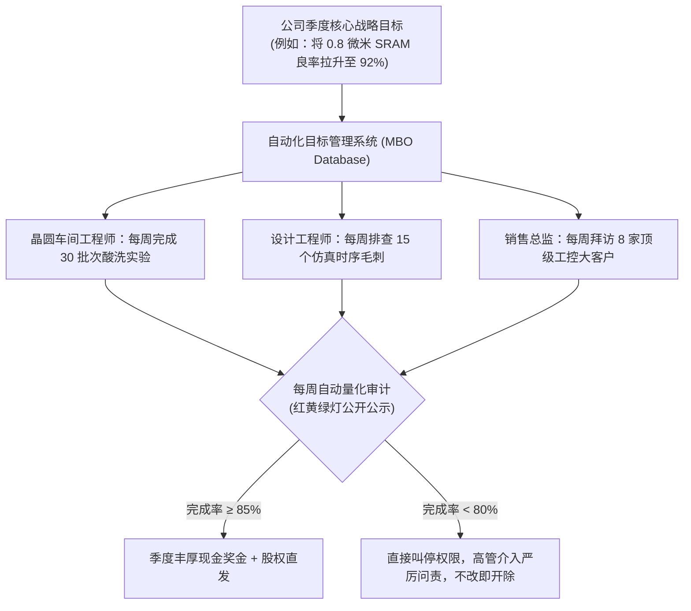

# Lec 10 高绩效问责与自动化管控：赛普拉斯半导体的铁腕法则 (Accountability and Control: Cypress Semiconductor)

> 授课教师：Prof. M. Diane Burton & Prof. Jesper B. Sørensen · MIT Sloan School of Management

## TL;DR

- 赛普拉斯半导体创始人 T.J. 罗杰斯开创了硅谷极度严苛的指标量化管理体系。
- 依靠自研自动化系统追踪全员每周目标，消除信息黑盒与借口。
- 极度透明的考核文化大幅降低了官僚层级内耗，提升了资本周转效率。
- 过度刚性的量化指标容易诱导短期投机行为，抑制非线性的探索性创新。

## 硅谷的另一面：拒绝温情脉脉的纯粹绩效主义

在公众普遍的认知中，硅谷的高科技企业文化往往与宽松、扁平、免费零食、带狗上班以及无限假期画上等号。然而，这种浪漫主义视角掩盖了半导体等重资本制造领域的残酷商业现实。在芯片制造行业，一条晶圆产线的建造成本高达数亿美元，机器每停工一分钟就意味着数万美元的真金白银蒸发；产品良率提升 1%，就是上千万美元的纯利润。

在这一容错率极低的工业战场上，**赛普拉斯半导体（Cypress Semiconductor）创始人 T.J. 罗杰斯（T.J. Rodgers）**开创了一套与“惠普之道”截然相反的强硬管理哲学：彻底摒弃人际温情与借口文化，依靠精密量化指标、绝对透明的数据追踪与不留情面的绩效问责，打造了一台精密运转的高绩效商业机器。

::: definition 无借口管理系统 (No-Excuse Management System)
将企业战略彻底拆解为每位员工每周可量化交付的具体目标，借助高度集成的管理信息系统进行实时追踪与红黄绿灯预警，使任何拖延与平庸在组织内部彻底透明化并直接与奖惩挂钩的管控体系。
:::

## 经典案例诊断：T.J. 罗杰斯的自动化监控大厦

### 1. 创立背景与反官僚执念
1982 年罗杰斯创立赛普拉斯，主攻高速静态随机存取存储器（SRAM）。罗杰斯早年在大型半导体国企历经了官僚扯皮与平庸腐化，他立誓建立一家“没有任何多余官僚、没有任何南郭先生”的极致效率企业。

### 2. 核心管控机制：目标管理（MBO）系统

在知识型团队中，传统的按工时考勤（如早上 9 点打卡、晚上 6 点打卡）不仅无法衡量真实的生产力，反而容易诱导出“工位磨洋工”的防御性平庸。员工可以在电脑前看似忙碌地坐上一整天，但实际上只是在浏览网页或编写毫无价值的垃圾代码。

罗杰斯的无借口管理体系的核心，在于将考核重心从“工作投入的形式（Input）”彻底转向“每周交付的客观结果（Output）”。通过自主研发的网络看板，赛普拉斯消除了层级传话带来的信息失真，让每一项承诺白纸黑字地暴露在全体同仁的注视之下。这种极致的透明度，构筑了一种强大而无形的同侪监督压力场。
早在个人电脑尚未完全普及的 1980 年代，罗杰斯便斥巨资自主研发了全公司联网的管理数据库：
- **目标颗粒度极其精密**：全公司每位员工（从清洁工、晶圆操作员到副总裁），每周必须在系统中维持 10 至 15 个极其具体的工作目标；
- **全公司实时公开可见**：系统彻底打破信息孤岛，任何员工都可以点开 CEO 或任何一位同事的主页，查看其本周的目标清单与历史完成率；
- **四小时法则与停机预警**：每周一下午，系统自动结算上周所有人的目标达成情况。如果某位员工的目标完成率连续多周低于 80%，系统会自动在其主管的屏幕上亮起红灯，并阻断其报销与差旅权限，直至整改完成。

### 3. “杀手软件（Killer Software）”与组织去中心化
罗杰斯最惊世骇俗的观点是：**“好的软件系统可以消灭 90% 的中层经理。”**
在赛普拉斯，没有专门负责催报表、传达指令的助理与项目协调员。系统会自动抓取库存异动、晶圆缺陷率与应收账款账龄，直接向责任人推送信标。凭借极高的自动化管控水平，赛普拉斯的管理层级比同等规模的半导体同行精简了一半以上。

## 赛普拉斯模式的得与失：量化管控的双刃剑

麻省理工学院组织学教授指出，罗杰斯的强权与数字化管控在带来极高执行效率的同时，也对组织的创新生态构成了深层反噬：

| 评估维度 | 积极商业收益 (光亮面) | 潜在系统性缺陷 (阴暗面) |
| :--- | :--- | :--- |
| **运营透明度** | 彻底消灭部门墙推诿，南郭先生无处藏身 | 员工面临长期高压与焦虑，长期心理健康损耗严重 |
| **战略执行速度** | 战略指令从董事会瞬间穿透到一线，响应极快 | 扼杀自下而上的探索性创新，员工只敢做可被量化的常规动作 |
| **资源使用效率** | 人均产值与资本周转率在硅谷半导体产业长年领跑 | 导致“唯指标论（Goodhart's Law）”，员工为保及格率故意降低目标难度 |
| **人才流动机制** | 吸引强抗压、以结果为导向的狼性执行者 | 难以容纳桀骜不驯、无法被常规考核约束的技术思想领袖 |

::: insight
古德哈特定律（Goodhart's Law）指出：“当一项指标变成目标时，它就不再是一项好指标。”在赛普拉斯后期，许多老练的工程师掌握了对付系统的技巧：他们会故意把原本 3 天就能做完的工作拆解为 5 个简单的微型目标填入系统，以此确保每周 95% 以上的高分。过度精密量化的考核，最终诱导了集体的防御性平庸。
:::

## 现代技术管理者如何汲取罗杰斯的管控智慧

虽然当代知识型企业不能简单照搬罗杰斯军营般的严苛打法，但其核心思想对于解决创业扩张期的“大企业病”极具借鉴价值：
1. **建立“单一事实来源（Single Source of Truth）”**：坚决摒弃通过层层邮件或 PPT 汇报业务进度的低效方式。通过统一的看板或系统直连底层数据库，让所有业务指标处于客观透明状态。
2. **区分“运营型业务”与“探索型业务”的考核容忍度**：对于成熟制造、销售转化与交付上线等确定性高的运营流程，坚决实行赛普拉斯式的刚性量化与每周对齐；但对于前沿技术攻坚与商业模式探索，必须划出保护区，允许长周期的定性评估与高试错容忍。
3. **推行“无废话、直击问题”的沟通文化**：坚决制止任何掩盖问题的修辞话术。在业务评审会议上，鼓励团队直奔失败原因与根因分析（Root Cause Analysis），把精力花在解决问题上而非维护面子。

::: pitfall
绝不要在缺乏清晰战略方向的前提下盲目上线复杂的监控软件。如果公司的战略本身是错误的，一套强大的自动化追踪系统只会以惊人的高效率把公司更快地推向悬崖。
:::
