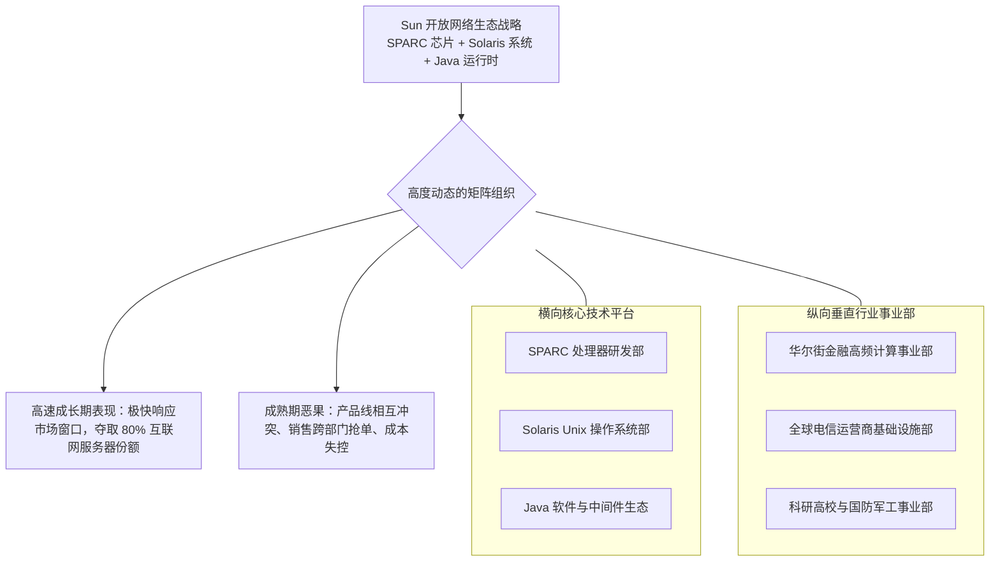

# Lec 11 激进网络战略与矩阵博弈：太阳微系统的成长与阵痛 (Scaled Management: Sun Microsystems)

> 授课教师：Prof. M. Diane Burton & Prof. Jesper B. Sørensen · MIT Sloan School of Management

## TL;DR

- Sun Microsystems 凭借“网络就是计算机”的开放标准击溃传统私有封闭巨头。
- 斯科特·麦克尼利推行高度激进、甚至略带混乱的内部竞争与矩阵管理。
- 在高速成长阶段，速度与进攻性优先于完美协调，内部赛马激发极强战斗力。
- 当产业进入成熟整合期，松散矩阵与产品线自相残杀成为公司溃败的深层诱因。

## “网络就是计算机”：重构计算产业格局的颠覆者

在 1980 年代初期，全球企业级计算市场被 IBM、DEC、惠普等老牌霸主牢牢统治。这些巨头依靠私有专有硬件架构、封闭操作系统与高昂的维护合同绑架客户，形成了坚不可摧的利润垄断堡垒。

在这一背景下，四位来自斯坦福大学与加州大学伯克利分校的年轻毕业生（安迪·贝托尔斯海姆、维诺德·科斯拉、斯科特·麦克尼利，以及后来写出 Java 的比尔·乔伊）创立了**太阳微系统公司（Sun Microsystems）**。他们提出了震撼业界的战略远见——**“网络就是计算机（The Network is the Computer）”**，凭借开放式 Unix（Solaris）、RISC 芯片架构（SPARC）以及开放工业标准，对在位巨头掀起了一场席卷全行业的降维打击。

::: definition 开放架构颠覆战略 (Open Architecture Disruption)
通过使用现成的商用现货零部件（COTS）、开源通用操作系统协议以及免版权费用的标准接口，以极低的研发投入与极快的迭代速度推出产品，打破在位垄断厂商通过私有封闭技术构筑的高价壁垒。
:::

## 经典案例诊断：斯科特·麦克尼利的牛仔式领导

### 1. 狼性文化与“受控的混乱（Controlled Chaos）”
斯科特·麦克尼利（Scott McNealy）执掌 Sun 长达 22 年。他性格火爆、热爱冰球对抗，在公司内部极力推崇一种崇尚进攻、无所畏惧的极客竞技文化：
- **“谁开枪快，谁先开枪”**：麦克尼利极其厌恶冗长的事前可行性论证，他鼓励各个工程团队“先开枪，再瞄准”。在 Sun，产品经理被赋予极大的立项自由度，哪怕项目之间存在功能重叠与自相残杀；
- **允许内部高度竞争**：如果两个团队分别提出了不同的图形工作站架构方案，麦克尼利不会在会议室强行裁判谁更优，而是拨付预算让他们各自造出原型，直接拉到市场上去跟真实客户碰撞，让市场来当终极裁判员。

### 2. 矩阵式组织与多归属博弈

矩阵式组织架构被誉为现代大型科技企业最复杂、也最富争议的管理发明。它打破了传统军队式单一命令链条（Command and Control），试图通过在纵向与横向设立平行的权力轴线，同时实现“技术平台的规模经济”与“垂直客户需求的敏捷定制”。

然而，矩阵组织的顺畅运转高度依赖于管理者高超的人际协商与利益平衡技巧。在高速成长期，充沛的利润掩盖了矩阵制天生带来的权力模糊与权责推诿；而一旦行业风口过去，双头汇报往往蜕变为旷日持久的高管政治摔跤，让任何一项新产品的量产审批陷入漫长的审批泥潭。
随着 Sun 业务从工作站向企业级服务器、企业存储与网络软件全方位扩张，公司引入了复杂的矩阵式组织架构：
- **横向职能轴**：芯片工程部、操作系统部、硬件制造部；
- **纵向业务轴**：金融行业事业部、电信事业部、政府教育事业部。

在互联网泡沫狂飙突进的 1995-2000 年间，几乎全球所有新生的互联网网站（雅虎、eBay、亚马逊、网景）都架构在 Sun 的高可靠性服务器之上，Sun 的市值一度突破 2,000 亿美元。

## 成长期的蜜糖 vs 成熟期的砒霜

Sun 的案例深刻揭示了同一种组织架构与领导风格在企业不同生命周期中所产生的截然相反的命运：

| 组织特性 | 创业爆发期 (1982-2000) 的积极作用 | 产业成熟整合期 (2001-2010) 的致命恶果 |
| :--- | :--- | :--- |
| **高度自主与分散立项** | 迅速抓住每个垂直领域突发的技术风口，跑马圈地 | 产品型号严重过剩，同公司销售在同一个客户门前大打出手 |
| **漠视内部冗余与重复** | 激发全员极度狂热的研发狼性，产品上市周期极短 | 研发预算被严重稀释，缺乏集中力量攻关新一代架构的战略定力 |
| **以攻为守的火爆领袖** | 在与微软件、英特尔（Wintel 联盟）的战斗中提振士气 | 盲目蔑视低成本 x86 架构崛起与 Linux 开源风暴，错失转型窗口 |
| **松散的横纵向矩阵** | 业务线能绕过总部官僚，灵活为头部大客户定制方案 | 随着组织膨胀至 4 万人，矩阵成为推诿借口，决策彻底瘫痪 |

::: insight
“混乱”在企业快速扩张期是一种健康的组织润滑剂，因为它能包容各种非共识的奇思妙想；但是，混乱必须以“高毛利”为充要条件。当整个互联网泡沫破裂、市场进入微利时代的精细化运营时，谁无法完成从松散自治向集约化运营的铁血收拢，谁就会被成本拖垮。
:::

## 矩阵组织管理的技术法则

对于今天正在经历规模化扩张的高成长型企业，Sun 的兴衰提供了宝贵的组织设计戒律：
1. **明确矩阵主次轴**：纯粹对称的 50/50 矩阵必然导致决策瘫痪。组织必须在制度上明确规定“谁是主轴、谁是辅助轴”（例如：产品技术平台拥有最终架构裁决权，行业线只拥有定制建议权与销售权）。
2. **设立内部赛马的“关门时限（Cut-Off Date）”**：可以允许两个团队在早期概念阶段分别探索不同方案，但必须在立项时明确约定裁决节点（如 6 个月内必须通过统一的基准跑分与核心客户盲测），决不允许赛马无限期拖延演变为派系内耗。
3. **敬畏底层成本曲线的颠覆**：Sun 最终被英特尔 x86 芯片加免费 Linux 操作系统的廉价服务器大军彻底摧毁。高科技领袖切忌因沉醉于高毛利自研架构的优雅，而低估了廉价标准化组件沿 S 曲线向上反噬的毁灭性力量。

::: pitfall
不要把“矩阵管理”当成逃避明确权力分配的借口。绝大多数平庸的领导者之所以推行矩阵制，是因为他们不敢直接得罪任何一方高管，企图用所谓的“协同与协商”掩盖自己的懦弱。没有清晰兜底仲裁机制的矩阵组织，本质上是对企业战略执行力的集体慢性谋杀。
:::
