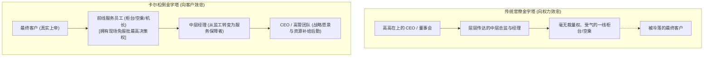

# Lec 12 以客户为中心与组织倒金字塔：北欧航空卡尔松的变革 (Customer-Centric Empowerment: Jan Carlzon)

> 授课教师：Prof. M. Diane Burton & Prof. Jesper B. Sørensen · MIT Sloan School of Management

## TL;DR

- 北欧航空（SAS）总裁扬·卡尔松开创了著名的“关键时刻（Moments of Truth）”服务哲学。
- 打破传统官僚层级，将组织结构彻底倒置，使一线员工直接拥有决策特权。
- 高管职责从发号施令的监工转变为一线员工的资源保障者与战略布道者。
- 一线充分授权需要清晰的安全红线与统一价值观底线作为坚实护栏。

## 谁才是企业真正的主人？传统官僚金字塔的异化

在绝大多数传统企业中，组织架构是一座严密的层级金字塔：董事会高居云端，副总裁、总监、经理逐级向下压制，最底层是一线员工（客服、销售、柜台接待、维修工）。在这一结构下，所有员工的眼睛都是“向上看”的：每个人都在处心积虑揣摩顶头上司的喜好、撰写漂亮的汇报材料以求升迁；而真正面对客户、为企业创造收入的一线员工，不仅在组织中地位最低、薪酬最薄，而且缺乏任何现场处理突发问题的裁量权。

麻省理工学院本讲通过对**北欧航空（Scandinavian Airlines System, SAS）传奇总裁扬·卡尔松（Jan Carlzon）**商业变革的深度解构，探讨如何通过重构权力流向，打造以真实客户体验为最高驱动力的高敏捷组织。

::: definition 关键时刻 (Moments of Truth)
企业与客户发生真实接触的每一次微观互动瞬间（通常只有 15 秒）。在这些短暂瞬间，客户会对企业的专业度、同理心与品牌信誉做出最直接的不可逆判断。企业一年的数亿美元品牌公关，往往决定于一线员工在这 15 秒内的微小举动。
:::

## 经典案例诊断：卡尔松逆转北欧航空的奇迹

### 1. 危机与传统自救手段的破产
1981 年，全球石油危机爆发，民航业遭遇寒冬。北欧航空陷入巨额亏损，每年亏损高达数千万美元，航班准点率跌落至全欧倒数。传统咨询公司给出的药方千篇一律：削减成本、封存机队、全员减薪、裁员 15%。

年仅 39 岁的扬·卡尔松临危受命出任总裁。卡尔松断然拒绝了削减成本的紧缩策略，他指出：“如果只靠削减成本，我们不仅无法自救，还会陷入服务恶化、客户流失、进一步亏损的死亡螺旋。”

### 2. 战略聚焦与“倒金字塔”组织重构

许多陷入亏损泥潭的企业管理者，在面对经营危机时本能采取的措施就是“向内看”：召开无休止的高管闭门会议、核算各项差旅开支、紧缩一线预算。然而，这些关起门来的算计不仅无法带来一分钱的新收入，反而让一线服务人员心灰意冷，导致服务质量进一步恶化。

扬·卡尔松的伟大变革在于彻底打破了这种自闭式的内部视角，将全员的注意力强行“拉向外部战场”。卡尔松深刻洞察到：航司真正的利润并不来源于总部的精打细算，而来源于高净值商务旅客在每一次出行时自发掏出的钱包。将组织权力向一线倾斜，正是为了让最能听见炮火声的人拥有呼叫炮火的权利。
卡尔松推行了一套颠覆性的战略重塑：
- **战略靶心单一化**：放弃争夺全客群，集中全部资源锁定欧洲高频全票价商务出行旅客（Frequent Business Traveler），提出“成为全欧洲最准点、最受商务人士信赖的航空公司”；
- **推倒传统金字塔，建立倒金字塔模型**：卡尔松提出，一线员工才是前线作战的步兵，整个总部的管理层唯一存在的合法性，就是为一线步兵提供弹药补给！

### 3. 经典的 15 秒现场授权
卡尔松赋予了一线基层极其惊人的现场裁量权：
- **行李超重豁免**：柜台人员可以根据客户紧急程度自行决定免收行李超重费，无需向值班经理请示；
- **误机紧急改签**：如果一位商务旅客因前序航班延误面临错失重要商业会议，一线地勤人员有权在无需任何审批的前提下，立即全额为客户购买竞争对手航空公司的即时航班，甚至全额报销其五星级酒店住宿与出租车费。

一年之内，北欧航空从全欧最差航空公司跃升为全球最佳航司，扭亏为盈创造了 8,000 万美元税前利润，成为商业史上最经典的逆转案例之一。

## 授权（Empowerment）的组织机制与制度护栏

许多管理者之所以不敢授权，是因为担心一旦放开权力，一线员工会滥用特权、乱花公司资金导致秩序彻底失控。卡尔松的实践证明，**成功的授权不是放任自流，而是建立在极高透明度与文化共识之上的纪律化工程**：

| 维度对比 | 伪授权 / 形式主义授权 | 卡尔松真正的倒金字塔授权 |
| :--- | :--- | :--- |
| **权力归属** | 允许员工提出建议，但签字盖章仍在经理手中 | 一线员工在特定额度与场景内拥有不可撤销的即时拍板权 |
| **信息可见度** | 财务与经营数据对下严密封锁，员工不知经营实情 | 全员极度透明，一线工人清楚了解每个航班的保本上座率与成本 |
| **容错机制** | 一旦出现授权偏差，立即追责通报并收回权力 | 将一线善意的判断失误视为“培训成本”，公开褒奖敢于担当的员工 |
| **管理层角色** | 挑刺、查岗、审核发票、审批例外申请 | 深入前线排查一线员工在服务客户时遇到的系统性流程卡点 |

::: insight
一个优秀的领导者，其终极价值不是证明自己有多么聪明能干，而是让组织中成百上千的普通人敢于在没有命令的时候做出卓越的判断。当你要求员工“对客户微笑、提供超越期待的服务”时，如果他为了帮客户退一张 20 块钱的餐券都需要找 3 个领导签字，他的微笑必然是机械而僵死的。只有当员工真正拥有尊严与权力时，他面对客户的眼神才会发光。
:::

## 现代企业如何构建“倒金字塔”响应体系

1. **量化梳理企业内部的“关键时刻”**：带领高管团队全面审视客户从接触产品到售后支持的每一个接触点，找出前 5 个最容易引发客户愤怒或极度惊喜的“15 秒瞬间”。
2. **设立“无需报批的现场授权额度”**：例如像丽思卡尔顿酒店（Ritz-Carlton）一样，明确授权一线员工在不需要向任何上级申请的前提下，每人每天拥有 2,000 美元的自主支配额度用于即时化解客户不满。
3. **将管理层的 KPI 与一线支持满意度挂钩**：在每季度的考核中，由一线业务员与客服团队给后台财务、法务、IT 与 HR 打分，考核后台部门解决前线阻碍的响应速度。

::: pitfall
千万不要在没有进行统一战略价值观布道的前提下进行“裸授权”。卡尔松在放权前，亲自飞赴几十个站点为全员进行了数十场深入浅出的服务哲学集训，并印发了通俗易懂的《红皮书》漫画手册。没有统一企业灵魂的盲目放权，必然演变为灾难性的无序与腐败。
:::
