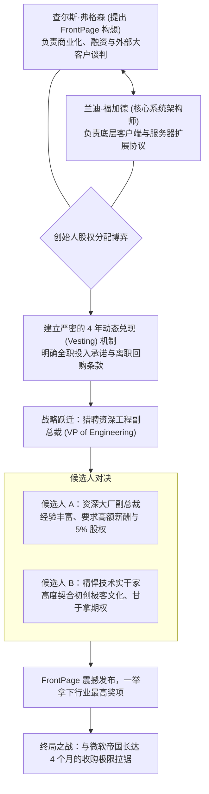

# Lec 13 初创合伙人股权、招聘与并购博弈：维米尔技术的 FrontPage 传奇 (Team Evolution and M&A: Vermeer)

> 授课教师：Prof. M. Diane Burton & Prof. Jesper B. Sørensen · MIT Sloan School of Management

## TL;DR

- 维米尔技术（Vermeer）开创了所见即所得网页编辑器 FrontPage 的技术先河。
- 案例详尽记录了联合创始人股权分配、动态既得权与高管搜寻的真实博弈。",
- 在引入资深工程副总裁时，创始人面临控制权稀释与团队专业化升级的权衡。
- 在与微软公司的世纪并购谈判中，创始人展现了高超的估值防御与战术韧性。

## 技术创业的微观实操：从车库构想到巨头并购

许多商学院课程倾向于讲授跨国 500 强企业的宏观战略与跨部门重组，对于刚走出大学校门的年轻创业者而言，这些宏大叙事往往显得过于遥远。创业者在第一天醒来面对的往往是极其具体而残酷的微观生存问题：我的联合创始人要走，他的股份怎么收回？我们该给新招来的工程副总裁多少期权？当微软这样的行业霸主伸出收购橄榄枝又暗含毁灭威胁时，我们该如何谈判？

麻省理工学院本讲通过哈佛商学院传奇案例——**维米尔技术公司（Vermeer Technologies）与 FrontPage 软件**的真实商业演进，完整拆解高科技创业企业从创始人股权切分、高管猎聘到最终被微软以 1.3 亿美元全资并购的教科书级实操全景。

::: definition 动态股权兑现 (Vesting Schedule)
初创企业联合创始人与核心骨干所持有的股权并非在设立第一天全部归其所有，而是必须按照工作年限（通常为 4 年）或战略里程碑分期逐步获取（通常包含 1 年悬崖期 Cliff）。一旦合伙人提前离职，公司有权以象征性价格回购未兑现的股权。
:::

## 经典案例诊断：查尔斯·弗格森与维米尔技术的狂飙之旅

### 1. 创立与核心技术构想
1994 年初，麻省理工学院政治学博士兼技术政策专家查尔斯·弗格森（Charles Ferguson）敏锐预见到互联网 Web 即将爆发，但当时编写网页必须手工编写晦涩的 HTML 代码。弗格森构想了一款“所见即所得（WYSIWYG）”的桌面网页编辑软件，让任何普通人都能像使用 Word 一样排版网页。

弗格森联合资深软件架构师兰迪·福加德（Randy Forgaard）共同创立了维米尔技术公司。产品代号 FrontPage。

### 2. 创始人股权分配与第一道生死劫

技术创业者最容易轻视的就是法律层面的股权分配协议。在创业最初的几个月里，大家都沉浸在改变世界的崇高激情中，谁也不愿意主动坐下来谈论“如果你不干了股权怎么办”这种破坏气氛的话题。许多联合创始人草草在一张餐巾纸上签下平均分股权的承诺，便急匆匆地投入开发。

维米尔案例给所有年轻技术人员上了最沉重、也最宝贵的一课：不谈利益才是对友谊最大的残忍。当业务推进到关键深水区时，合伙人之间的精力投入、家庭变故与风险承受力必然发生分化。如果没有前置的法律契约作为护栏，人性的幽暗面便会瞬间爆发，将原本极具前途的优秀技术产品彻底拖入股权死锁的深渊。
弗格森与福加德在初期经历了极其惊险的股权拉锯：
- 弗格森提出构想并负责融资与战略；福加德负责代码架构与技术实现；
- **早期致命疏漏**：最初双方未设立严格的股权兑现与离职退出协议。随着项目推进，福加德因个人健康与家庭原因提出希望减少工作投入，甚至萌生退意。如果按原方案福加德带走半数股权，公司将彻底失去后续融资能力！
- 经过激烈的法律博弈与风险投资人（Matrix Partners 与 Sigma Partners）的深度介入，双方重新签署了严密的动态 Vesting 协议，化解了解体危机。

### 3. 猎聘工程副总裁的经典抉择
随着代码体量暴增，两个创始人的管理带宽彻底过载。维米尔展开了全美猎聘工程副总裁的行动。这一过程展现了初创公司在招募高管时的核心纠结：
- 到底是选一个懂大企业正规流程、能镇住场子的行业名流？还是选一个能在泥泞中通宵调试底层代码的硬核悍将？
- 最终维米尔选拔了具备极强敏捷管理能力的工程骨干，并在期权池中划出 3-5% 的重磅份额，为 FrontPage 的按时量化交付奠定了基石。

### 4. 微软并购谈判的极限施压
1995 年底，比尔·盖茨在著名的“互联网海啸（The Internet Tidal Wave）”备忘录中警醒，微软必须全速进军互联网。微软派出顶级并购团队接触维米尔：
- **胡萝卜与大棒策略**：微软谈判代表一边给出数千万美元的报价，一边冷酷暗示：“如果你们不卖，微软雷德蒙德总部的 100 名顶尖工程师将在 6 个月内开发出同类产品，并在 Windows 中免费捆绑赠送，让你们一文不值。”
- **弗格森的战术反击**：弗格森没有被吓倒。他一方面加速与网景（Netscape）进行接触制造竞价恐慌，另一方面在公开媒体上高调展示 FrontPage 的跨平台技术优势。最终，微软被迫将报价一路拉升，在 1996 年 1 月以 **1.33 亿美元现金与股票**完成收购，维米尔团队实现了数百倍的投资回报。

## 创业合伙人与融资治理的四大铁律

通过对维米尔案例文献的逐句剖析，可以提炼出每位技术创业者必须刻在脑海中的法务与战略原则：

| 关键决策节点 | 业余创业者的错误做法 | 专业投资人与成熟创业者的做法 |
| :--- | :--- | :--- |
| **初期股权划分** | 哥俩好五五开，第一天就把股份分完且无任何锁定 | 依据未来贡献动态调整，必须包含 4 年 Vesting 与 1 年 Cliff |
| **高管期权分配** | 吝啬小气只给 0.5%，或者盲目给大厂空降高管 10% | 设立 10-15% 规范期权池，依据关键里程碑与绩效分批释放 |
| **面对巨头施压** | 吓破胆立即贱卖，或者由于情绪化傲慢直接掀桌子 | 识别巨头的时间紧迫度窗口，主动寻找第二买家营造竞价张力 |
| **尽职调查准备** | 知识产权混乱，代码中私自混入未经授权的开源协议 | 建立严密的代码审计与专利防御清单，保证随时接受跨国审计 |

::: insight
许多技术创业者极其鄙视“谈钱与谈股权”，认为只要大家兄弟同心，白纸黑字的合同会伤了感情。维米尔案例给所有人的警钟是：**最伤感情的恰恰是模糊不清的权力与利益界定**。在公司价值只有零的时候把最坏的情况（离职、翻脸、残疾、被收购）白纸黑字写进具有法律约束力的协议里，不仅不会破坏信任，反而是给团队友谊戴上了一顶最坚固的安全帽。
:::

## 应对并购谈判（M&A）的实战心法

1. **永远建立你的“最佳替代方案（BATNA）”**：在与任何行业巨头谈判收购时，你的最大底气不是口才，而是“老子随时可以不卖、并且能独立活下去”的备选方案。如果你账上只有 30 天现金流，你就不配拥有谈判筹码。
2. **利用巨头的内部焦虑**：巨头之所以花上亿美元收购一家几十人的初创公司，不是因为他们技术上做不出来，而是因为他们的内部官僚流程太慢，他们买的是“不可逆的时间窗口”。看穿这一点，你就能牢牢卡住高估值的咽喉。
3. **保持技术团队在收购交割前的心态稳定**：并购谈判往往历时数月且极易中途流产。创始团队必须在核心技术研发团队面前建立“信息保密防火墙”，绝不能让传闻干扰日常产品的版本迭代。

::: pitfall
在尽职调查（Due Diligence）阶段切忌隐瞒任何重大缺陷。微软等巨头拥有一流的法务与审计团队，一旦在交割前的最后审计中发现核心代码存在侵权漏洞或财务隐瞒，巨头会利用单方面排他协议残酷压价，甚至直接毁约将初创公司拖入诉讼深渊。
:::
