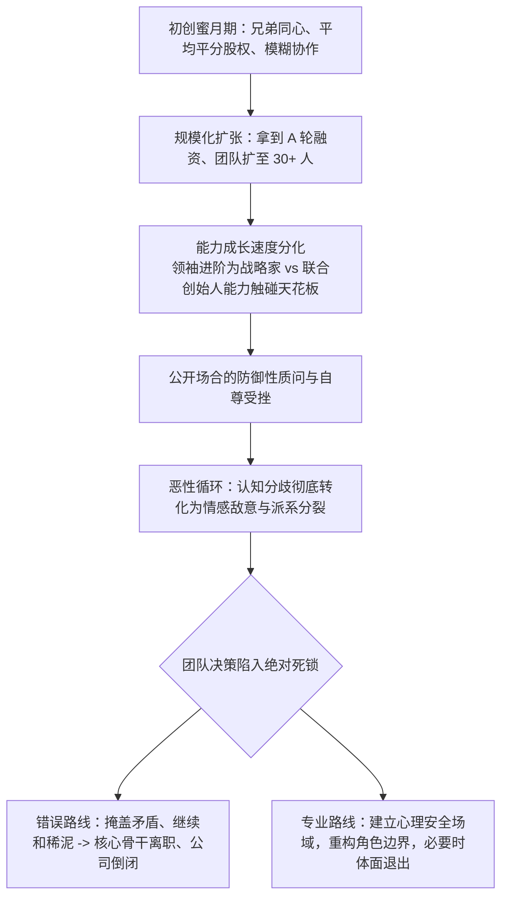

# Lec 14 团队危机化解与角色重构：马克·皮茨的冲突处理 (Conflict Resolution: Mark Pitts)

> 授课教师：Prof. M. Diane Burton & Prof. Jesper B. Sørensen · MIT Sloan School of Management

## TL;DR

- 创业初期的亲密伙伴关系在业务扩张期往往遭遇严重的认知与角色撕裂。
- 马克·皮茨案例展示了合伙人之间因能力天花板与沟通失调引发的死锁。
- 化解团队致命冲突需要建立非防御性沟通场域与客观的事实陈述机制。
- 当角色再造失败时，果断而体面的退出机制是保护企业生存的底线选择。

## 创业初创团队的隐形杀手：人际内耗与角色冲突

风险投资界的统计数据揭示了一个令人警醒的现实：超过 65% 的高科技初创企业最终倒闭，并非由于技术攻关失败或市场需求不存在，而是由于**联合创始人团队的内部撕裂与人际内讧**。在创业极度高压的环境下，长期的睡眠剥夺、财务紧绷与对不确定性的恐惧，会将个体性格中哪怕最微小的瑕疵放大为不可调和的仇恨与猜忌。

麻省理工学院本讲通过对经典案例**马克·皮茨（Mark Pitts）及其团队危机**的深度研判，探讨当核心初创团队遭遇信任崩塌、技能跟不上发展以及情感破裂时，领导者应当如何运用组织行为学工具进行危机干预与角色再造。

::: definition 认知冲突 vs 情感冲突 (Cognitive vs Affective Conflict)
- **认知冲突 (Task/Cognitive Conflict)**：围绕“如何完成工作任务、如何选择技术路线、如何制定商业战略”而展开的健康理性争论，能显著提升决策质量；
- **情感冲突 (Affective/Personal Conflict)**：围绕“个人品格评价、自尊心受挫、权力争夺与人身攻击”而产生的破坏性争斗，会导致团队心理安全感荡然无存并加速组织解体。
:::

## 经典案例诊断：马克·皮茨团队的螺旋下坠

### 1. 蜜月期的幻象与隐患
马克·皮茨与两位好友怀着巨大的激情联合创立了一家科技服务企业。早期三人无话不谈，在地下室吃同一份外卖、睡同一个通铺，彼此之间充满信任。
- 此时组织规模小，大家不计较具体头衔与权限边界，所有事情共同商量；
- 然而，由于缺乏对个人胜任力边界的客观评估，三人草率地平分了股权，并设立了模糊的“三驾马车”共同决策机制。

### 2. 规模化带来的能力天花板暴露

当一家初创企业拿到外部机构风险投资并迅速扩充人员时，联合创始人之间的心理契约往往会遭遇最残酷的现实考验。在车库阶段，只要有热情和基础编程技能就能扛起技术总监的重任；但在公司面临数十万用户的高并发架构挑战与二十人跨职能团队的管理调度时，个体的能力短板会被迅速暴露在聚光灯下。

此时，团队内部最容易爆发的致命误区，就是将客观的“胜任力差距（Competence Gap）”上升为主观的“人品与忠诚度攻击”。创始领袖如果缺乏处理敏感人际冲突的情商与专业对话工具，粗暴地在众人面前剥夺老伙伴的权力，必然会触发其激烈的防御性心理反弹，让原本可以平稳协商的角色调整演变为鱼死网破的派系内战。
当公司拿到首轮风险投资、员工规模突破 30 人后，环境发生了剧烈变化：
- 马克展现出了卓越的战略前瞻性与客户大单拿下能力，自然成长为核心领袖；
- 联合创始人之一的汤姆（化名）负责技术运营，但他缺乏管理 20 人工程团队的成熟经验，导致系统频繁宕机、客户投诉激增；
- 面对交付事故，马克开始在公开会议上直接指责汤姆能力不足；汤姆则认为马克“拿了投资人的钱就变修了、看不起当年的老兄弟”，双方的认知争论迅速恶化为激烈的**人身情感冲突**。

### 3. 沟通瘫痪与全员选边站队
到项目后期，两位联合创始人已经无法在同一个会议室平和交流。一线员工敏锐察觉到了最高层的冷战，整个办公室弥漫着压抑的气氛，老员工开始私下站队，关键决策被无限期搁置，企业命悬一线。

## 化解团队毒性冲突的四步干预模型

当创业团队出现严重的信任危机时，领导者绝不能指望“时间会冲淡一切”。必须由具备中立威望的第三方（资深投资人、创业导师或外部咨询顾问）介入主持**非防御性重构（Non-Defensive Restructuring）**：

| 干预步骤 | 核心行动要点 | 常见禁忌 (绝对严禁) |
| :--- | :--- | :--- |
| **第一步：建立物理隔离与情绪降温** | 暂停公开争议，分别进行 1 对 1 深度倾听，宣泄负面情绪 | 严禁在全员大会或普通员工面前爆发对峙争吵 |
| **第二步：剥离人身攻击，还原事实基线** | 用客观的业务数据（如交付延误天数、客户流失率）替代主观道德评判 | 严禁使用“你总是……”、“你从来都不……”等绝对化定性词汇 |
| **第三步：区分“角色”与“人”** | 明确告知对方：“我们质疑的是当前岗位的交付结果，绝非否定你对公司的历史功绩与个人品格” | 严禁在背后搞小动作联络其他股东企图暗中清洗排挤 |
| **第四步：设计双赢的角色重构或退出方案** | 转任首席架构师/技术顾问，或依据既得协议给予体面的股票折价回购与感谢仪式 | 严禁以法律漏洞强行剥夺其应得的股权与经济补偿 |

::: insight
在创业团队中，“好心人往往杀死公司”。许多创始人因为顾及朋友情面，对于明显跟不上公司发展步伐的早期合伙人迟迟不敢动刀，企图通过“增设虚职、派副手架空”来掩耳盗铃。这种行为不仅是对公司生存的不负责任，更是对那位合伙人的残忍折磨。真正的成熟是敢于坐下来开诚布公地谈清楚能力差距，并为其安排一条体面、受人尊重的离场通道。
:::

## 预防合伙人决裂的前置组织机制

1. **确立“同舟共济，但权力归一”的决策原则**：在创立第一天就必须确立唯一的最终决策裁决人（Tie-Breaker）。民主讨论至关重要，但在面临重大生死抉择且争执不下时，必须有一位领袖拥有合法的最终定夺权。
2. **设立定期的“团队健康度复盘会（Retro）”**：每月组织一次不谈具体 KPI、只谈团队协作感受的闭门复盘。强制每个人回答两个问题：“过去一个月，团队中哪件事让你感到沮丧？哪件事让你感到被支持？”在小火苗演化为大火灾前将其扑灭。
3. **引入外部中立董事会成员**：在董事会中保留至少一个独立董事席位（由经验丰富、与各方无利益冲突的连续创业者担任）。当创始人之间陷入僵局时，独立董事可以充当客观的心理缓冲器与仲裁者。

::: pitfall
绝不要试图用金钱来解决纯粹的自尊心受挫。如果一位联合创始人在组织中感到被边缘化、被羞辱，给他多发几万块钱奖金只会让他觉得这是施舍与侮辱。必须在战略地位、对外声誉与情感认可上给予充分尊重，才能达成真正的心理和解。
:::
