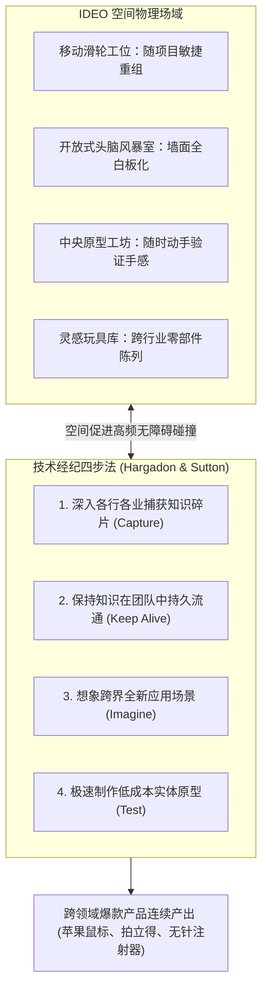

# Lec 15 高绩效创新办公环境设计：IDEO 的空间社会学 (Working Environments: IDEO)

> 授课教师：Prof. M. Diane Burton & Prof. Jesper B. Sørensen · MIT Sloan School of Management

## TL;DR

- 物理工作空间是塑造组织非正式沟通与创新密度的无声催化剂。
- IDEO 通过去中心化开放空间、悬挂式原型道具与极速头脑风暴室打破部门隔阂。
- 哈加顿-萨顿技术经纪人模型揭示了跨行业跨界创新的知识搬运逻辑。
- 高创造力环境需要在无压力发散探索与高强度原型验证之间取得平衡。

## 空间社会学：物理环境如何塑造组织行为

在传统的企业管理文献中，人们习惯于将关注点聚焦于组织架构图（Org Chart）、绩效指标与激励方案，而常常将员工日常置身其中的**物理建筑与办公空间（Working Environments）**视为纯粹的固定资产或后勤物业。然而，环境心理学与组织社会学研究揭示了一个冷酷的事实：**物理空间的布局是决定组织内部信息传递速度、权力距离与非正式碰撞概率的最具强制力的隐形结构**。

一堵厚重的承重墙或一道门禁刷卡，可以彻底阻断两个原本应当紧密协同的技术团队之间的所有自发对话；而一个精心设计的咖啡吧台或一个随处可见白板的挑空中庭，却能在不经意间催生出价值数千万美元的跨界创新构想。

麻省理工学院本讲通过对全球顶尖设计创新公司**IDEO**办公空间与组织机制的深度剖析，解构如何通过空间建筑设计与“技术经纪（Technology Brokering）”流程打造高创造力组织。

::: definition 技术经纪人模型 (Technology Brokering Model)
由安德鲁·哈加顿（Andrew Hargadon）与罗伯特·萨顿（Robert Sutton）提出的创新机制：创新往往不是在单一领域从零发明全新的科学原理，而是将某一个成熟行业（如医疗器械）中司空见惯的技术或概念，跨界“搬运”并重组到另一个对此浑然不知的行业（如儿童玩具或滑雪器材）之中。
:::

## 经典案例诊断：IDEO 的空间建筑与创新流水线

### 1. 反权威、去层级的物理空间实验

物理环境不仅是开展工作的场所，更是组织文化最直观的实体化体现。一间拥有独立行政卫生间、专用电梯卡与厚重红木大门的高管办公室，即便墙上挂着“倡导开放与扁平”的横幅，也在每时每刻无声地向全员传递着不容挑战的权力等级森严感。在这种环境下，普通基层员工在与管理层对话时会本能地产生心理戒备与自我防卫。

IDEO 的空间设计哲学正是为了彻底瓦解这种潜意识中的阶级壁垒。通过将所有办公家具轮子化、将所有墙壁白板化、将所有零件陈列化，IDEO 构建了一个极度去神圣化的“极客游乐场”。在这里，没有不可触碰的权威，也没有不可推翻的权威定义，所有的想法都必须在开放的原型台前接受客观的物理测试。
在加州帕洛阿尔托的 IDEO 总部，你找不到任何一间带有尊贵皮椅的“高管独立办公室”：
- **空间平等主义**：创始人戴维·凯利（David Kelley）与刚入职的设计实习生一样，坐在完全开放的工位上；工位装有滑轮，员工可以根据当前项目的变动在几分钟内自由拼装重组；
- **视觉化与触觉化轰炸**：天花板上悬挂着各式各样被肢解的自行车车架、吸尘器外壳与塑料模型；墙面上铺满了写满灵感的彩色便利贴；
- **无处不在的原型制作间（Shop）**：在办公区域中央设立了完备的车床、泡沫切割机、3D 打印机与胶水枪，工程师在讨论完一个概念后，几小时内就能用硬纸板和乐高积木捏出一个实体模型。

### 2. 技术经纪的四步实操循环
哈加顿与萨顿在《行政科学季刊》上发表的里程碑研究指出，IDEO 之所以能持续产出颠覆性设计，核心在于其组织空间对技术经纪流程的高效支撑：
1. **跨界捕获（Capture）**：设计师每年承接数十个截然不同的行业项目（从高铁机车到牙刷），在每个项目中捕获该行业的独特材料与工艺诀窍；
2. **知识保鲜（Keep Knowledge Alive）**：设立专门的“灵感档案馆（Tech Box）”，存放成百上千种奇形怪状的传感器、齿轮与高分子凝胶，供全员随时把玩；
3. **跨界联想（Imagine New Combinations）**：在面对全新挑战（如设计一款新型防漏水壶）时，团队从医疗输液阀和潜水呼吸管中提取灵感；
4. **原型验证（Put Concepts to the Test）**：绝不搞空洞的纯理论辩论，用实体模型让客户亲自上手体验，以最快速度暴露出潜在的人机工程学硬伤。

## 办公空间类型的组织效应矩阵

麻省理工学院组织学研究对四种典型的企业办公环境形态及其产生的文化效应进行了对比：

| 办公空间布局形态 | 物理空间特征 | 核心优势 | 潜在系统性缺陷 | 适配业务类型 |
| :--- | :--- | :--- | :--- | :--- |
| **蜂巢型 (The Hive)** | 密闭格子间、千篇一律、高隔板遮挡 | 空间利用率极高、租金成本低 | 员工缺乏归属感，人际冷漠，彻底扼杀跨界交流 | 数据录入、低端呼叫中心 |
| **单间密闭型 (Cellular)** | 每个人拥有独立关闭的办公室、厚重木门 | 极高的个人专注度与隐私性 | 强化官僚等级壁垒，信息传递损耗巨大 | 独立审计、传统律所、纯理论数学研究 |
| **群聚型 (The Den)** | 类似 IDEO 的项目战室（War Room）、高度开放 | 团队同频共振、沟通摩擦为零 | 噪音严重干扰深度思考，容易引发认知疲劳 | 敏捷研发攻坚、工业设计、突发危机公关 |
| **俱乐部型 (Club)** | 混合型布局：涵盖专注静音仓、开放咖啡区与共享工位 | 兼顾个人专注与自发社交，极具灵活性 | 资产改造成本较高，需要极高的自律文化 | 现代高科技软件工程、混合办公企业 |

::: insight
办公桌不是摆放电脑的家具，而是“组织权力的实体化投射”。当你走进一家公司，看到管理层的办公室占据了采光最好的朝南全景落地窗，而普通员工被挤在不见天日的阴暗连排工位上时，这家公司口头宣称的“我们人人平等、鼓励下属畅所欲言”就彻底成了一句谎言。物理空间的诚实度，永远超越管理层的公开演讲。
:::

## 打造高创新密度办公空间的实践指引

1. **缩短“关键碰撞距离（Collision Radius）”**：麻省理工学院托马斯·艾伦教授著名的“艾伦曲线（Allen Curve）”表明：**当两位员工的物理距离超过 30 米时，他们日常发生自发沟通的概率将暴跌至接近零**。确保需要跨职能紧密协同的骨干（如产品经理、UI 设计师与核心架构师）处于彼此视线可及的 15 米黄金半径内。
2. **将茶水间打造成组织的“引力中心”**：将最好的咖啡机、零食吧与舒适沙发放置在动线的核心十字路口，强制创造不同部门员工在接水和排队时的偶然邂逅（Serendipity）。
3. **设置“静音深潜区”防范开放式噪音灾难**：完全开放式的大平层如果缺乏隔音舱，会导致程序员在嘈杂的电话交谈声中无法进入深度编码心流。高水平的空间设计必须严格区分“高噪音协作区”与“绝对静音专注区”。

::: pitfall
切忌盲目照搬所谓硅谷风格的“滑梯、秋千与游戏机”。如果一家公司缺乏对员工的人格尊重、缺乏清晰的授权机制与容错文化，摆上几台足球机只会沦为员工眼中虚伪的公关摆设，甚至会导致员工因为害怕被视作“偷懒”而根本不敢靠近。
:::
