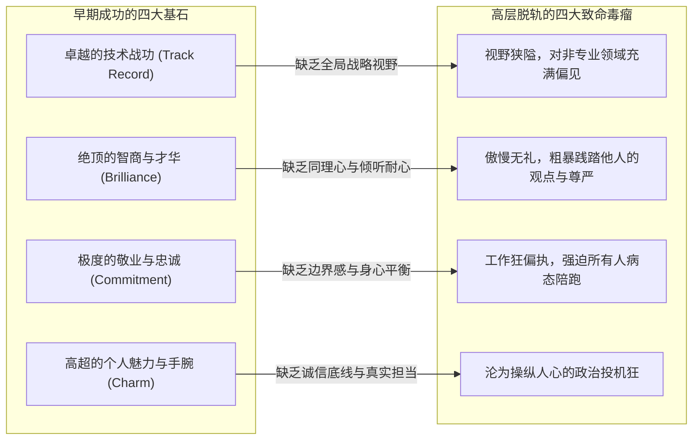

# Lec 16 领导力脱轨与风险投资合伙人博弈：凯勒基金风云 (Leadership Derailment: The Keller Fund)

> 授课教师：Prof. M. Diane Burton & Prof. Jesper B. Sørensen · MIT Sloan School of Management

## TL;DR

- 高管在职业生涯早期促成成功的核心优势，往往在更高层级蜕变为致命弱点。
- 聪明才智转化为傲慢霸道，忠诚敬业转化为要求全员病态加班。
- 凯勒基金案例深入剖析了早期风险投资机构内部合伙人分红与治理困局。
- 建立定期的外部 360 度匿名反馈与合伙人权力制约是防范脱轨的关键。

## 优势的反噬：为什么极具才华的管理者会突然“脱轨”？

在企业管理与高管领导力发展领域，存在一个令人困惑的长久谜题：为什么许多在职业生涯前十五年战功赫赫、被誉为“商业奇才”的领袖，在晋升为最高统帅（CEO）或掌管一家独立合伙企业后，却在短短两三年内遭遇灾难性的滑铁卢（Derailment）？

顶尖组织心理学研究（包括麦考尔 McCall 与隆巴多 Lombardo 的经典高管追踪调查）指出：**导致优秀管理者最终脱轨的，往往不是他们身上的弱点，而是他们赖以成名的“核心优势”的恶性过度膨胀**。当外部环境从“执行确定性任务”跃迁为“复杂人际博弈与战略平衡”时，过去的成功反而构筑了最深层的心理自负堡垒。

麻省理工学院本讲通过对**凯勒基金（The Keller Fund）**内部管理危机与合伙人博弈的真实案例剖析，系统解构高管脱轨的深层机制及风险投资机构（VC）内部治理的复杂动态。

::: definition 领导力脱轨 (Executive Derailment)
原本具备极高潜力、过去业绩辉煌的资深管理者，在达到高级领导岗位后，由于未能适应新层级的复杂人际与战略要求，暴露出致命的行为偏差，最终导致其被董事会解雇、合伙人背叛或被迫出局的现象。
:::

## 核心机制：成功特质如何异化为致命缺陷

麻省理工课堂上展示的高管脱轨对照矩阵，深刻揭示了四种最经典的人格特质在其职业生涯不同阶段的异化轨迹：

| 原始成功特质 | 早期促进跃迁的正面表现 | 高层职位上的异化与致命弱点 |
| :--- | :--- | :--- |
| **辉煌战功 (Track Record)** | 在特定技术或销售职能领域总能超额交付，成为不可或缺的单兵大将 | 极度迷信自己过去的狭隘经验，看不起财务、人事与法务等支撑职能，抗拒战略转型 |
| **才华横溢 (Brilliance)** | 学习能力极强，能在 5 分钟内看穿复杂的财务模型与架构漏洞 | 表现得不可一世，经常在公开会议上粗暴打断并羞辱下属，导致身边聚集唯唯诺诺的庸才 |
| **极致敬业 (Commitment)** | 视工作为生命唯一意义，一周工作 90 小时，对公司无限忠诚 | 将个人生活强加于他人，认为不通宵的员工就是缺乏忠诚，彻底搞垮整个团队的家庭与身心健康 |
| **八面玲珑 (Charm)** | 极富亲和力，极擅长向上管理与讨好重要投资人 | 缺乏做艰难决策与得罪人的勇气，见人说人话见鬼说鬼话，最终在团队内部丧失根本信任 |

## 经典案例诊断：凯勒基金内部的合伙人内战

### 1. 基金创立与明星合伙人的崛起
凯勒基金是一家专注于早期硬科技投资的知名风投机构。高级合伙人凯勒（化名）凭借其敏锐的技术嗅觉，在早期连续捕获了两家独角兽企业，为基金赚取了数亿美元的超额收益，从而在基金内部确立了说一不二的绝对权威。

### 2. 独裁统治与业绩分成（Carried Interest）分歧
随着新一期规模达 5 亿美元的基金募集完成，内部治理矛盾急剧爆发：
- **收益分配严重失衡**：凯勒坚持独占 60% 以上的基金业绩分成（Carried Interest），给其他几位共同负责案源开拓与投后管理的年轻合伙人仅留下微薄的份额；
- **投资过会决策独裁化**：原本设立的投委会多票制沦为走过场。凡是凯勒看好的项目，即使尽职调查漏洞百出也强行过会；凡是其他合伙人挖掘的项目，凯勒只要看不顺眼就一票否决；
- **年轻合伙人集体反水**：三位最具潜力的年轻合伙人在长期的自尊受挫与经济压榨下，暗中联络基金的主要出资人（LP），并在年度出资人大会前夕集体递交辞呈并另立门户，直接导致凯勒基金新一期募资流产并名誉扫地。

## 风险投资机构（VC）合伙关系的深层脆弱性

与传统企业不同，专业服务机构与投资合伙企业的资产“每晚都是坐电梯下班的”。合伙人之间本质上是平等自愿的知识协同体，而非行政命令下的雇佣关系：
- **知识产权与案源的个人依附性**：优秀的创业者往往只认某一位具体的投资合伙人，而不是认基金的招牌；一旦合伙人离职，案源网络会被连根带走；
- **长周期的激励滞后性**：一支风投基金的退出周期长达 7 至 10 年。如果早期股权与分成机制未能绑定中长期价值创造，团队必然在周期中途分崩离析。

::: insight
优秀的领导者在攀登职业阶梯的过程中，必须经历一次痛苦的“心理断奶”：早期你的价值来自于“你自己有多强”（个人贡献者思维）；而成为高级合伙人或 CEO 后，你的唯一价值在于“你能否让身边的其他人变得更强”。如果一个领导者始终沉醉于证明自己是会议室里最聪明的人，他实际上已经敲响了自己领导力生命的丧钟。
:::

## 建立高管自我防卫与纠偏机制

为防范自身或核心高管陷入脱轨深渊，企业与投资机构必须建立三道制度护栏：
1. **推行非利益相关的 360 度匿名心理评估**：每年聘请外部资深组织心理学专家，对创始合伙人及核心高管进行深入的下属匿名访谈，客观排查盲点（Blind Spots）。
2. **设立明确的合伙人退伙与分成继承机制（Sunset Clause）**：在基金创立第一天就用法律协议约定清楚：未来新基金的业绩分成如何随年轻骨干的晋升动态再分配，避免老合伙人凭借历史功劳形成永久性分肥垄断。
3. **寻找一位敢于泼冷水的“首席异见官”**：高管身边必须有一两位无论面对多大压力都敢当面直言其荒谬决策的知心挚友或独立董事，这是抵御独裁自大狂的最后解毒剂。

::: pitfall
不要试图用“他虽然脾气坏、羞辱下属，但他能赚钱”作为借口去长期纵容一位有毒高管。无数商业史案例表明，一个才华横溢但品格有毒的高管所破坏的组织信任与人才流失损失，最终会数倍吞噬掉他所贡献的那点短期利润。
:::
