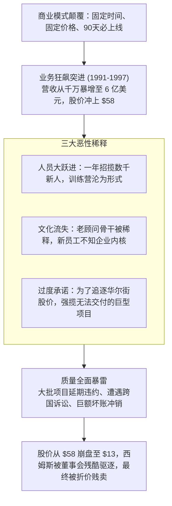

# Lec 17 专业服务业的极速规模化：剑桥技术合伙人的起落 (Service Scaling: Cambridge Technology Partners)

> 授课教师：Prof. M. Diane Burton & Prof. Jesper B. Sørensen · MIT Sloan School of Management

## TL;DR

- 剑桥技术合伙人（CTP）凭借“固定时间、固定价格”颠覆了传统 IT 咨询业。
- 高强度的入职集训营（Bootcamp）成为初期快速复制文化与交付能力的熔炉。
- 年营收从千万飙升至 6 亿美元的极速膨胀导致服务质量失控与客户诉讼。
- 重度依赖人力的知识服务型企业在规模化扩张中面临严峻的“质量稀释定律”。

## 知识密集型服务的规模化难题

在软件与互联网行业，边际成本接近于零，一套成熟的代码可以瞬间分发给上亿用户，享受极高经营杠杆。然而，在管理咨询、系统集成与定制化企业级服务等**以人为核心资产的专业服务业（Professional Service Firms, PSFs）**中，企业的每一分营收都必须对应具体的咨询顾问工时。

当这类企业试图追求类似高科技软件公司一样每年 50%-100% 的爆发式增长时，就会撞上一道坚硬的物理铁墙：**合格专业人才的培养速度无法跟上资本驱动的扩张步伐**。为了达成华尔街的增长指标，企业只能被迫降低招募标准、压缩入职培训周期，并把尚未成熟的新人推向客户现场，最终引发服务崩溃。

麻省理工学院本讲通过对 1990 年代 IT 咨询霸主**剑桥技术合伙人公司（Cambridge Technology Partners, CTP）**兴衰史的系统解构，深入探讨专业服务企业在规模化狂飙中的文化稀释与质量失控风险。

::: definition 固定时间/固定价格模型 (Fixed-Time / Fixed-Price Model)
CTP 首创的咨询服务商业模式：与传统 IT 巨头（如 IBM、埃森哲）按天按人头计费（Time and Materials）且常年无限期延期拖延不同，CTP 向客户承诺在极短的确定时间内（如 90 天内）以固定总包费用交付可运行的客户端/服务器系统，超时一切损失由 CTP 自行承担。
:::

## 经典案例诊断：CTP 的神话与崩塌

### 1. 颠覆传统的商业模式创新
1991 年詹姆斯·西姆斯（James K. Sims）执掌 CTP。当时全球大企业对传统 IT 咨询公司的漫长拖延极其厌恶。西姆斯开创了革命性的商业打法：
- **前置急速概念验证（Radical JAD Workshops）**：在签约前把客户高管拉到马萨诸塞州剑桥，用 3 天时间通过白板头脑风暴直接画出系统原型；
- **90 天固定总包交付**：将庞大的企业系统拆解为数个 90 天内必上线的敏捷冲刺，将工程风险从客户身上转移到自己身上，一举击穿在位巨头防线。

### 2. 文化的军营式复制：CTP 训练营（Bootcamp）

专业服务机构的核心竞争力在于其交付成果的一致性与品牌信誉。当一家咨询公司只有几十名资深合伙人时，企业可以通过面对面的言传身教维系极高的交付质量。然而，当业务规模迅速膨胀、成千上万名毫无经验的年轻应届生涌入机构时，如何在极短的时间内将企业底层的价值观、方法论与敏捷交付代码库复制进他们的大脑，是决定企业生死的核心挑战。

CTP 的魔鬼训练营不仅是一次高强度的技术培训，更是一场充满仪式感的社会化熔炉（Socialization Crucible）。在长达数周的高压攻坚中，学员们共同经历挫折、共同攻克严苛的模拟案例、共同接受资深合伙人的无情复盘。正是这种军营式的淬炼，将来自五湖四海的陌生年轻人锻造成了一支行动一致、步调统一的特战旅。
在早期扩张阶段，西姆斯设计了一套极具凝聚力的文化锻造机制：
- 所有新招募的顶尖大学毕业生，无论派驻全球哪个分公司，必须先在波士顿总部接受长达数周的高强度**封闭式魔鬼训练营（Bootcamp）**；
- 在训练营中灌输极度强烈的客户承诺、团队配合精神与独特的 CTP 专用敏捷代码库，全员身着统一步伐一致，形成了极高的组织凝聚力与交付一致性。

### 3. 增长的诅咒：质量雪崩与创始人出局
1997 年后，为了迎合华尔街对其持续 40% 以上增长的预期，CTP 陷入了彻底的盲目膨胀：
- **培训机制被彻底架空**：由于客户订单暴增，新员工周一刚办完入职手续，周二就被直接塞上飞往客户现场的航班，神圣的训练营被缩水甚至取消；
- **过度承诺导致多米诺骨牌倒塌**：咨询顾问开始硬接复杂的全球级 ERP 遗留系统改造项目，这完全超出了固定价格模型的承载极限。项目大面积延期违约，客户拒绝付款并提起欺诈诉讼；
- 1998-1999 年，CTP 股票发生断崖式崩盘，股价从 58 美元暴跌至 13 美元，公司不得不计提近千万美元坏账。缔造了 6 亿美元帝国的大功臣西姆斯被董事会无情驱逐，最终 CTP 在 2001 年被 Novell 以极低估值折价收购。

## 知识服务企业的“质量稀释定律”

麻省理工学院组织学教授指出，任何知识服务型企业在制定扩张战略时，都必须敬畏以下不可违背的数学与社会学规律：

| 规模扩张维度 | 稳健有机增长状态 (每年 15%-25%) | 资本催熟失控状态 (每年 >50%) |
| :--- | :--- | :--- |
| **老带新比例 (Mentorship Ratio)** | 1 名经验丰富的老资深顾问带 2 名新手，手把手传帮带 | 1 名老顾问要带 8 名以上完全无经验的新人，辅导彻底归零 |
| **文化仪式感认同** | 员工对企业独特的底层价值观与方法论拥有深厚自豪感 | 员工只将企业视为领薪水的普通跳板，缺乏任何情感抵押 |
| **客户承诺边界** | 敢于拒绝不匹配自身核心能力的大客户与怪异需求 | “先拿下来再说”，为了短期做大流水被迫迎合一切畸形诉求 |
| **风险敞口控制** | 严格评估固定价格项目的技术不确定性，留足缓冲准备金 | 忽视底层架构技术陷阱，将全公司命运赌在单一大单上 |

::: insight
“规模不是免费的午餐”。在软件行业，规模带来的是网络效应与极高利润率；而在重度依赖智力交付的专业服务行业，**过快追求规模往往带来的是平庸与自杀**。世界上最顶尖的专业服务机构（如早期的麦肯锡或高盛）之所以能在百年间保持金字招牌，核心就在于它们敢于为了守护质量标准而主动克制扩张欲望，甚至定期拒绝大量送上门来的高利润业务。
:::

## 现代企业服务（ToB）团队的规模化防御法则

1. **守护核心人员招募标准底线**：不论销售前端拿到多少大单，绝对不能因为“缺人干活”就降低面试门槛。宁可推迟开工日期或退单，也绝不在市场上招募二流平庸人员滥竽充数。
2. **制度化隔离“标准化产品交付”与“定制化咨询”**：不要试图用一套固定流程通吃所有需求。将业务清晰划分为可被代码自动化解决的标准交付模块，与必须由精英专家深度驻场攻坚的高难度定制模块，分别核算风险敞口。
3. **建立项目红黄旗早期熔断机制**：设立独立于销售团队的项目质量审计小组。一旦发现某个交付项目出现核心需求蔓延（Scope Creep）或技术架构跑偏，立即亮起红旗并启动项目重构，决不允许项目经理为了粉饰太平而隐瞒延误。

::: pitfall
绝不要在公司规模急剧扩张时取消基础入职集训！许多管理层为了省钱或赶交付，最先砍掉的就是新人的脱产培训与企业文化布道。这种举措在第一季度看似提高了人效，但它埋下的隐性质量炸弹，会在接下来的两年内将整个公司的品牌信誉炸得粉碎。
:::
