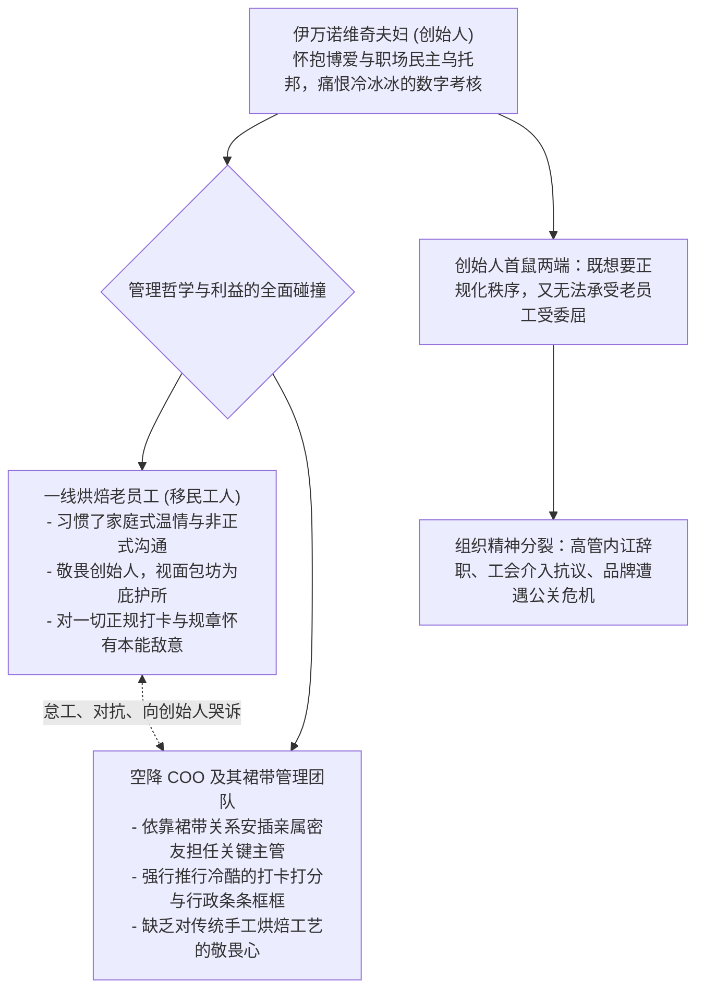

# Lec 18 理想主义愿景与商业现实撕裂：伊吉面包坊的治理困局 (Values-Driven Organization: Iggy's Bread)

> 授课教师：Prof. M. Diane Burton & Prof. Jesper B. Sørensen · MIT Sloan School of Management

## TL;DR

- 伊吉面包坊案例揭示了将崇高人文情怀与职场民主引入传统制造时的残酷现实。
- 过度追求家庭式无差别关怀往往演变为平庸者的庇护所与考核真空。
- 在引入外部专业职业经理人时，裙带关系与双重标准导致管理彻底瘫痪。
- 有尊严的人文关怀必须建立在严谨的财务纪律与高效的流程运营基础之上。

## 理想主义的暗礁：当崇高价值观遭遇商业重力

在当代创业思潮中，有越来越多的创始人渴望建立不同于传统资本主义冰冷雇佣关系的“价值观驱动型企业（Values-Driven Enterprise）”。他们梦想消除层级压迫，实行职场民主，把员工当成亲人，向所有人支付高于市场水平的体面薪酬，并提供终身关怀。

然而，企业终究是生存于竞争激烈的市场经济生态之中的经济组织。商业世界有一套冷酷的物理学重力定律：**不论愿景多么崇高，企业的总收入必须大于总成本，现金流断流就会死亡**。当创始人的理想主义蜕变为拒绝面对财务现实、拒绝考核追责与盲目排斥科学管理时，这种善意往往会演变为毁灭性的管理灾难。

麻省理工学院本讲通过对哈佛商学院经典案例——**世界之面包·伊吉面包坊（Iggy's Bread of the World）**内部管理风暴的深度剖析，解构企业在平衡社会理想与商业纪律时的深层困境。

::: definition 价值观与运营失调 (Values-Operations Misalignment)
企业在口头愿景中确立了极高标准的人文与伦理目标，但在底层的生产调度、成本控制、绩效问责与决策权限等微观运营制度上缺乏支撑甚至自相矛盾，导致组织陷入虚伪、内耗与财务危机的状态。
:::

## 经典案例诊断：伊吉面包坊的爱与痛

### 1. 创立与崇高的烘焙乌托邦
伊戈尔（Igor）与卢德米拉·伊万诺维奇（Ludmilla Ivanovic）夫妇早年从饱受战火摧残的南斯拉夫移民美国波士顿。他们创立了伊吉面包坊，主打传统手工欧式硬壳面包。
- **狂热的品质追求**：坚持纯天然发酵、绝不添加任何化学防腐剂，伊吉面包迅速风靡波士顿顶级餐厅与高档超市，成为当地极具美誉度的标杆品牌；
- **博爱主义的组织哲学**：伊万诺维奇夫妇立誓把面包坊办成一个跨越国界与种族的“爱的大家庭”。他们大量录用移民劳工与弱势群体，提供丰厚的带薪休假，甚至借钱给员工买房买车。

### 2. 增长失控与引入“外部救星”

当理想主义的创业者第一次面对企业规模化扩张带来的混乱时，他们往往会产生一种深刻的自我怀疑与焦虑。面对堆积如山的账单、不断延误的订单与员工的抱怨，创始人最容易产生的心理幻觉，就是渴望从外部寻找一位无所不能的“职业经理人教父”来替自己搞定所有脏活累活。

然而，如果创始人在引入外部专业高管时，依然沿用私人朋友圈的熟人推荐机制，甚至盲目容忍外部高管在企业内部拉帮结派、安插亲信，这种所谓的职业化改造不仅无法解决原有的运营混乱，反而会直接摧毁企业赖以生存的最后防线——员工对公平与创始人的道德信赖。
到 1999 年，伊吉面包坊年销售额突破千万美元，生产工厂从早到晚连轴运转。但由于缺乏任何排产系统与库存记录，现场一片混乱：面粉受潮变质、送货卡车频繁延误、客户账单错漏百出。

疲惫不堪的伊万诺维奇夫妇决定引入外部专业管理：
- **裙带化的管理层空降**：卢德米拉通过私人熟人网络，聘请了一位外部组织咨询顾问出任首席运营官（COO）；
- 该 COO 随后迅速通过私人关系，任命自己的亲兄弟出任物流分销经理，任命自己的密友出任财务总监兼人力资源总监，任命自己孩子学校的熟人出任销售副总裁！
- 原本崇尚平等的面包坊，在一夜之间被一个充斥着**裙带关系（Nepotism）**的外部高管小圈子牢牢把持。

### 3. 精神分裂与全面崩盘
新管理团队推行了极其生硬的流水线打卡、罚款与格式化日报；一线烘焙师感到尊严遭到践踏，纷纷向创始人哭诉。创始人一方面要求职业经理人整肃纪律，另一方面又私下推翻职业经理人的惩罚决定、给违纪老员工撑腰。

最终，这种**双重信号（Double Messaging）**彻底搞垮了组织秩序：新任高管团队集体辞职反目成仇，一线工人发起工会维权抗议，原本充满温情的乌托邦最终沦为一地鸡毛。

## 价值观驱动型组织的四大致命误区

伊吉面包坊的教训深刻揭示了许多怀抱善意的创业者最容易陷入的组织认知误区：

| 认知误区 | 典型错误言行 | 真实商业规律与反噬 |
| :--- | :--- | :--- |
| **家庭隐喻陷阱** (The Family Fallacy) | “我们这里不是冷酷的公司，我们是一个家庭” | 家庭无法解雇平庸孩子，而公司必须依据绩效优胜劣汰；混淆概念导致无法淘汰违规人员 |
| **虚伪的绝对民主** | 任何排班或采购都要全员投票举手表决 | 决策效率极其低下，责任彻底分散；最终演变为嗓门大的人绑架全员决策 |
| **将专业流程视为“冰冷背叛”** | 认为上考勤系统、做标准作业程序（SOP）就是失去初心 | 科学的流程不是压迫员工，而是保护员工免受无序加班与重复劳动之苦的盾牌 |
| **裙带化充当“职业化”** | 因为抹不开面子或图省事，从私人亲友圈子里招揽高管 | 破坏全员公平感，形成不可碰触的特权阶层，彻底摧毁组织的公信力 |

::: insight
“没有边界的爱不是善良，而是懦弱”。一个真正热爱员工的领导者，必须明白：守护企业长期健康生存，按时给所有人发放工资与社保，才是对员工最大的慈悲。如果你因为不忍心辞退两个屡次违规操作的懒汉，导致整座工厂因食品卫生安全暴雷而倒闭，让全厂两百个家庭失业，你的善意就是对全体员工最残忍的犯罪。
:::

## 如何平衡人文情怀与商业纪律

对于追求社会价值与员工关怀的现代企业，伊吉面包坊提供了极具深度的治理戒律：
1. **用“高绩效运动队”替代“大家庭”隐喻**：向员工明确宣导：我们是一支为了共同目标奋勇拼搏的职业运动队（Sports Team）。我们彼此关爱、互相掩护，但每个人必须在自己的位置上全力以赴；平庸和渎职会伤害整支球队的胜利。
2. **严把高管招募的利益回避关**：建立严格的亲属回避制度。坚决杜绝任何高管私自将七大姑八大姨安排进关键中后台管理岗位，所有关键聘用必须走阳光化的胜任力评估。
3. **将人文关怀融入“赋能流程”而非“破坏规矩”**：关怀员工应该体现在提供顶尖的人体工学设备、安全的工作环境、清晰的职业技能培训与有竞争力的薪酬上，而不是体现在纵容违纪与免除绩效考核上。

::: pitfall
绝不要当一个“当面做好人、背后放暗箭”的双面领导者。如果你授权外部职业经理人推行管理流程改造，你就必须在公开场合坚定不移地支持其合规执法。如果你一听到老员工哭诉就私下给职业经理人使绊子，你不仅是在羞辱职业经理人，更是在向全员宣扬“按规章办事不如找老板走后门”的毒性文化。
:::
