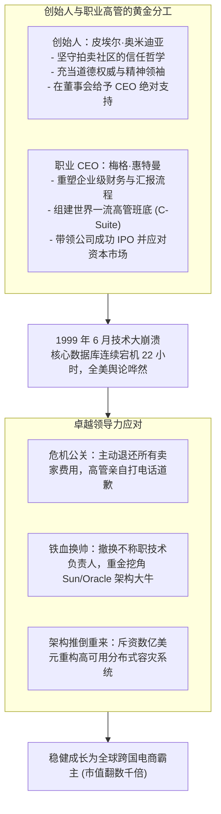

# Lec 19 从创始人到职业 CEO：梅格·惠特曼执掌 eBay (Scaling Governance: Meg Whitman at eBay)

> 授课教师：Prof. M. Diane Burton & Prof. Jesper B. Sørensen · MIT Sloan School of Management

## TL;DR

- eBay 案例系统复盘了从草根创始人向全明星职业 CEO 的权力平稳交接。
- 梅格·惠特曼凭借严谨的消费品品牌治理与跨国管理经验重构了早期拍卖社区。
- 面对 1999 年连续宕机数十小时的技术灾难，展现了高超的危机公关与技术治理。
- 成功的创始人接班要求创始人退守精神图腾，赋予职业高管绝对的管理主导权。

## 创业扩张的“成人监管（Adult Supervision）”时刻

在互联网泡沫狂飙的年代，无数二十多岁年轻极客创立的科技公司在一两年内市值暴涨至数十亿美元。然而，管理一家拥有数百名员工、数百万活跃交易用户且需要承担上市公司合规法律责任的企业，所需要的组织运营能力远远超出了一个极客写代码或讲商业故事的范畴。

硅谷投资界由此提出了著名的**“引入成人监管（Bringing in Adult Supervision）”**策略：在企业即将跨越规模化鸿沟的关键节点，主动引入受过顶级商学教育、在跨国 500 强企业历经风浪检验的资深职业经理人执掌帅印。

麻省理工学院本讲通过对商业史上最成功的创始人交接典范——**皮埃尔·奥米迪亚（Pierre Omidyar）与梅格·惠特曼（Meg Whitman）在 eBay 的合璧共生**，深入剖析企业如何平稳完成从初创极客玩具向全球数字商业帝国的惊险跃迁。

::: definition 成人监管与权力交接 (Adult Supervision Transition)
初创企业创始人清醒认知到自身在规模化行政、财务合规与跨部门运营上的知识局限，主动让渡最高执行权力，引入经验丰富的成熟职业高管接任首席执行官，自身转任董事长兼产品精神领袖的治理演进过程。
:::

## 经典案例诊断：惠特曼重构 eBay 的十年基石

### 1. 接手一个看似杂乱无章的拍卖集市
1997 年底，当顶尖猎头公司接触梅格·惠特曼时，惠特曼拥有极其耀眼的职业履历：哈佛商学院 MBA、宝洁品牌经理、贝恩咨询资深合伙人、迪士尼营销高级副总裁，以及孩之宝（Hasbro）全球业务总经理。
- 当时由皮埃尔·奥米迪亚创立的 eBay（前身 AuctionWeb）只有 30 名员工，办公室脏乱差，网站服务器经常因过载而崩溃；
- 然而，惠特曼敏锐洞察到了其惊人的底层商业模式：**没有实体库存、极高毛利、依托买家与卖家的双边正向网络效应**。1998 年 3 月，惠特曼正式加盟出任总裁兼 CEO。

### 2. 创始人皮埃尔的高风亮节与角色定位

许多创业创始人把企业视为自己的亲生骨肉。当企业发展到需要引入外部更成熟的统帅时，绝大多数创始人都会经历极度痛苦的心理挣扎：他们害怕大权旁落、害怕被团队遗忘、害怕自己亲手创立的企业变得面目全非。这种深层的自尊焦虑，使得许多创始人表面上退居二线，暗地里却不断插手日常事务，最终导致双头政治撕裂。

皮埃尔·奥米迪亚在商业历史上之所以享有极高的声誉，正是因为他展现出了一种超越个人自尊的无私格局。他清醒地认识到，自己热爱的是技术创新与社区哲学的思考，而非管理一个数千人的跨国商业机器。主动且彻底地将最高行政大权授予梅格·惠特曼，并在其背后给予坚如磐石的政治支撑，这本身就是创业领导力的最高境界。
eBay 交接之所以成为商业教科书级的典范，核心在于创始人皮埃尔·奥米迪亚展现出了硅谷极其罕见的胸襟：
- 皮埃尔在惠特曼入职第一天就向全员宣布：**“从今天起，梅格是这家公司的唯一首席执行官，所有运营决策以梅格的指令为准。”**
- 皮埃尔退居幕后担任董事长，专注于维护 eBay 买家与卖家的“社区核心价值观与信任生态”，从不横加干涉惠特曼的行政与人事布局。

### 3. 1999 年大宕机：危机中的铁血领导力
惠特曼执掌 eBay 面临的最大生死考验发生于 1999 年 6 月：
- 网站核心服务器发生毁灭性硬件故障，整个 eBay 平台连续瘫痪长达 22 个小时！数百万买家和卖家无法交易，全美媒体铺天盖地质疑其技术能力，股价一天暴跌近 20%；
- **惠特曼的危机处理堪称教科书**：
  1. 亲自召开全美媒体发布会，不推卸任何客观责任，主动承担全部错误；
  2. 宣布免收事故期间所有受影响卖家的刊登与交易佣金，自掏腰包承担数百万美元损失；
  3. 铁腕整肃技术线：果断解雇原本侥幸对付的技术副总裁，亲自飞赴 Sun Microsystems 堵在 CEO 麦克尼利门前，要求调集全美最顶尖的工程师驻场排查；
  4. 推动将底层系统全面迁移至具有主备高可用的企业级集群，彻底消除了单点故障隐患。

## 创始人交接成败的对比分析

将惠特曼在 eBay 的成功，与同时代其他硅谷初创企业引入职业经理人的失败（如前文 Zaplet 案例）进行深度对照：

| 评估维度 | 成功的典范 (eBay: 惠特曼) | 失败的反面教材 (Zaplet: 巴拉茨) |
| :--- | :--- | :--- |
| **引入时机** | 商业模式与 PMF 已经彻底验证，业务处于爆发性自增长期 | 商业模式完全未经验证，急于向资本讲宏大企业级故事 |
| **创始人心态** | 创始人主动求变，深刻敬畏自身局限，全权彻底交接 | 创始人被资本强行逼宫退位，心存怨恨，暗中拆台对抗 |
| **经理人打法** | 极其尊重原有社区文化，在不改变内核前提下补齐规范 | 蔑视原有极客文化，生搬硬套大公司陈旧官僚体系 |
| **业务聚焦度** | 死死盯住客户留存、单次交易抽成与系统稳定性等硬指标 | 沉醉于宏大的平台愿景概念，招揽冗员，烧光现金流 |

::: insight
一个优秀的职业经理人进入初创企业，切忌以“我是来拯救你们这帮土包子”的高傲姿态示人。惠特曼在进入 eBay 的前三个月，几乎没有对业务做任何颠覆性改动，而是每天花数小时在拍卖社区里阅读普通用户的发帖，亲自在网上拍卖自己的二手玩具。她首先赢得了社区与团队在文化上的尊重，随后推行的制度化改革才能如水银泻地般落地。
:::

## 挑选与引入“职业 CEO”的行动指引

1. **识别创业阶段的“交接信号”**：当企业面临以下三种信号时，创始人应主动考虑引入外部专业统帅：第一，日常 80% 的时间被财务合规、税务、法务与大型 HR 纠纷所占据；第二，业务已跨入多产品线与跨国运营阶段；第三，创始人感到身心枯竭，失去了当年面对技术突破时的纯粹快乐。
2. **考察候选人的“跨界适配性（Cultural Humility）”**：绝不要仅仅看其名片上的 500 强高管头衔。必须重点考察其是否具备“放下身段在泥泞中作战的谦卑心”。如果一个高管必须配备两个助理、一个司机才懂得如何工作，他会把初创企业拖入深渊。
3. **在董事会层面建立明确的交接契约**：明确界定董事会、创始人与新 CEO 的法定权责。在行政运营事务上必须坚持“单一权力中心”，坚决杜绝下属绕过新 CEO 向创始人私下请示汇报。

::: pitfall
绝不要试图寻找一个“既能当顶尖科学家、又能当大厂销售总监、还能搞定上市合规”的全能神人。承认个体的局限性，正是管理科学的起点。创始人的伟大不仅在于创造企业，更在于知道什么时候为了企业的更高远大前程而体面让出驾驶舱的最高指挥位。
:::
