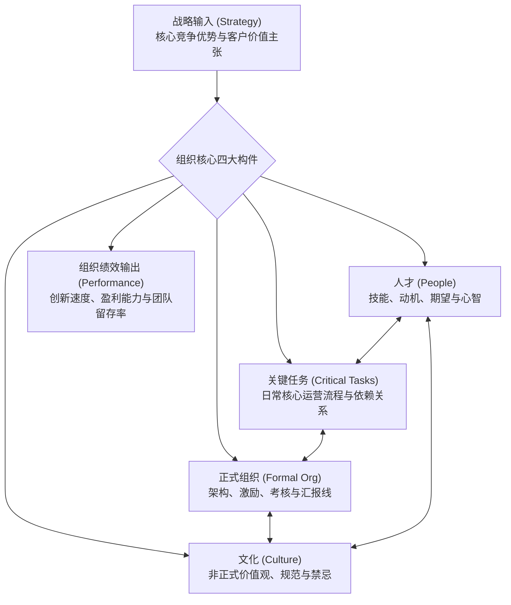
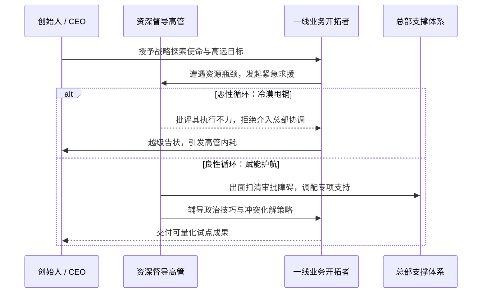

# Lec 02 组织一致性模型与埃里克·彼得森困境（下） (Course Overview and Erik Peterson Part Two)

> 授课教师：Prof. M. Diane Burton & Prof. Jesper B. Sørensen · MIT Sloan School of Management

## TL;DR

- 组织一致性模型将战略落地拆解为任务、人才、正式组织与文化的匹配。
- 彼得森案例后续表明，局部努力无法弥补系统层面的结构性脱节。
- 高管督导缺失与心理契约破裂是初创期核心人才流失的根源。
- 创业企业在扩张阶段必须建立定期的组织健康度诊断与对齐机制。

## 组织一致性分析框架（The Congruence Model）

在对任何创业企业进行管理干预之前，领导者必须建立全景式的诊断视线。当企业出现执行力低下或团队士气崩溃时，管理者最容易犯的错误就是“抓典型”或怪罪个别下属的能力与态度。然而，经验丰富的组织架构师深知，绝大多数表面上的行为懈怠与交付拖延，本质上都是组织底层架构设计缺陷的自然映射。

纳德勒-塔什曼一致性模型为我们提供了一张高精度的系统断层扫描图。它告诫我们：不要孤立地评价任何单一部件的优劣。一个高度集权的正式审批流程在探索性业务中是灾难，但在需要严苛遵循医疗安全法规的量产车间里却是必不可少的生命防线。关键永远在于“各部件之间的相互咬合度”。

组织并非各个职能部门的机械拼接，而是一个动态自适应系统。麻省理工学院在该课程中确立了以“一致性模型”为核心的组织诊断分析方法，用于系统评估创业企业内部各关键要素的契合度。

组织一致性理论的核心公理是：**系统的整体表现取决于组件之间的一致性程度，而非单个组件的最优性**。如果一家公司招聘了全球最顶尖的研发科学家（人才），却设计了极其繁琐的层层审批流程（正式组织），同时倡导循规蹈矩、零失误的合规准则（文化），其创新产出必然极其低下。

## 彼得森案例深度解剖：系统性错配复盘

在彼得森案例的后续发展（C, D, E 部分）中，危机全面爆发：移动医疗车队遭遇严重的设备故障与调度延误，关键合作医生愤而罢工，地方卫生部门发出停业警告。彼得森最终因身体崩溃和无法达成业绩指标而被迫离职。

运用组织一致性模型对彼得森的失败进行解构，可以清晰发现系统层面的全方位错配：

| 维度对比 | 战略对环境的客观要求 | 实际运行中的组织状态 | 错配诊断 (Misfit) |
| :--- | :--- | :--- | :--- |
| **战略 vs 关键任务** | 探索式试点，需要高频试错与敏捷调整调度算法 | 总部强制要求按传统成熟诊所的标准化月度指标考核 | 任务性质是探索，管理工具却采用规模型控制 |
| **关键任务 vs 正式组织** | 需要现场快速拍板与跨职能紧急协同 | 矩阵式双头汇报，设备维修审批耗时数周 | 响应敏捷度与层层官僚汇报产生致命冲突 |
| **人才 vs 文化** | 招聘了雄心勃勃、渴望自主权的顶尖 MBA | 总部弥漫着保守官僚、规避风险、论资排辈的国企式文化 | 个体成就动机遭到组织文化的系统性压制 |
| **领导力 vs 心理契约** | 管理者需要上级的心理安全感与政治护航 | 督导高管詹金斯采取冷眼旁观与甩锅策略 | 隐性心理契约彻底破裂，导致一线管理崩溃 |

::: definition 心理契约 (Psychological Contract)
组织与员工之间未以书面合同明确载明、但双方心照不宣的一系列主观期望与承诺。在创业团队中，心理契约（如“你拼命扛下新业务，我保障你的晋升与容错空间”）往往比法定劳动合同对员工投入度产生更深远的影响。
:::

## 创始人督导体系与管理支持设计

彼得森的悲剧在创业公司中屡见不鲜：创始人喜欢给年轻骨干画大饼、委以重任，却未能在正式组织架构中为其配备相应的资源协调人与缓冲垫。

如上图所示，资深督导高管的定位应当是“破冰船”与“政治导师”，而非居高临下的裁判员。如果督导人本身对新业务心存疑虑甚至存在利益冲突，创始人必须果断介入调整汇报线，否则新业务必死无疑。

::: insight
一个优秀的创业领导者不仅懂得如何给下属压担子，更懂得为下属“设计成功的条件”。当你把一个年轻人推向没有既定轨道的前线战场时，必须为其建立三条生命线：第一，明确的止损容错底线；第二，关键职能部门的绿色通道特权；第三，每周固定的导师对话机制。
:::

## 创业扩张期的组织审计清单

为防止类似彼得森式的溃败在团队中重演，创业团队每半年应执行一次组织一致性体检：
1. **任务与架构对齐**：当前最具战略突破性的业务，是否拥有最高的组织灵活性和最短的审批链路？
2. **权责闭环审计**：背负核心指标的业务负责人，是否拥有其达成目标所必需的人事考核权与资源调配权？
3. **晋升与淘汰逻辑**：公司的实际晋升名单，是在奖赏那些勇于承担探索风险的拓荒者，还是在奖赏循规蹈矩、善于向上逢迎的守成者？
4. **横向沟通摩擦系数**：一线团队跨部门申请支持的平均交付周期是多少？是否存在关键职能部门的霸王条款？

::: pitfall
不要把组织一致性理解为“静态的一成不变”。随着初创企业从种子期迈向成长期，战略重心会从“寻找产品市场契合（PMF）”转变为“规模化交付”。一致性模型必须动态迭代，若沿用早期的扁平口头协调来管理数百人团队，必然引发更大的管理灾难。
:::
