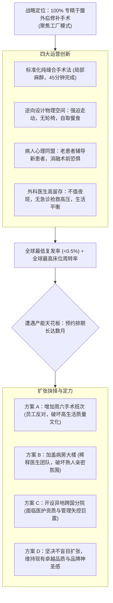

# Lec 20 聚焦工厂模式与企业文化定力：休迪斯医院的专注运营 (Focused Factory and Culture: Shouldice Hospital)

> 授课教师：Prof. M. Diane Burton & Prof. Jesper B. Sørensen · MIT Sloan School of Management

## TL;DR

- 加拿大休迪斯医院（Shouldice）开创了全球医疗服务“聚焦工厂（Focused Factory）”典范。
- 仅专注于单一部位疝气手术修补，通过极致专业化实现全美最低复发率与最低成本。
- 设计由病人自主参与的康复社群文化，将医疗流程转变为温馨互助的度假体验。
- 在面对庞大的产能扩张诱惑时，管理层展现了拒绝稀释品质的战略定力。

## 战略的本质是学会“放弃”：聚焦工厂的力量

在当代商业竞争中，“多元化拓展、业务协同、一站式服务”往往被无数企业奉为金科玉律。大企业总是忍不住在现有主业之外不断增加新功能、开辟新产品线、迎合所有客群的全部诉求。然而，哈佛商学院运营管理大师威克姆·斯金纳（Wickham Skinner）早在 1970 年代就提出了振聋发聩的**“聚焦工厂（The Focused Factory）”**理论：**一家试图在同一屋檐下同时做到质量最好、成本最低、交期最快且品种最齐全的企业，最终必然在所有维度上都被专精对手击败**。

麻省理工学院本讲通过哈佛与麻省理工商学院共同采纳的殿堂级案例——**加拿大休迪斯医院（Shouldice Hospital）**，深度解构极度专注的运营模型与独特的病人文化如何形成不可撼动的竞争壁垒，并探讨企业在面对扩张诱惑时的战略定力。

::: definition 聚焦工厂模式 (Focused Factory Model)
将组织的全部生产与服务资源，高度集中于特定细分市场、特定工序或高度同质化的单一任务上。通过消除任务复杂性与机器频繁换线的损耗，在效率、质量控制、技能熟练度与客户体验上建立极致压倒性优势的运营策略。
:::

## 经典案例诊断：休迪斯医院的极致专精奇迹

### 1. 业务定义极度纯粹：只做疝气手术
休迪斯医院位于加拿大多伦多郊外，由厄尔·休迪斯（Dr. Earle Shouldice）创立。该医院在全球医疗界堪称奇迹：
- **拒绝综合性收治**：不接急诊、不看感冒、不做骨科，**100% 只专精于腹外疝修补手术**！
- **自研微创纯缝合法**：拒绝使用昂贵的人工合成补片，采用休迪斯独创的解剖学钢丝缝合技术，仅需局部麻醉；
- **惊人的临床数据**：手术平均用时仅需 30-45 分钟；术后复发率低于 **0.5%**（全球综合性医院该指标常年徘徊在 5%-10% 之间）；医疗并发症几乎为零；而总费用不到传统大医院的三分之一。

### 2. 颠覆传统的服务流程与“病人互助康复文化”

在传统的现代大型综合性医院中，服务流程的设计几乎完全是围绕着医生的便利与医院的排班展开的。病人被推在冰冷的轮椅上，在昏暗的地下室与检验科之间来回穿梭；医护人员神情严肃，病房里弥漫着消毒水与恐惧的气氛。这种被动的病患角色设定，不仅大幅增加了护理人力成本，更在心理上加剧了病患的无助感与生理应激反应。

休迪斯医院的开创性贡献，在于通过反常规的环境与流程设计，将病人从被动的受害者彻底转化为积极主动的“自我康复合伙人”。当一个刚做完手术的病患看到隔壁床的老先生正精神抖擞地在走廊散步吃冰淇淋时，他内心的恐惧会在瞬间烟消云散。这种强大的同侪心理场，构成了现代医药学所无法替代的自愈引擎。
休迪斯医院不仅是一家医院，更像是一座优雅的乡村俱乐部度假村：
- **没有轮椅与病床送餐**：医院强制取消轮椅。手术结束后仅数小时，护士便鼓励患者自行下床走回病房；
- **设计促进走动的物理空间**：病房内严禁安装电视与电话；所有电视、台球桌与图书室集中设立在远端公共活动大厅，倒逼患者必须每天在走廊漫步数公里，这反而极大地加快了肠蠕动与伤口愈合；
- **病人社区滚雪球机制**：术后康复的老病人主动在走廊向刚入院极度恐惧的新病人现身说法，消解其术前焦虑。医院每年还会举办盛大的“校友返校聚会”，吸引成千上万名康复患者携家带口赶回医院聚餐庆祝。

### 3. 产能极限的十字路口：四大扩张方案辩论
由于声名远扬，全美乃至全球患者排队数月求医，休迪斯面临严重的产能瓶颈。管理层面临艰难的抉择：
- **方案一：推行周六加班排班**。虽然能增加 20% 吞吐量，但会摧毁医生与护士“周末永不加班”的幸福感，引发核心医护流失；
- **方案二：扩建现有主楼病房层**。虽可容纳更多病人，但会导致餐厅与活动区过于拥挤，破坏原本亲密无间的大家庭氛围；
- **方案三：在美国或欧洲复制分院**。但休迪斯的技术依赖于师徒制的手手相传，异地扩张极易发生质量走样，一旦出现几起医疗事故，金字招牌将被摧毁；
- **方案四：克制贪婪，保持现状**。将排队视为高质量的无形资产，专注深耕现有基准。

## 聚焦工厂与专注文化的四项核心启示

休迪斯医院的运营哲学为所有追求卓越的企业提供了深刻的反思契机：

| 运营维度 | 传统多元化大企业的通病 | 休迪斯医院的极致专精 | 商业效率对比 |
| :--- | :--- | :--- | :--- |
| **产品与服务范围** | 试图满足所有客户的一切个性化需求，产品线极度繁杂 | 仅做单一类型服务，拒绝不符合严苛标准的病患 | 员工肌肉记忆与熟练度达到顶峰，差错率趋近于零 |
| **客户角色定位** | 客户被视为被动的接受者，所有服务由企业重度包办 | 将客户转变为“共同生产者（Co-Producer）”，深度参与康复 | 大幅降低人力照料成本，患者自主康复速度大幅提升 |
| **员工生活质量** | 频繁加班、紧急抢救、长期处于高压应激状态 | 规律作息、不值夜班、高度可预测的工作节奏 | 极低的医护离职率，几十年来核心团队几乎零流动 |
| **对待增长的态度** | 将规模扩张与营收翻倍视为最高不可违抗的硬指标 | 视“品质与文化纯洁度”高于一切，敢于主动对规模说不 | 穿越半个多世纪周期，始终享有无可争议的顶级声誉 |

::: insight
在商业世界里，**“不做什么”往往比“做什么”更考验领导者的智慧**。平庸的公司总是在机会面前盲目扑上，看到什么赚钱就做什么，最后变成一头动作迟缓、臃肿不堪的四不像怪物；而真正伟大的企业敢于用刀刃雕刻自己的边界，用极度的克制换取单点突破的无可匹敌。排队不是你的问题，排队是你卓越的勋章。
:::

## 现代创新企业践行“聚焦工厂”的行动心法

1. **坚决剥离“负毛利与低协同”的边缘业务**：每年对全公司的产品线进行一次无情审计。找出那些占据了团队 50% 精力却只贡献 5% 利润的琐碎定制需求，坚决砍掉或转包给外部同行。
2. **将用户转化为你的“生产合伙人”**：在服务设计中，思考哪些环节可以让用户深度参与进来（如宜家的平板包装自行组装、开源软件的社区协作排错）。用户亲自投入努力的过程，不仅降低了企业成本，反而加深了其对品牌的深层心理认同。
3. **警惕“资本绑架下的盲目跃进”**：当投资人催促你“迅速复制模式、在全国开设 50 家分公司”时，冷静自问：你的核心交付品质是否高度依赖无法被代码标准化的工匠直觉？如果是，强行铺摊子就是走向自杀的代名词。

::: pitfall
不要把“聚焦”误解为“不思进取”。休迪斯医院虽然几十年只做同一种手术，但他们在缝合线材料选择、术后感染控制算法与病人心理诱导方面进行了极其精密的持续微创新。聚焦的目的是为了“把一厘米宽的壕沟掘进到一公里深”，而不是在原地睡大觉。
:::
