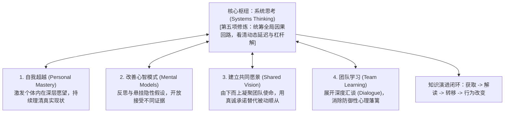

# Lec 21 系统思考与构建学习型组织：彼得·圣吉的五项修炼 (Building a Learning Organization: Peter Senge)

> 授课教师：Prof. M. Diane Burton & Prof. Jesper B. Sørensen · MIT Sloan School of Management

## TL;DR

- 彼得·圣吉五项修炼构成了企业适应动态复杂环境的组织演进基石。
- 打破局限思考与局部归罪，通过因果回路图识别系统的深层反馈动态。
- 心智模式的反思与悬挂是打破组织防御性常规与认知偏见的解药。
- 学习型组织需要将知识的捕获、解读、共享与行为迭代固化为制度流程。

## 组织的智障：为什么卓越的企业总是在重复犯错？

在现代商业环境中，几乎所有企业都在强调“数字化转型”、“创新突破”与“敏捷迭代”。然而，现实中令人震惊的是：哪怕拥有全球最顶尖的智囊团、最昂贵的管理信息系统与最严密的流程，绝大多数企业依然在周期性地重复犯下相同的致命错误。新上任的部门主管总是在重复前任被证明行不通的政策；当项目延期时，管理层的本能反应依然是盲目增加人手，导致项目延期更加严重。

麻省理工学院斯隆管理学院教授**彼得·圣吉（Peter Senge）**在里程碑巨著《第五项修炼》（The Fifth Discipline）以及戴维·加文（David Garvin）的后续研究中指出：**现代企业普遍患有严重的“组织学习智障（Learning Disabilities）”**。企业习惯于用机械线性的眼光看待动态复杂的因果关系，从而被锁死在自掘的防御性陷阱之中。

::: definition 学习型组织 (Learning Organization)
熟练掌握以下五项核心能力的自适应组织系统：能够持续创造、获取、解读、转移并保留新知识，并且能够**有目的地修正自身的微观组织行为与心智模式**，以敏锐反映新的认知与洞察。
:::

## 经典框架解析：彼得·圣吉的五项修炼

彼得·圣吉提出，构建一个真正具备自进化能力的企业，必须在全员范围内贯彻五项互为支撑的精神修炼：

### 1. 第一项修炼：自我超越（Personal Mastery）
许多企业试图用制度去逼迫员工学习。圣吉指出，真正的学习源于个体对于“自我卓越”的内在渴望。组织必须尊重员工的个人愿景，为员工创造安全探索其潜能的土壤。

### 2. 第二项修炼：改善心智模式（Mental Models）
心智模式是深植于我们大脑中的既有成见与过滤网。例如：“工程师就是不懂商业”、“大客户永远最看重价格”。改善心智模式的关键在于学会**“悬挂假设（Suspending Assumptions）”**：在得出结论前，敢于公开质问自己：“我凭什么认为这是真的？有什么事实能证伪我的观点？”

### 3. 第三项修炼：建立共同愿景（Shared Vision）
许多 CEO 的愿景只是高高挂在公司大堂里的口号，员工对此毫无共鸣。共同愿景必须是团队所有人在内心深处共同渴望实现的未来图景，它能激发深层的“奉献承诺（Commitment）”，而非表面上的“勉强顺从（Compliance）”。

### 4. 第四项修炼：团队学习（Team Learning）
为什么一帮智商 130 的顶尖人才聚在会议室，团队的集体智商往往跌落至 60？圣吉指出，传统会议充斥着“讨论（Discussion，词根来自击碎与辩论）”，每个人都在捍卫自己的既得观点与面子；真正的团队学习必须推行**“深度汇谈（Dialogue，意为通过言辞自由流通）”**，全员放下防备，共同探寻集体智慧。

### 5. 第五项修炼：系统思考（Systems Thinking）——灵魂基石
系统思考是整合前四项修炼的基石。它要求管理者彻底告别“头痛医头、脚痛医脚”的单向线性因果逻辑，学会辨识系统中的**正反馈（增强回路）、负反馈（平衡回路）以及时间延迟（Delays）**。

## 戴维·加文的学习型组织三阶段落地模型

哈佛教授戴维·加文指出，许多企业推行学习型组织沦落为空洞的哲学清谈。一个严谨的学习闭环必须包含三个具体的操作阶段：

| 学习阶段 | 核心任务与具体动作 | 常见组织阻碍与卡点 |
| :--- | :--- | :--- |
| **第一阶段：获取与吸收 (Acquiring Information)** | 设立情报雷达，系统化追踪竞品专利、前沿学术论文、客户极端投诉与一线失败案例 | “非我所创（Not Invented Here）”的盲目傲慢，对外部异质性信号视而不见 |
| **第二阶段：解读与消化 (Interpreting Information)** | 召开项目无指责复盘会（Blameless Post-Mortem），运用根因分析还原真实因果链条 | 充斥政治甩锅与面子保卫战，为了息事宁人草率将失败归咎于“不可抗力” |
| **第三阶段：转移与应用 (Applying & Retaining Knowledge)** | 将沉淀的洞察转化为代码库、微调 SOP、修改设计基线与新人培训教材 | 知识停留在少数离职员工的大脑中，组织缺乏记忆载体，年年重复交学费 |

::: insight
“今日的问题往往来自昨日的解局”。系统思考最深刻的洞见在于：绝大多数我们今天深恶痛绝的危机（如恶性缺货、核心骨干罢工、系统架构崩溃），恰恰是我们在半年前为了追求所谓的“速赢（Quick Fix）”所采取的短期救火措施所埋下的副反应。真正的智慧是克制按下那些表面见效奇快、实则饮鸩止渴的短期按钮，寻找那些撬动系统长期演进的微小杠杆解。
:::

## 打造学习型团队的四项落地实践

1. **推行“无指责事后复盘（Blameless Post-Mortem）”**：当线上系统发生重大事故或重大销售丢单时，会议室的第一条刚性铁律是：**严禁将责任推给某一个具体的倒霉蛋**。全员将注意力集中在“系统设计存在什么漏洞，使得一个普通员工的微小疏忽能酿成全盘崩溃？”
2. **绘制关键业务的“因果回路图（Causal Loop Diagrams）”**：带领高管团队在白板上梳理业务的核心增长飞轮与潜在制约杠杆，明确标注出长达 6 至 12 个月的时间延迟，防止团队因短期未见效果而盲目改变战略定力。
3. **建立跨项目“失败博物馆”**：鼓励员工公开展示并分享那些虽然投入了巨大心血、但最终因技术或市场原因失败的项目。对展现出高水平严谨试错的团队予以公开表彰，用制度消融全员对犯错的恐惧。

::: pitfall
切忌把“学习”当成逃避业务结果的遮羞布。许多平庸的团队在遭遇业绩重大滑铁卢时，喜欢用“虽然我们亏损了 2,000 万，但我们学到了宝贵的经验”来为自己开脱。真正的学习型组织对商业结果极其冷酷苛刻，如果学到了经验却没有在接下来的行为与流程中产生可量化的纠偏，那不是学习，那是无耻的自欺欺人。
:::
