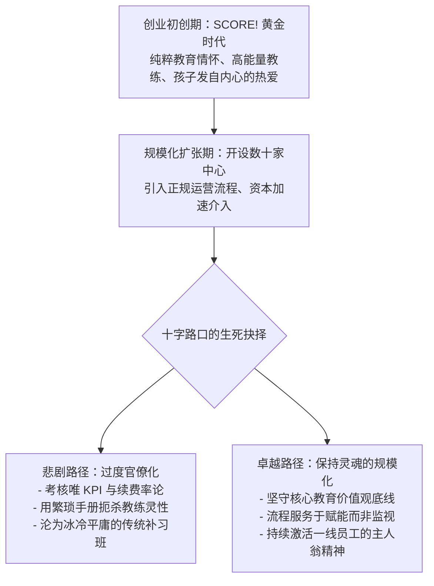

# Lec 22 从创业走向成熟：SCORE! 教育中心的组织蜕变与领导力全景 (Course Wrap-up: SCORE!)

> 授课教师：Prof. M. Diane Burton & Prof. Jesper B. Sørensen · MIT Sloan School of Management

## TL;DR

- SCORE! 教育中心案例生动展现了初创企业从个性化草创向全国连锁扩张的阵痛。
- 如何在规模化标准化与早期打动人心的教育温度之间保持微妙平衡。
- 创始人向职业管理层交权时必须防范“管理过度扼杀企业灵魂”。
- 本讲系统总结全课程领导力矩阵，确立持续审视组织一致性的终身工具箱。

## 终章之辩：创业灵魂能否在成熟大企业中永生？

从斯坦福商学院年轻极客在车库捏出的第一个原型，到员工数万人、业务横跨全球的巨型上市公司，企业的生命周期演进犹如一场惊心动魄的跨越峡谷之旅。绝大多数创业企业在第一阶段死于找不到产品市场契合点；而在跨越初创期后，几乎所有企业都要面临第二道更为严酷的生死关隘：**为了规模化，我们必须引入标准化流程与科层管理；但标准化往往在悄无声息中谋杀了最初那份充满热情、敢于冒险的创业灵魂**。

麻省理工学院 15.394 课程的压轴讲次，通过对全美课外辅导连锁明星**SCORE! 教育中心（SCORE! Educational Centers）**从草创到扩张再到被巨头并购后命运演变的案例复盘，串联全课程二十余讲的核心框架，为创业领导者打造一套终身受用的组织设计与领导力自我审计工具箱。

::: definition 创业向职业管理蜕变 (The Entrepreneurial Transition)
企业从依赖创始人个人魅力、非正式沟通与英雄主义攻坚的草创形态，向依托制度化组织架构、可复制运营流程与分布式领导力矩阵的成熟企业演变的历史跨越。
:::

## 经典案例诊断：SCORE! 教育中心的两次蜕变

### 1. 第一天：用纯粹的热情与关怀点燃孩子
SCORE! 由斯坦福大学毕业生阿兰·哈泽伊（Alan Khazei）与吉姆·埃利斯（Jim Ellis）创立。他们试图打破传统补习班沉闷枯燥、以应试刷题为导向的死板模式：
- **个性化互动与高能量教练**：从顶尖名校招募极具亲和力与感染力的年轻大学毕业生担任辅导教练；
- **自适应电脑教学软件 + 即时正向激励**：孩子在电脑上完成数学和阅读挑战，每取得突破，教练便带领全场孩子击掌欢呼、赠予定制篮球卡与勋章；
- **不可思议的家长满意度**：孩子们哭着喊着要去 SCORE! 上课。早期的 SCORE! 门店弥漫着不可复制的快乐、温度与纯粹使命感。

### 2. 第二天：狂飙扩张下的标准化阵痛与收购后的迷失
随着资本的介入，SCORE! 开启了在全美铺设数百家连锁中心的狂飙扩张，并在随后被教育出版巨头开普兰（Kaplan）收购：
- **流程的异化**：为了确保每家门店表现一致，总部制定了厚达数百页的操作手册，甚至对教练每天必须微笑几次、击掌必须用什么角度做出了荒唐的量化规定；
- **使命感的消解**：原本由对教育充满热忱的理想主义极客组成的团队，逐步被只看单店坪效、续费转化率与课程销售提成的传统连锁店长所取代；
- 门店数量虽然激增，但那个曾经打动全美无数家庭的精神图腾逐渐褪色，最终沦为一家平庸的商业辅导机构。

## 15.394 全课程核心理论与工具箱大盘点

在课程结课之际，麻省理工教授将全学期讲授的领导力与组织设计工具浓缩为四大核心维度：

| 组织维度 | 核心代表案例与理论模型 | 创业领导者的终身心法与行动法则 |
| :--- | :--- | :--- |
| **方向确立与战略对齐** (Setting Direction) | - 组织一致性模型 (Lec 01-02) - Zaplet 战略对齐起伏 (Lec 03) | 战略不是墙上的标语，而是任务、人才、正式组织与文化的无缝契合；警惕未成形时的愿景过度膨胀 |
| **社会资本与网络领导力** (Social Capital & Influence) | - 杰里·桑德斯魅力动员 (Lec 04) - 海蒂·罗伊森社会资本 (Lec 05) | 人际网络是企业无形资产；跨越结构洞创造价值；用真金白银的利益共享与情感抵押铸就高承诺团队 |
| **能力构建与人才蓝图** (Building Capabilities) | - 斯坦福 SPEC 雇佣模型 (Lec 06) - 惠普之道信任制度化 (Lec 07) - 数据通用极客动机 (Lec 09) | 招揽前十人即在为组织基因投票；切忌中途随意切换雇佣蓝图；用自主权与硬核技术挑战激活天才极客 |
| **治理博弈与持续演进** (Governance & Renewal) | - 苹果乔布斯与斯卡利 (Lec 08) - 维米尔 FrontPage 并购 (Lec 13) - 倒金字塔与学习型组织 (Lec 12, 21) | 坚决拆除特权海盗团队；白纸黑字落实合伙人股权兑现；向一线充分授权；用系统思考破除组织学习智障 |

::: insight
“伟大的企业不是被外部竞争对手击垮的，它们永远是死于内部的组织溃烂”。当你作为创始人或高管带领团队在商海征战时，最危险的敌人不是拥有更多资金的巨头，而是当你走进公司大楼时，发现员工的眼神失去了光芒，会议室里充斥着圆滑的太极推诿，人们更在意职级与 PPT 排版而非产品本身。守护这份初创的纯粹与敏捷，是领导者一生最庄严的修行。
:::

## 创业领袖的自我审计积分卡（Leadership Scorecard）

在未来的创业征途上，请定期站在镜子前问自己以下六个终极问题：
1. **组织一致性体检**：我们当前的核心人员激励方案，是否在真正奖赏我们战略上最需要鼓励的突破行为？
2. **心理安全感度量**：当一线员工发现产品存在严重漏洞或项目遭遇延误时，他们敢在 24 小时内向我坦诚直言吗？
3. **特权与公平底线**：公司内部是否存在不受规章约束的“特权阶层”？我们的晋升机制是否完全依据客观战功与价值观？
4. **权力归一与授权**：我是在事无巨细地充当监工，还是在为一线优秀的开拓者充当扫清阻碍的后勤兵？
5. **社会资本的纯洁度**：我是在真诚地为行业生态创造长远价值，还是在进行急功近利的浅层投机社交？
6. **超越短期的使命**：如果除去账上的资金与报表上的利润，这家公司在这个世界上留下的独一无二的积极痕迹究竟是什么？

::: pitfall
绝不要试图寻找一套一劳永逸的“终极管理秘籍”。环境在变，技术在变，人性深处的恐惧与贪婪却从未改变。优秀的领导力从来不是一套僵化的操作规程，而是一种在混沌中保持警醒、在逆境中传递坚定信念、并始终对组织系统保持敬畏与自省的动态平衡艺术。
:::
